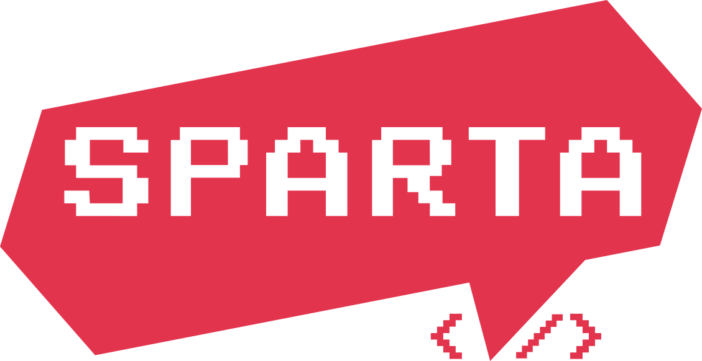

전 직장에서 퇴사가 늦어지게 되어 전부터 눈여겨보던 '내일배움캠프'를 수강하지 못할 것이라고 생각했다.

<!--truncate-->

하지만 10월 31일 인수인계 마무리 짓고 직장 근무자들과 이야기 하다가 '항해99' 출신 개발자분께서 문의하기로 빈자리 있는지 확인 해보라고 하신 덕분에

문의 결과 예비합격으로 대기는 가능하다고 했다... 사실 React 반 인기가 많아 빠른 마감이 되었던 터라, 그다지 기대하지는 않았다.

11월 2일 갑작스럽게 예비 합격도 수강신청 해달라고 연락이 와 서둘러서 수강신청 했고, 합류 준비는 미리 끝내 놓은 상태였다😎

11월 3일 비염 수술예정일에 수술 들어가기 전 최종 합류 결정 연락으로 만감이 교차했다... 그래서 매니저님께 자초지종 설명 드리고, 11월 4일 합류하는 것으로 결정되어

기쁘게 수술을 받고 나왔다😂

코에 엄청난 고통을 느끼고 있지만 개발자라는 직종에 누구보다 목마른 나였기에 더할 나위 없이 기쁘게 공부하고 있다!

{/* 이 글은 Tistory(https://hyoloui.tistory.com/2)에서 옮겨 온 글입니다. 원문 작성일: 2022-11-04 */}
