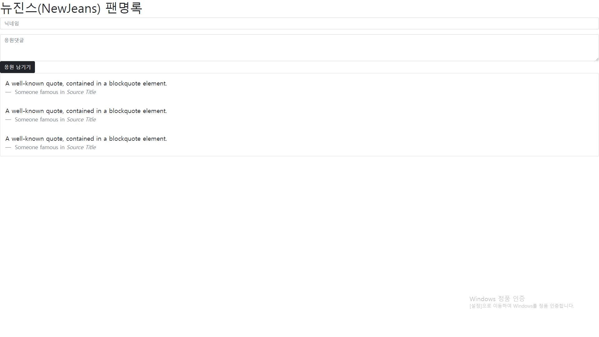

> '너가 장사를 하려고 하는데, 공간이 필요하겠지?
> HTML은 인테리어가 아무 것도 안되어있고
> 시멘트만으로 구역을 나눈 하나의 건축물, 건물이라고 생각하면 되겠다'

저는 친구들에게 설명할 때 이렇게 말하곤 합니다.

<!--truncate-->

## HTML은 문서 파일이다

사실 HTML 은 웹 브라우저에서 우리가 보는 가장 흔한 문서파일 입니다.

하지만 순수하게 HTML 파일이 가진 태그 만으로는 우리가 아는 멋진 웹페이지가 아닐겁니다. HTML 파일의 목적이 문서, 정보 전달이였기 때문이죠.

## HTML이란

HTML 은 **Hyper Text Markup Language** 약어로 HyperText(웹 페이지에서 다른 페이지로 이동할 수 있도록 하는 것) 기능을 가진 문서를 만드는 언어입니다. 다시 말해, 구조를 설계할 때 사용되는 언어로 hyper link 시스템을 가지고 있으며, 흔히 말하는 웹 페이지를 위한 마크업 언어라고 할 수 있습니다.

HTML 은 다른 프로그래밍 언어에 비해 난이도가 쉽다고 하지만, 그 만큼 기초가 되는 뼈대라고 생각합니다.

:::note HTML은 크게 head와 body로 구성된답니다

- `head` 안에는 페이지의 속성 정보를, `body` 안에는 페이지의 내용을 담습니다.
- `head` 안에 들어가는 대표적인 요소들: `meta`, `script`, `link`, `title` 등
- 페이지의 속성을 정의하거나, 필요한 스크립트들을 부릅니다. 즉, 눈에 안 보이는 필요한 것들을 담는 것. 나중에 `body` 작업을 하면서 필요한 정보들을 넣어보겠습니다.
- `body` 안에 들어가는 대표적인 요소들!

:::

html 태그가 기본적으로 가지고있는 속성이 있으나 태그만으로 웹페이지를 구성하기에는 정말 심심할 겁니다~

아래 포스팅에선 위처럼 심심한 html(건축물) 을 꾸며줄 css(인테리어) 를 설명 하겠습니다.

[css는 '인테리어'](https://hyoloui.tistory.com/4)

{/* 이 글은 Tistory(https://hyoloui.tistory.com/3)에서 옮겨 온 글입니다. 원문 작성일: 2022-11-04 */}
