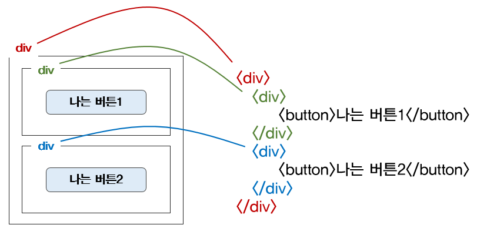

> '가게를 인테리어를 하려면 많은 도구들이 필요하겠지? 아니면 시중에 파는 제품을 사와도 좋고'

**저번포스팅에 순수한 html파일만 가지고 보여드린 html에서 style 을 추가한 웹페이지 입니다!**


<!--truncate-->

## CSS 기초

### 1. HTML 부모-자식 구조 살펴보기

👉 html 태그는, "누가 누구 안에 있느냐"를 이해하는 것이 가장 중요합니다. 나를 감싸고 있는 태그가 바뀌면, 그 안의 내용물도 모두 영향을 받지요!

- 빨간색 `div` 안에, 초록색/파란색 `div`가 들어있습니다. 아래와 같은 상황에서 빨간색 `div`를 가운데로 옮기면, 내용물인 초록/파란 `div`도 모두 함께 이동하겠죠!
- 즉, 박스를 옮기면 안의 내용물도 함께 옮겨지는 것과 같은 원리입니다.
- 같은 원리로, 초록 `div`의 글씨색을 바꾸면, 나는버튼1의 글씨색도 바뀐답니다!



### 2. CSS 파일 분리하기

html 파일 내부에, `style` 태그로 `id`와 `class` 를 활용하여 element 들을 꾸며주었으나 작업중 불가피하게 길어 질 수 밖에 없습니다..

그리하여 우리는 css 파일을

```html
<link rel="stylesheet" href="style.css">
```

이러한 `link` 태그의 형태로 분리하여 편리하게 작업하는 것이죠~

{/* 이 글은 Tistory(https://hyoloui.tistory.com/4)에서 옮겨 온 글입니다. 원문 작성일: 2022-11-04 */}
