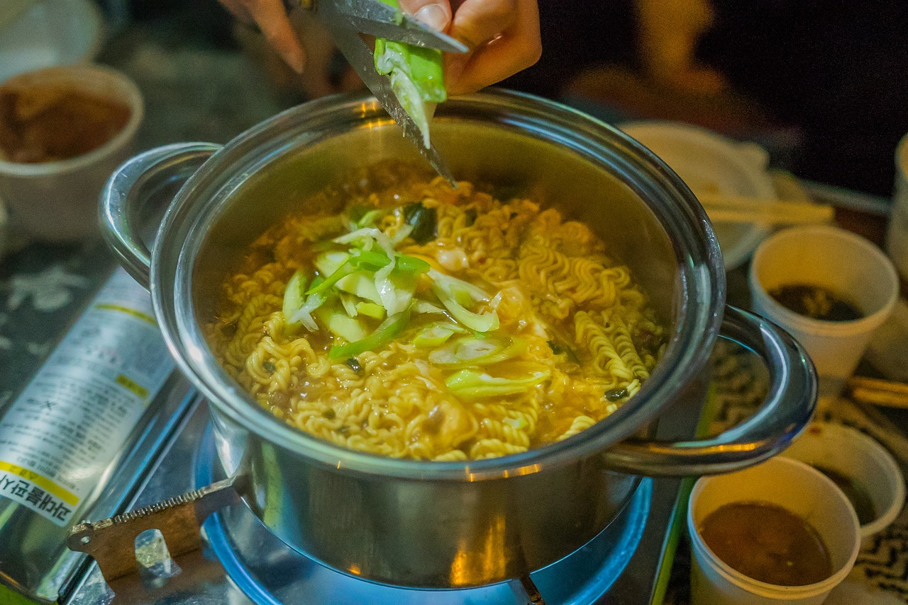

파이썬을 공부한다면 **패키지**를 이해하고 잘 사용해야 한다. 이해가 쉽도록 '식당 > 주방' 상황에서 설명하겠다.

<!--truncate-->

우선 라면을 만든다고 치자. 여기서 공통적으로 필요한 식기도구를 생각해보자.

**[냄비, 물, 라면]** 이 있다! 자 여기에 하나라도 빠진다면 라면이 만들어 질 수가 없다.

:::tip 정리

식기도구라고 생각하고, 패키지를 설치 할 때에도 **필요한 도구를 내가 준비하는 과정**이라고 생각한다.

:::

{/* 이 글은 Tistory(https://hyoloui.tistory.com/9)에서 옮겨 온 글입니다. 원문 작성일: 2022-11-06 */}
