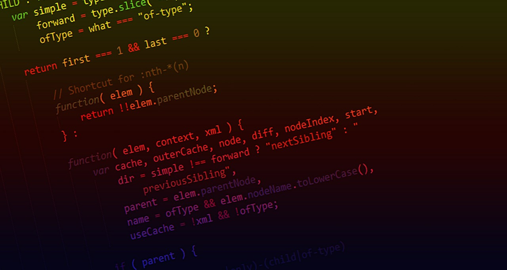

:::note WIL: Weekly I Learned

이번주 한 일

1. **티스토리** 블로그(기술 블로그) 개설 = **매일 TIL 일지**
2. **JavaScript** 문법 기초 KDT 실무형 프론트엔드 엔지니어 = **강의 완주**
3. **파이썬** 문법 기초 KDT 실무형 프론트엔드 엔지니어 양성과정 = **강의 완주**
4. 자료구조, **알고리즘** KDT 실무형 프론트엔드 엔지니어 = 청취중
5. 깃허브 repository 생성 + 초대 react A반 10조(부드라미조) 조장으로써 한일

:::

<!--truncate-->

## study review

2주차는 본격적인 강의 커리큘럼이 시작되었다.

**자바스크립트**는 다른 강의들로 선학습을 해놓은 터라 수월하게 강의를 들을 수 있었다.

**파이썬**은 너무 생소해서 무의식적으로 어렵겠다 라는 생각을 갖고 공부를 시작했지만, 그래도 자바스크립트로 어느정도 프로그래밍 문법에 익숙해진 상태이기도 하고, 문법의 형태가 비슷해서 금방 익숙해 졌다!

**자료구조, 알고리즘** 강의는 선학습을 자바스크립트로 했지만, 파이썬으로 진행하는 강의라서 더 파이썬에 익숙해질 수 있는 계기가 되었으면 좋겠다! 사실, 알고리즘은 한 문제를 이해해도 막상 응용 문제가 나오면 구현하기 어려운 부분이 있는 것 같다😥

<u>알고리즘 더 열심히 하자!</u>

---

번 외로,

이번 내일배움캠프(부트캠프) 조가 재편성 되면서 B반에서 A반으로 옮겨지게 되었고, 10조가 되었다!

이번에는 꼭 조장 해봐야지 하고 조장을 자원하여 '부드라미'조의 조장역할을 맡게 되었다!

첫 조별 미션은 조 이름 정하기로

1. 판교가조
2. 부드라미조

중에 다수결로 최종 부드라미조 가 되었고,

조원 한분께서 '<u>미리 깃허브 하나 만들어서 같이 협업하는 연습해보자</u>'라는 좋은 의견으로 깃허브에 레파지토리 생성하고 브랜치 생성, 조원 초대를 진행했다!

다음 주는 자료구조, 알고리즘을 완강하고 깃허브 활용/ 웹 퍼블리싱 정복 수강이다!

또 한주 달려보자~

빠이팅그.

|             | 1 week                                                                                                                                                              | 2 week                                                     |
| ----------- | ------------------------------------------------------------------------------------------------------------------------------------------------------------------- | ---------------------------------------------------------- |
| 학습 내용 (프로젝트) | 웹개발 종합반 - HTML, CSS, Javascript, jQuery, JSON, AJAX, Python, Flask, MongoDB (로그인 페이지, 팬명록, 지니뮤직 크롤링, 화성땅 공동구매, 스파르타피디아, 버킷리스트, nohup 배포) | 자바스크립트(Javascript), 파이썬(python), 자료구조와 알고리즘(algorithm) |
| 사용 툴        | VS code, Bootstrap, Git Bash, FileZila, AWS(ec2), gabia                                                                                                           | VS code, Git, Git hub                                      |

{/* 이 글은 Tistory(https://hyoloui.tistory.com/23)에서 옮겨 온 글입니다. 원문 작성일: 2022-11-14 */}
