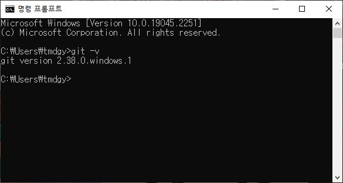
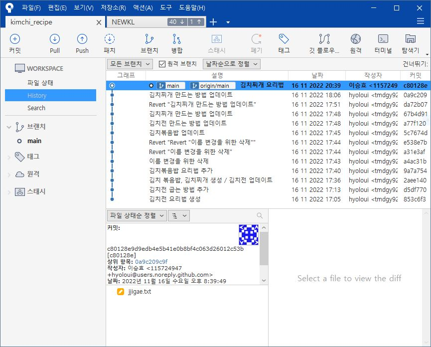

❤️‍🔥 TIL : Today I Learned

## 버전관리

1. Git 은 파일(프로젝트)의 변경사항을 지켜보는 프로그램이다!
2. Git 을 설치 했다면 터미널, sourcetree, vscode 터미널 에서 `git init` 이라는 명령어로 `.git` 폴더를 생성한다.

<!--truncate-->

### Git 은 왜 사용하나요?

우리가 학교, 직장 등 문서작업을 할 경우에 작업내용을 수정, 삭제, 삽입 하는 등 변동사항이 생기면 어떻게 관리를 하나요?

작업물을 완성 한 후, 최종 > 진짜최종 > 리얼최종 > 마지막 > 발표전 이렇게 계속 수정사항 때문에 다른이름으로 저장하여 불필요한 파일을 계속 생성했던 경험이 있습니다.

Git 은 이러한 작업내용을 아주 똑똑한 방법으로 관리 해주는 프로그램 입니다. 바로 `commit` 이라는 개념을 통해 파일안의 변동사항만 찰칵(캡처) 하여 조금씩 조금씩 작업을 쌓아가며, 커밋 메세지 기능으로 어떠한 작업을 했는지 한눈에 파악하여 해당 부분으로 다시 돌아갈 수도 있고 다른 사람들과의 협업을 원활하게 돕는 프로그램입니다.

현재 대다수의 기업에서는 git 을 사용하여 프로젝트를 관리하고 대부분의 개발자분들이 github라는 엄청난 커뮤니티에 프로젝트를 공개하기도하고 서로의 작업내용을 공유 한답니다!

### git 과 github 차이

- Git 은 프로젝트 버전 관리, 작업 단위 나누기, 협업 등 유용하게 사용되는 하나의 프로그램 입니다.
- Github 은 Git 으로 된 프로젝트를 공유할 수 있도록 저장 공간을 제공하고, Git 편하게 사용하기 위한 여러가지 부가기능을 가지고 있어요. Github 를 사용하기 위해서는 Git 이 협업할 때 필수입니다. + 개발자들의 sns 입니다.

### sourcetree

- Git 을 쉽게 사용할 수 있는 도구입니다. 워드 파일을 편집할 때 MS office 를 사용하는 것처럼요!
- 까만 배경에 어려운 명령어를 사용하는 터미널과는 다르게, 마우스 클릭 몇번으로도 git 을 편리하게 사용하고 UI 가 직관적으로 사용자 눈에 보이게되어 현재 프로젝트가 어떤 상태인지 한눈에 알아보기 편해요.

### terminal 과 sourcetree 비교

## commit

- 커밋은 프로젝트 상태 저장! `git commit` 이라는 명령어로 현재 프로젝트 상태를 찰칵 저장할 수 있습니다. 이렇게 commit 이 쌓으며 프로젝트를 만들어가면 탄탄한 프로젝트 관리가 되겠죠?

### commit 의 순서

커밋을 하려면 `stage` 라는 공간에 작업물이 있어야 합니다! `stage`는 내가 작업한 파일을 모아두는 공간이라고 할 수 있어요.

위처럼 작업파일을 `stage` 로 이동하는 것을 `add` 한다 라고 합니다. `add` 한 파일을 모아 하나의 버전으로 묶어 작업내용(커밋메세지)과 함께 커밋을 올립니다.

> 1. add : 작업파일의 추가, 삭제, 삽입을 stage로 이동한다

명령어 : `git add <파일이름>`
(`git add .`) 파일이름을 마침표로 대신하면 변동 파일을 모두 `stage`로 이동 합니다.

> 2. status : stage 안에 있는 파일을 확인, 재수정 한 후 원하는 파일 또는 모든파일을 커밋 메세지와 함께 커밋을 준비한다 (생략 가능)

명령어 : `git status`

> 3. commit : 커밋은 하나의 버전이 됩니다! 추후에 history 로 기록된 커밋들을 볼 수 있답니다. 핵심적인 작업 내용을 커밋 메세지에 담고 커밋을 합니다!

명령어 : `git commit -m "작업 내용의 커밋 메세지"`

## Tracking / pull / push

`pull` 이라는 명령을 하기 전 우리가 알아야 할 것은 **repository**(이하 repo) 입니다. 우리는 `git init` 으로 프로젝트를 git 이 관리할 수 있도록 한 폴더를 github 에 공개하고 다른 사람들과 공유, 협업을 진행 할 수 있는데요 repo 를 만든다는 것은 github 상에서 저장소를 만들어 놓는것 입니다.

> 로컬 repo : 내 컴퓨터에만 존재하는 repository 입니다. 컴퓨터가 가지고 있는 프로젝트에 어떠한 변동사항이 생겨도 github 에 반영하지 않는다면 오직 자신만 가지고있는 프로젝트입니다.
>
> 원격 repo : github 에 실제로 올라가 있는 repo 입니다. 어디서, 누구든 공개된 repo 를 볼 수 있습니다.

### Tracking

Github 에 있는 '원격 repo' 와 내 컴퓨터에 만들어 놓은 '로컬 repo' 를 연동, 연결 하는 것을 말합니다. 이때, 내가 생성한 '원격 repo' 또는 기존에 만들어진 '원격 repo' 의 URL 을 알아야 연동 할 수 있습니다! 만들어진 '원격repo'는 `clone` 이라는 명령이 필요합니다.

> Tracking 이 된 프로젝트는 이제 새로 생긴 변동사항을 `pull` 과 `push` 로 동기화 할 수 있습니다!

### Pull

Tracking 이 된 프로젝트는 이제 새로 생긴 변동사항을 동기화 할 수 있습니다. `pull` 을 직역하면 당기다, 당겨오다의 의미가 있죠? 네 맞습니다 **'원격 repo'를 '로컬 repo' 로 당겨**오는 것을 의미 합니다.

### Push

`push` 를 직역하면 밀다는 의미죠. 네 본인이 작업한 '로컬 repo'에서 생성한 소중한 커밋들을 '원격 repo' 로 보내는 작업 입니다!

:::warning 주의

여기서 주의하고 꼭 알아야 할 부분이 있는데요, 가령 '원격 repo' 의 `a.txt` 라는 동일한 파일을 다른 사람도 작업하고 내가 작업했다면 '원격 repo' 는 누구의 작업물을 따라가야 할까요? 이 부분이 충돌이라고 합니다!

그래서 꼭 작업 순서는 `push` 를 하기 전 '원격 repo' 의 상태로 최신화 하도록 `pull`을 먼저 하는 것이 충돌을 예방할 수 있습니다!

기억하세요 **pull > commit > push**

:::

추가로 `clone` 이라는 명령어는 기존에 생성된 원격repo를 다운로드 받아 로컬repo 를 생성하는 것입니다!

:::tip 최종 정리

1. git은 버전관리 프로그램, github는 원격 저장소 또는 개발자 sns
2. commit은 버전! 변동사항을 나누어 기록한다
3. 원격repo : github에 올라가 있는 프로젝트
4. 로컬repo : 내가 가지고있는 프로젝트
5. tracking : 원격과 로컬 연동!
6. pull : 원격repo의 작업내용을 로컬repo로 당겨오는 것
7. push : 로컬repo의 작업내용을 원격repo로 미는 것

:::

{/* 이 글은 Tistory(https://hyoloui.tistory.com/27)에서 옮겨 온 글입니다. 원문 작성일: 2022-11-17 */}
