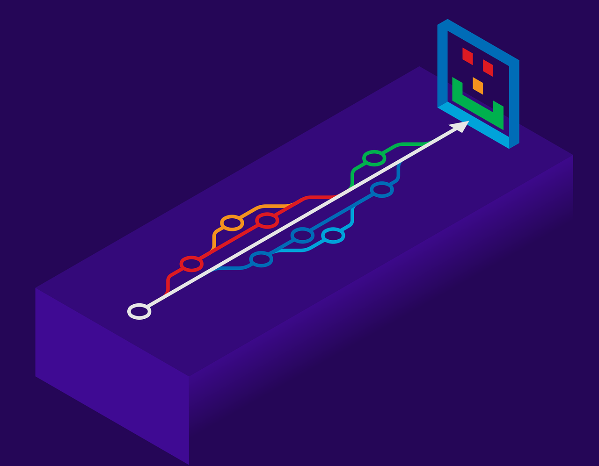

:::note WIL: Weekly I Learned

이번 주 한 일

1. **티스토리** 포스팅 = **매일 TIL 일지**
2. 협업을 위한 Git 활용 = **강의 완주**
3. 자료구조, **알고리즘** KDT 실무형 프론트엔드 엔지니어 = 청취중(3주차)
4. Project S.A 작성 react A반 10조(부드라미조)
5. 알고리즘, js-spa, database, cs기초 특강 청취

:::

<!--truncate-->

## study review

벌써 or 아직 3주 차(?)

사실 12시간이 정식 출석이지만 이 시간도 모자라다... 하루가 너무 짧다...

사실 첫 개강 후 웹 개발 종합강의 5주차를 3일 동안 미친 듯이 완강해서 자신감이 솟았다.

틈틈이 유튜브 강의, [노마드코더님 강의](https://nomadcoders.co/javascript-for-beginners)와 작고 소중한 현업 3개월 경력으로ㅜㅡㅜ 비교적 수월하게 완강했지만

다른 강의는 사실 쉽지 않았다. 아니 뭐든 쉽지 않겠지만 소화해야 할 강의 분량이 상당해 우선순위를 정해서 하나씩 집중해야 했다.

1. 깃허브 - 팀장으로서 프로젝트 관리 우선
2. 특강 - 이번 프로젝트에 첫 적용될 spa 집중
3. 알고리즘 - 개념 적립과 청취 중인 3주 차 까지는 마무리
4. 특강 - cs 기본, database, 알고리즘 특강(반복)

저번 주 WIL에서 계획했던, 퍼블리싱 강의는 시간 관계상 우선 보류했고, (퍼블리싱은 6개월 과정을 밟았으므로)

**Git, github**는 현업 경험으로 사용하는데 문제없을 정도였지만 팀장으로서 '원격 repo'를 관리해야 하기에 이론적인 것과 기초를 다시 꼼꼼하게 공부하자는 마음으로 차근차근 공부했지만 3주 분량이 만만치 않았다.

**SPA는** 기존에 알고 있던 React의 기초가 된다는 것을 이해했고, 어떻게 적용하는지 감이 왔지만 프로젝트로 팀원들도 함께 이해하고 공유해야 하는 부분이 있어 회의에서 다음 주 월요일 특강 이후 실제 작업을 진행하는 것으로 결정했다.

**자료구조, 알고리즘** 강의는 기본 개념을 익히기 위해 강의를 3회 이상 돌려보았고, 또 [프로그래머스](https://school.programmers.co.kr/learn/challenges?order=acceptance_desc&levels=0&languages=python3)에서 js 이용해 0 레벨은 반 이상 풀었다! 하지만 아직 남은 강의들은 더 심화된 내용이므로 지금 푸는 문제 유형들과 문법들이 더 익숙해질 때 까지는 알고리즘 진도를 나가면 다른 강의와 프로젝트에 영향이 생길 것 같아 이번 '팬pick' 프로젝트 마무리 지을 때까지 정지상태가 될 듯하다.

신규 특강으로 cs기초와 database를 청취했으나 cs 기초는 용어 독해가 안되어 깊게 이해하지 못했지만,

[YES24 - 비전공자를 위한 이해할 수 있는 IT 지식](http://www.yes24.com/Product/Goods/91165789)

책을 통해 얕게나마 이해했다.

> 쉽게 마인드 맵으로 그려본 내용으로는
> 도서관(보조기억장치)에서 책상에 마음에 드는 책들(프로그램)을 책상(RAM)으로 꺼내 머리(CPU)로 이해하고 문제를 해결한다.

Database는 sql과 no-sql의 차이를 확실하게 이해했다.

또 부족한 알고리즘을 이해하기 위해 식사시간에는 틈틈이 알고리즘 특강을 반복해서 시청했다.

---

이번 내일배움캠프(부트캠프) '부드라미'조의 팀원 분들이 너무 잘 따라주고 팀장 대우를 해주셔서 다시 한번 책임감을 가지고 프로젝트를 시작해야겠다.

조원 한분께서 '커피라도 보내드려야겠네요'라는 말에 장난으로 '저희 집 앞에는 스타벅스밖에 없어요'라고 한 말을 기억하고 주말에 스타벅스 기프티콘을 보내주셨다... 장난으로 그런 말인데😭 덕분에 토요일에 스타벅스에 가서 위에 링크로 올려둔 책을 읽었다. (따로 네이버 블로그로 책 리뷰를 하고 있어 그곳에 리뷰할 예정이다)

다음 주는 프로젝트 기똥차게 마무리 지으며 틈틈이 웹 퍼블리싱 강의 수강 해야겠다!

또 한주 달려보자~

빠이팅그.

|             | 1 week                                                                                                                                                              | 2 week                                                     | 3 week                                      |
| ----------- | ------------------------------------------------------------------------------------------------------------------------------------------------------------------- | ---------------------------------------------------------- | ------------------------------------------- |
| 학습 내용 (프로젝트) | 웹개발 종합반 - HTML, CSS, Javascript, jQuery, JSON, AJAX, Python, Flask, MongoDB (로그인 페이지, 팬명록, 지니뮤직 크롤링, 화성땅 공동구매, 스파르타피디아, 버킷리스트, nohup 배포) | 자바스크립트(Javascript), 파이썬(python), 자료구조와 알고리즘(algorithm) | 버전관리프로그램(Git, github), 자료구조와 알고리즘(algorithm) |
| 사용 툴        | VS code, Bootstrap, Git Bash, FileZila, AWS(ec2), gabia                                                                                                           | VS code, Git, Git hub                                      | VS code, Git, Git hub, sourcetree, programmers |

{/* 이 글은 Tistory(https://hyoloui.tistory.com/30)에서 옮겨 온 글입니다. 원문 작성일: 2022-11-20 */}
