❤️‍🔥 TIL : Today I Learned

## commit 관리

1. PR (pull request)
2. commit 고치기 - amend
3. commit 되돌리기 - revert, reset
4. 작업내역 임시 저장 - stash

<!--truncate-->

## PR (pull request)

내 작업 내역을 바로 merge 하지 않고, 참여하고 있는 프로젝트 내 작업(branch)을 merge해 달라고 요청(request) 보내는 것 입니다.

Github 에서 pull request 하는 방법

Github 에 로그인 후, 내 repo 에서 pull request 해 보겠습니다.

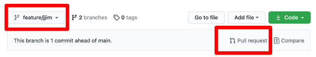

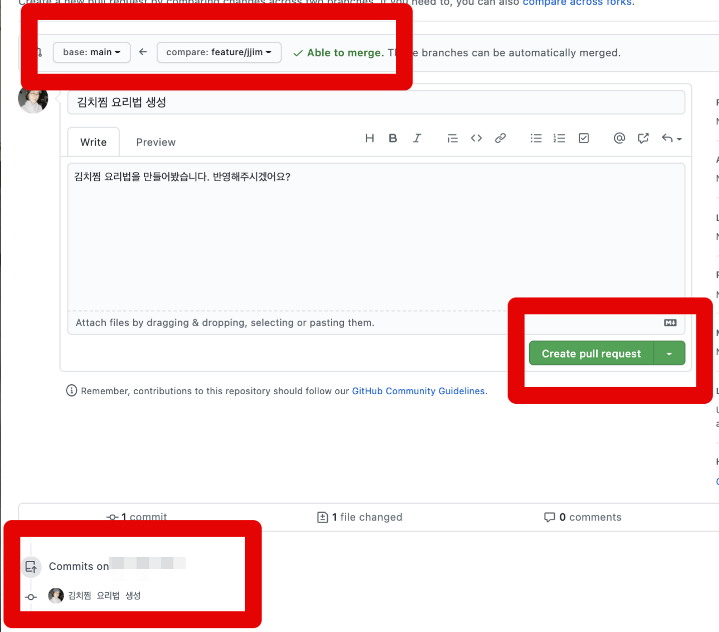

1. 상단박스 / base (merge 할 브랜치) `<<` compare (base에 합칠 브랜치)
2. 하단박스 / 현재 브랜치에 작업된 commit 내역 확인
3. 녹색박스 / create pull request : PR 생성

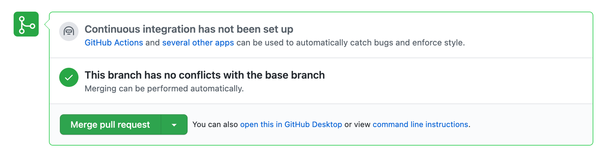

이후, `fetch` 명령으로 원격repo의 해당 브랜치에 잘 merge 가 되었는지 확인 후 `pull` 하여 로컬repo를 최신 상태로 만들고 branch를 삭제하여 이슈, 작업을 종료합니다.

:::warning 주의사항

협업 시, PR 이 최종적으로 완료되기 전까지는 해당 브랜치를 삭제 하시면 안됩니다. 코드리뷰, 피드백으로 완전한 PR 전 추가 수정이 필요 할 수 있기 때문입니다.

:::

## commit 고치기 - amend

우리는 작업 중 `add` 후 실수를 인지하기도 하고, 실수로 `stage` 에 넣고싶지 않은 파일을 넣어 함께 commit 하기도 합니다. 이럴 때, 사용할 수 있는 명령어로 `amend` 가 있습니다.

+ `amend`는 가장 최신의 커밋 즉, 방금 한 실수만 되돌릴 수 있습니다!

### push 하기 전 되돌리기

sourcetree 로 되돌리기

sourcetree 를 활용 해 보겠습니다.

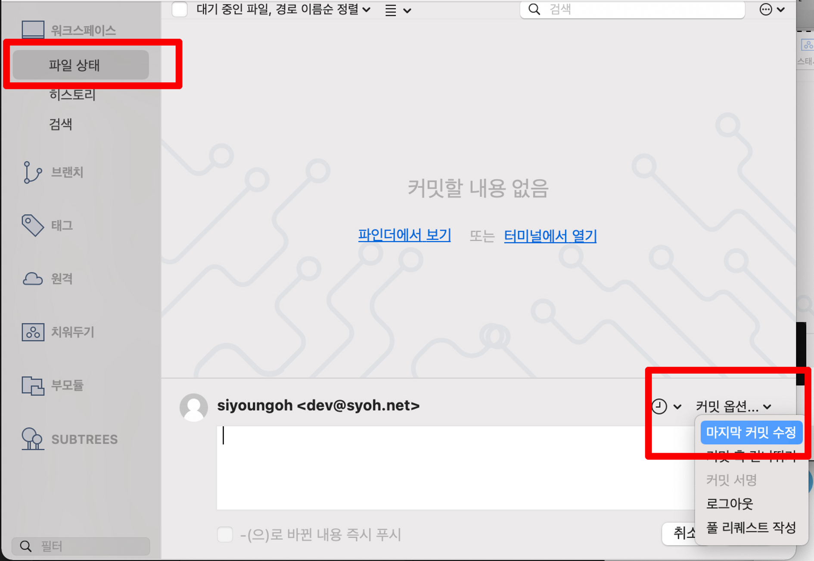

1. 파일상태로 이동
2. 우측 하단의 커밋옵션 > 마지막 커밋 수정
3. 추가 작업 및 수정 후 커밋

### push 한 후 되돌리기

강제푸시로 되돌리기

위처럼 마지막 커밋 수정하여 커밋을 돌리고 작업 후 아래 사진과 같이 강제푸시를 사용합니다.

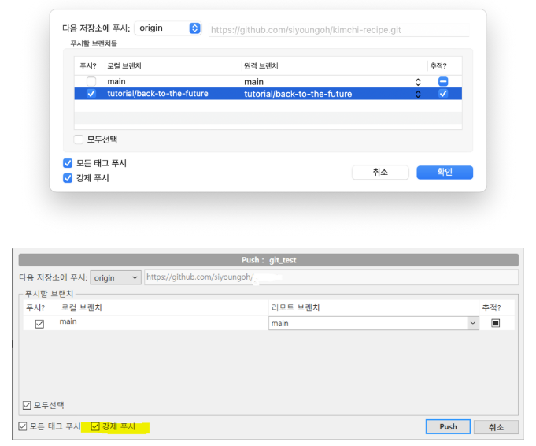

### 강제푸시 설정 방법

mac, window 설정 방법

mac - [맥 소스트리 강제푸시하기](https://velog.io/@hamcheese/%EB%A7%A5-%EC%86%8C%EC%8A%A4%ED%8A%B8%EB%A6%AC-%EA%B0%95%EC%A0%9C%ED%91%B8%EC%8B%9C%ED%95%98%EA%B8%B0)

window - 도구 > 옵션 > Git > '강제 푸시 가능' 체크

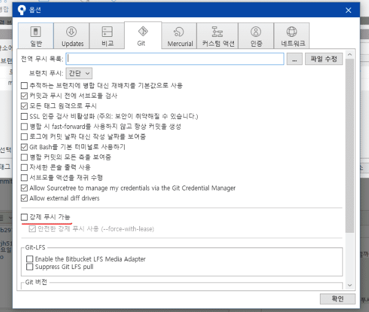

:::warning 강제푸시 주의

강제푸시는 꼭 필요할 때, 혼자 작업하는 브랜치에서만 사용해야 합니다.

다른 사람이 내가 수정하려고 한 commit 을 pull 하지 않은 상태여야합니다. 그렇지 않으면 다른 사람의 작업내역이 모두 꼬이기 때문에 다른 사람들은 기존에 작업하던 프로젝트를 지우고 새롭게 프로젝트를 clone 해야하는 상황이 발생합니다!

:::

## commit 되돌리기 - revert, reset

### revert

revert 하는 방법

- 커밋을 되돌리며 어떤 내용이 되돌려 졌는지 기록으로 남길 수 있고, 최신 커밋 뿐 아니라 이전 커밋들도 가능 합니다!

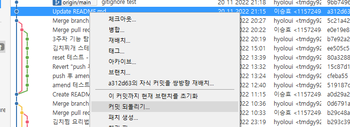

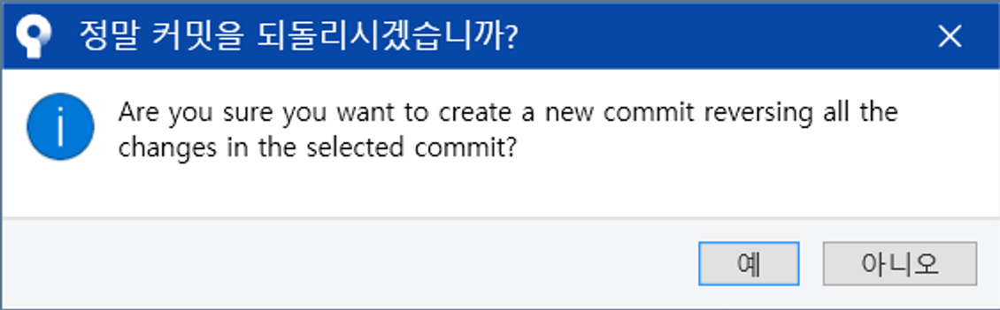

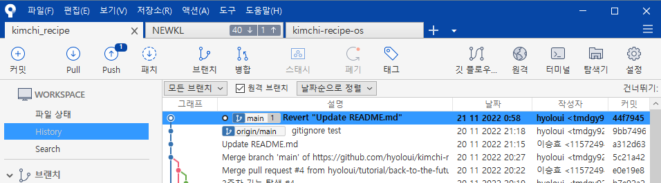

이렇게, 새로운 커밋이 생성된 것을 볼 수 있습니다!

### reset

reset 하는 방법

- 리셋 지점 이후 커밋은 사라지며 우리는 `mixed` 를 사용하여 작업내용은 남기고 히스토리만 되돌려 보도록 하겠습니다.

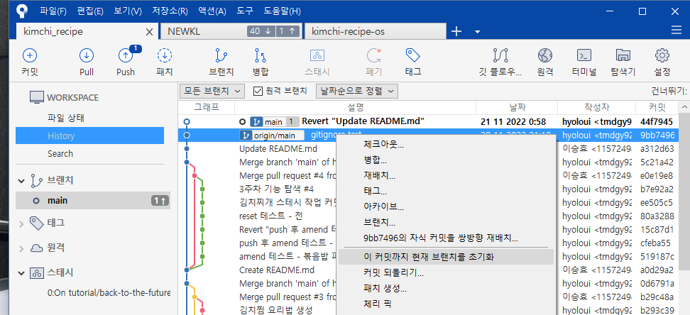

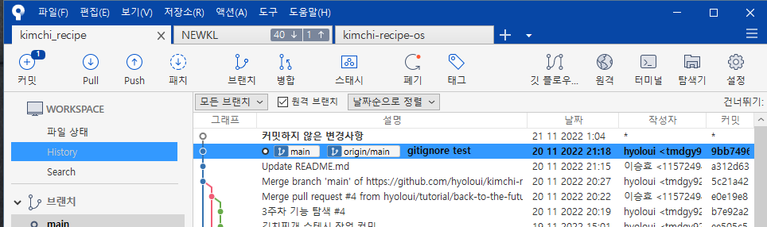

`mixed` 는 uncommit 을 남기고 히스토리를 삭제되는 똑똑한 reset 입니다!

`hard` 는 변경사항도 전부 삭제하여 흔적 자체를 다 지우게 됩니다.

## 변경사항 임시 보관하기 - stash

잠시만요, 이따 작업할게요. 변경사항 임시 보관하기 - stash (스태시)

stash 사용 방법

파일을 작업 도중 우리는 또 다른 작업요청이나, 우선순위가 높은 작업이 생길 수 있습니다. 그런 상황에서는 작업중이던 파일을 어떻게 해야할 까요?

저는 git을 이용한지 얼마 안되었을 때, stash를 몰라서 우선 커밋을 하고 다른 작업을 처리한 적이 있습니다. 그렇게 된다면 히스토리도 지저분해지며 커밋 관리가 깔끔하지 않습니다.

현업에서는 stash를 사용해야 하는 상황이 반드시 있답니다!

1. 작업 내용과 파일 상태를 확인

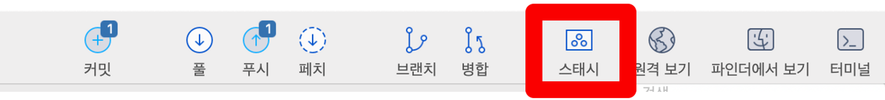

2. stash 도 커밋과 동일하게 상세하게 작업중이던 내용을 상세히 메세지로 남깁니다.

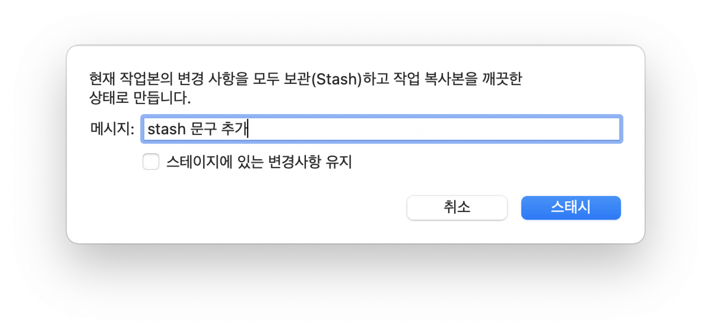

3. 스태시 폴더에 작업내용이 추가되고 현재 파일상태는 비워져있게 됩니다.

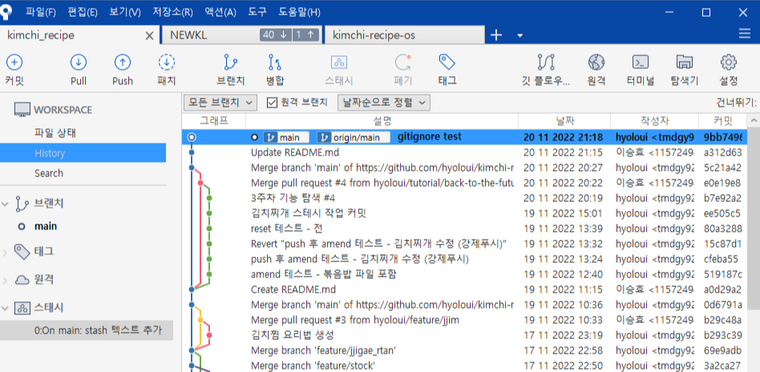

4. 저장된 스태시에 우클릭하여 '스태시 적용'

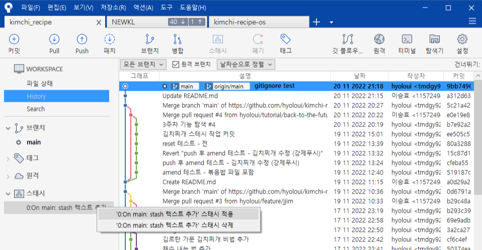

5. 다시 생긴 작업 내용!

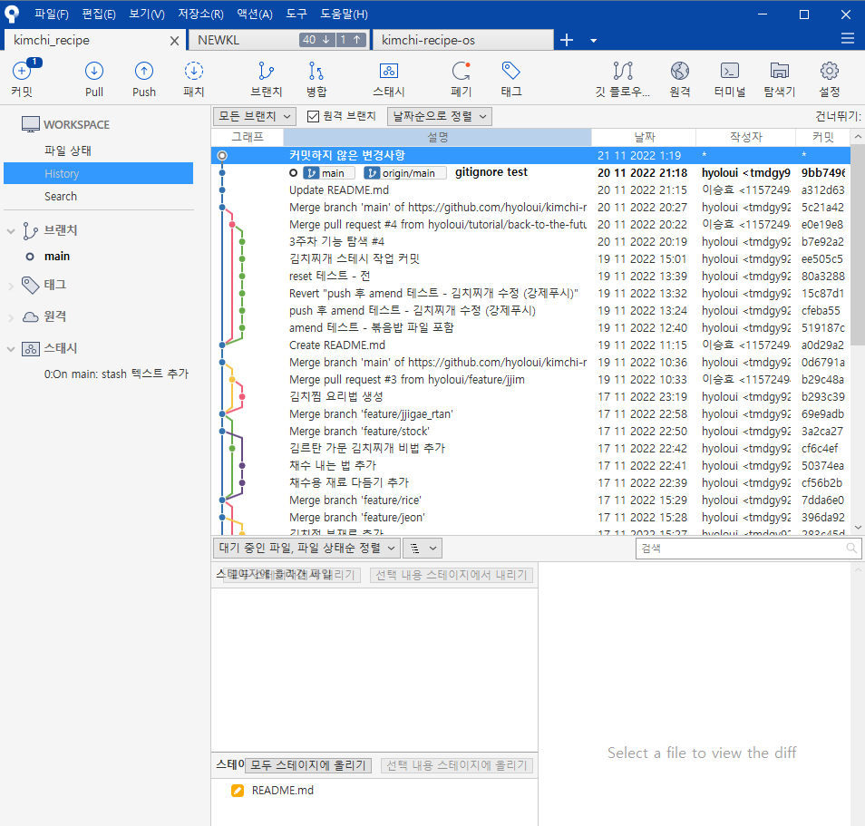

이후, 작업내용을 이어서 작업하고 커밋 > 푸시까지 마쳤다면 저장된 스태시를 삭제하여 나중에 햇갈리는 일이 없도록 해야겠습니다!

## Git 프로젝트 관리 - 협업 매너

### commit 메시지 컨벤션

commit 메세지 작성하는 규칙은 **commit 메시지 컨벤션(commit message convention)**!

- 어떤 작업을 했는지 commit history (commit log)만 보고 알 수 있다
- 버그를 찾을 때와 코드 고치기 쉽다
- 다른 사람이 코드를 리뷰할 때 편하다

### .gitignore

공유하거나 공개되면 안되는 나만의 설정 파일, API key 정보를 Git이 무시할 수 있도록, 없는 척하는 설정. 무시할 파일/폴더 이름을 `.gitignore` 파일에 적는다.

[gitignore.io](https://www.toptal.com/developers/gitignore/)

첨부한 링크는 프로젝트별 사용하는 언어, 라이브러리에 따른 gitignore 내용을 제시해준다. 예를 들면 python 에서 필수로 생성되는 가상환경 폴더인 `venv` 등이 해당 된다!

### README.md

프로젝트 안내글을 적어둡니다. 프로젝트의 어마어마하게 많은 파일들을 하나하나씩 다 읽어볼 수는 없으니 꼭 이런 안내 파일이 있는게 좋겠죠! markdown(md) 형식을 따르는 텍스트파일입니다.

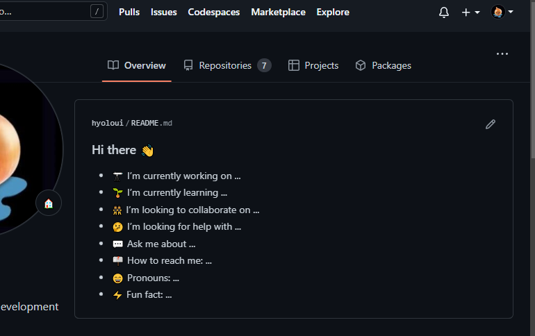

위처럼 계정의 프로필이나 프로젝트의 설명서, 소개글로 활용 된다!

## Github 에서 정보 나누기

우리는 깃허브에서 프로필 소개 페이지(포트폴리오)를 작성하고, 다른 훌륭한 개발자들의 코드를 참고해 영감을 얻을 수 있습니다. 또한 깃허브 익스플로러에 공개된 거대한 프로젝트의 코드를 보고 코멘트로 의견을 나누며, 자신이 공부중인 언어와 즐겨 사용하는 라이브러리, 프레임워크에 대한 정보를 활용 할 수 있습니다!

[Explore GitHub](https://github.com/explore)

### 오픈소스

open source 란 개인, 단체, 기업 모두 개발하는 내용을 공개하여 누구나 프로젝트에 기여하거나 코멘트를 달며 자유롭게 프로젝트가 인터넷에 공개된 것을 의미합니다. 하지만, 무료라고 해서 이를 자신의 소유물처럼 이용하는데는 한계가 있습니다. 공개된 프로젝트를 사용하는 만큼 우리는 오픈소스를 활용할 때 라이센스가 어떤 라이센스인지 해당 라이센스의 조건은 무엇인지 조사하고 사용해야 라이센스 분쟁 문제를 예방할 수 있습니다.

:::tip 최종 정리

1. PR(pull request) : 작업내역을 바로 merge 하지 않고, 참여하고 있는 프로젝트에 내 브랜치를 merge 해달라고 요청 하는 것.
2. amend : 방금 전 커밋 되돌려 수정하기
3. revert(리버트) : 어떤 내용을 되돌렸는지 새로운 commit을 남기고 되돌리기
4. reset(리셋) : commit 했던 작업내역을 말 그대로 리셋시키는 것입니다.
5. stash(스태시) : 프로젝트의 변경사항을 임시적으로 보관해둘 때 사용합니다.
6. .gitignore : 공유하거나 공개되면 안되는 나만의 설정 파일, API key 정보를 Git이 무시할 수 있도록, 없는 척하는 설정. 무시할 파일/폴더 이름을 `.gitignore` 파일에 적어줌.
7. README.md : 프로젝트 안내글을 적어둡니다. 프로젝트의 어마어마하게 많은 파일들을 하나하나씩 다 읽어볼 수는 없으니 꼭 이런 안내 파일이 있는게 좋겠죠! markdown(md) 형식을 따르는 텍스트파일

:::

{/* 이 글은 Tistory(https://hyoloui.tistory.com/31)에서 옮겨 온 글입니다. 원문 작성일: 2022-11-22 */}
