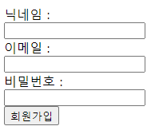

❤️‍🔥 TIL : Today I Learned

우리가 html 에서 `form` 태그를 쓰는 용도로는 유저(사용자)에게 입력받은 값을 js 에서 핸들링하여 백엔드로 넘겨주기 위함이다.

<!--truncate-->

1. form 태그 하위 요소들
2. form 예시
3. 입력 받기 - submit
4. `<input>`의 value
5. `<input>`의 type
6. `<input>`과 `<label>`
7. `<button>`의 type

## form 태그 하위 요소들

- `<input>`
- `<label>`
- `<select>`
- `<textarea>`
- `<button>`
- `<fieldset>`
- `<legend>`
- `<datalist>`
- `<output>`
- `<option>`
- `<optgroup>`

위와 같은 태그들이 들어갈 수 있다.

## form 예시

하지만 이해를 위해 간단하게 작성해 보겠다.

```html
<form onsubmit="입력보내기(event)">
  <label for="name">닉네임 :</label>
  <input type="text" name="name" id="name">

  <label for="email">이메일 :</label>
  <input type="email" name="email" id="email">

  <label for="password">비밀번호 :</label>
  <input type="password" name="password" id="password">

  <input type="submit" value="회원가입">
</form>
```



사용자에게 `input` 으로 받은 `value` 들을 전부 넘겨줘야한다.

## 입력 받기 - submit

위에서 회원가입버튼의 `submit`은 `form` 안에 있는 `input`으로 받은내용(`value`)을 전송하는 태그이다.

```js
function 입력보내기(event) {
  event.preventDefault();
  console.log('전송 성공.');
}

// console
// '전송 성공'
```

위처럼 함수를 만들어야 `form` 이 제대로 전달 된다.

순서

1. 회원가입 버튼 `submit`
2. `form`의 `입력보내기()` 함수 실행

`submit` 이벤트는 양식을 제출하는 동시에 기본 동작으로 새로고침이 발생하는데, `preventDefault()` 를 사용하여 이를 막아줄 수 있다.

## `<input>`의 value

`submit` 을 통해 이벤트가 발생하고, `event` 의 `target` 을 통해 지정한 값을 받아온다.

```js
function 입력보내기(event) {
  event.preventDefault();
  const name = event.target['name'];
  console.log(name.value);
}
```

여기서 받아 올 때 실험결과 `target` 은 `for`, `name`, `id` 상관 없이 `form` 안에 있는 하위 요소중 하나를 지정하여 가져온다는 것이다.

이전에는 `getElement` 로 하나하나 가져다가 돔을 가져다가 썼지만 새로 알게되었다!

자세한건 더 알아봐야겠다.

## `<input>`의 type

`type`을 사용하면 더 명확한 값을 제공한다.

위에서는 `text` 와, `email`, `password` 는 각각 특징이 있다.

- `text` 타입는 기본 기능 이지만
- `email` 타입은 `@`가 포함되어야 하며,
- `password` 는 ●●●●● 표시로 가려서 나온다(기본 보안)

```html
<input type="text" name="name" id="name">
<input type="email" name="email" id="email">
<input type="password" name="password" id="password">
```

그래서 이렇게 작성을 했다.

또 자주 사용하는 속성으로는

- `placeholder` == 임시 텍스트, 우리가 id라는 박스에 들어가면
- `required` == 유저에게 해당 `input`을 필수 작성 요청
- `autofocus` == 해당 페이지가 로딩이 되면 자동 포커스를 갖는다

## `<input>`과 `<label>`

`label` 을 사용하면 `input`에 이름을 붙여준다. 또한 `label` 의 `for` 과 `input` 의 `id` 값이 같으면 서로 연결된다.

```html
<form>
  <label for="name">닉네임 :</label>
  <input type="text" name="name" id="name" required>
</form>

<!-- label(for=name) ~> input(id=name) -->
```

※ '닉네임'이라는 텍스트를 클릭해도 연결된 `input`을 포커스시켜준다.

## `<button>`의 type

`<form>` 의 `<button>` 은 `submit`, `reset`, `button` 세가지 타입을 지원한다.

```html
<button type="submit"></button>
<button type="reset"></button>
<button type="button"></button>
```

`submit` 은 위에서 설명한 것처럼 양식 제출 역할이며 `reset` 은 흔히 아는 '초기화' 기능이다. `button` 은 기본 타입이 `submit` 이지만, 접근성 과 중복방지를 위해 `type` 을 항상 지정해 주는 것이 좋다. 왜냐하면, `<form>` 에 `<button>` 이 여러개 라면 `submit` 이 중복되어 코드상 좋지 않다.

또한 `button` 은 `input` 과 다르게 엘리먼트들을 삽입 할 수 있고, 자유로운 스타일 적용이 가능하다.

:::tip 최종 정리

1. `form`의 개념을 개발자가 잘 알고있어야 오류 없이 깔끔한 `value` 를 가져올 수 있다.
2. `form`을 `onsubmit`으로 내부에 `submit` 이 되면, 함수를 할당해 줄 수 있다.
3. `<label>`의 `for` 과 `<input>` 의 `id` 가 동일하다면 둘은 연결되어 작용한다.
4. `<input>` 에 `submit` 속성을 추가 할 수 있지만, 목적상 `<button>`을 사용하는 것이 좋다.

:::

{/* 이 글은 Tistory(https://hyoloui.tistory.com/33)에서 옮겨 온 글입니다. 원문 작성일: 2022-11-24 */}
