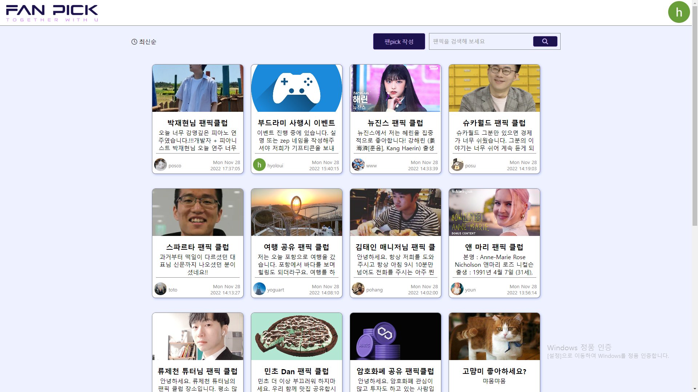

[부드라미조. fanpick.shop](http://fanpick.shop/)

<!--truncate-->

## 팀원별 회고!!

> **이번 프로젝트에서 좋았던 부분 및 다음 프로젝트에서도 이렇게 했으면 좋겠다. 하는 부분**

**승효** : 첫 기획부터 기능구현으로 역할을 나누어 진행하며, 팀원분들께서 작업이 끝나도 선택기능 구현에 힘써주어 완성도 높은 프로젝트가 된 것 같다. 다음 프로젝트에서는 기본문법을 충분히 익혀서 내가 생각하고 구상한 코드를 직접 작성할 수 있도록 더 노력해야겠다.

**미영** : git으로 모든 협업을 진행한 부분 좋았습니다. 공부가 많이 되었구요. 다음 프로젝트에서도 이번 프로젝트처럼 깃으로 모든 협업을 진행하고, 역할 분담을 잘 해서 각자 맡은바 공부 열심히 해서 직접 구현해볼 수 있도록 했으면 좋을 것 같아요.

**창순** : 팀원들끼리의 소통이 잘 된 것 같아 이 부분이 정말 좋았습니다.

**도원** : 이번 프로젝트는 너무 좋은 팀원들과 함께 웃으면서 진행한 부분이 너무 행복했습니다. 어려운 과정속에서도 서로 믿고 의지하며, 결과를 도출하는 모습이 너무 좋은 경험이였습니다. 다음 프로젝트는 이번 프로젝트의 팀원분들을 만난다면, 바라는 점은 딱히 없습니다.

**홍구** : 와이어프레임을 꼼꼼하게 작성해서 명확한 가이드라인아래 작업한점이 좋았습니다.

> **프로젝트 진행 중 발생한 문제점**

**승효** : 작업 중 수많은 오류를 만났고 해결했음에도 프로젝트를 완성하는데 촛점을 둔 나머지 해결내용을 기록하지 못해서 너무 아쉬웠다

**미영** : 다크모드를 만들었는데 다시 들어오면 라이트모드로 바뀌게 하고싶어 세션스토리지를 이용하였으나 로컬스토리지던, 세션스토리지던 새로고침을 하면 라이트모드로 다시 바뀌는 문제가 있었습니다.

**창순** : 자바스크립트 기본 문법도 제대로 숙지가 되어있지 않아 파이어베이스 문법을 제대로 사용하지 못했습니다.

**도원** : JS의 문법이 완전 기초 문법만 알고 있는 상태에서 알고리즘을 만나고 새로운 Firebase를 만났더니 제대로 사용하지 못한 부분이 문제점이였습니다.

**홍구** : 지급된 강의만으로는 프로젝트에 사용된 자바스크립트 문법을 이해하는데 어려움이 있어서 공부하는데 애로사항이 있었습니다.

> **위 문제점을 해결할 수 있는 현실적인 방안**

**승효** : 이제 TIL 작성시 기본문법, 배운내용 보다는 오류와 해결방법 위주로 작성 해야겠다

**미영** : CSS 미디어쿼리 중 "prefers-color-scheme" 이란게 있습니다. 다크모드를 구현할 수 있는 쿼리인데요. 사용자의 운영체제 설정(다크모드 or 라이트모드)이나 에이전트 설정에서 선호하는 테마로 나타낼 수 있습니다. 다음 프로젝트때는 이 방법을 통해 진행해볼 예정입니다.

**창순** : 튜터님 찬스를 많이 사용한 것 같습니다.. 그리고 기능구현을 할 때 마다 콘솔 로그를 모든 곳에 찍어봐야 한다는 것을 배웠습니다.

**도원** : 이승효 대표님 찬스 부탁 + 튜터님에게 몰랐던 문법과 기초 내용을 숙지하는 방향

**홍구** : 프로젝트는 끝났지만 작성한 코드들을 한줄한줄 주석달아가며 공부하면 향후 프로젝트에 도움이 많이될것같습니다.

> **이번 프로젝트를 통해 느낀 점**

**승효** : SPA 를 활용해 사용자 경험(UX)적으로도 좋다는 것을 느꼈고, Firebase 를 잘 활용하여 프론트 개발자끼리도 프로젝트 풀스택 구현이 충분히 가능하다는 것을 체감했고, 팀장 역할을 맡으며 프로젝트에 대한 책임감을 느껴, 능동적이고 효율적인 구조를 위한 작업 경험을 했다.

**미영** : 간단한 사이드프로젝트 할 때에 파이어베이스를 사용하면 좋겠다고 생각했습니다. 그리고 자바스크립트 문법은 정말 중요하다는것을 절실히 깨달았어요. 리액트 배운다고 자바스크립트에 소홀하지 않고 더 열심히 배우겠다고 다짐하게되는 계기였습니다.

**창순** : 처음에는 너무나도 내용이 어려웠지만 점점 더 제 실력이 늘어가는 것을 알 수 있었고, 콘솔 로그 찍어보기는 정말 중요하다는 것을 느꼈습니다.

**도원** : 리액트 과정 속에서 우리가 어떻게 나아가야할지 방향을 찾았다! 라고 느꼈습니다.

**홍구** : 파이어베이스, 깃, 노션같은 툴을 처음 사용해봤는데 앞으로도 꾸준히 사용하고 더 공부해서 잘 활용할수 있게 해야겠다고 느꼈습니다.

---

[fanpick 프로젝트 배포](http://fanpick.shop/)

{/* 이 글은 Tistory(https://hyoloui.tistory.com/36)에서 옮겨 온 글입니다. 원문 작성일: 2022-11-28 */}
