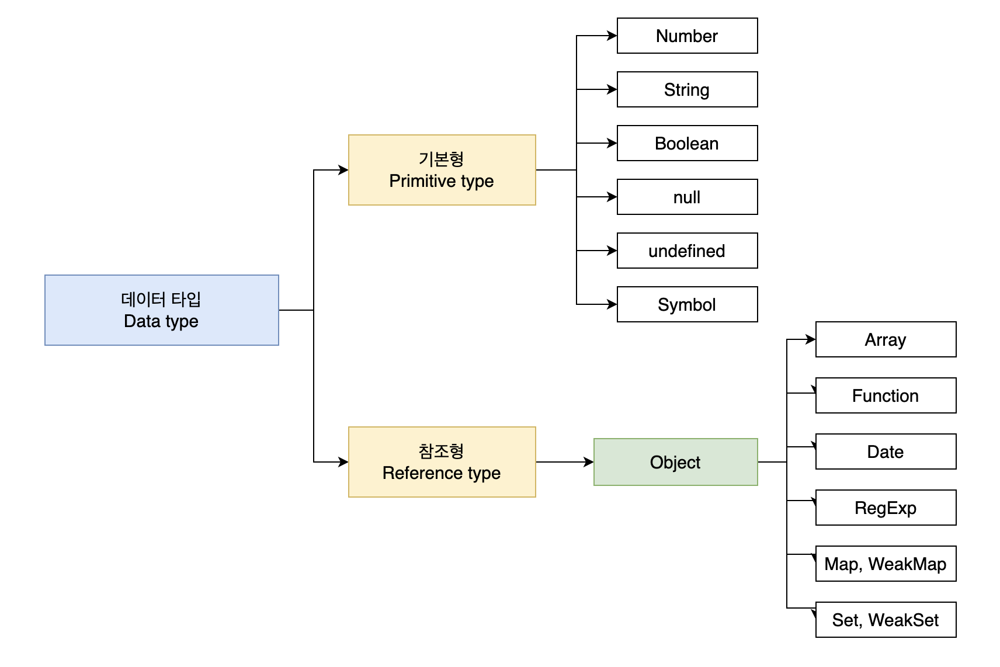

❤️‍🔥 TIL : Today I Learned

:::note 목차

1. 데이터 타입의 종류
2. 데이터 할당
3. 기본형 데이터와 참조형 데이터
4. 불변객체 - 얕은 복사, 깊은 복사
5. `undefined` 와 `null`

:::

<!--truncate-->

## 데이터 타입의 종류



※ `Symbol` 은 '객체의 프로퍼티 키'로 사용되는 ES6 에 새로 추가된 타입이다.

(이미지 출처 : [velog - 자바스크립트 데이터 타입 정리](https://velog.io/@imjkim49/자바스크립트-데이터-타입-정리))

**기본형과 참조형의 구분 기준**

- 복제의 방식
  1. 기본형(Primitive type) : 값이 담긴 주소값을 복제
  2. 참조형(Reference type) : 주소값들의 묶음을 가리키는 주소값을 복제
- 불변의 여부 : 기본형은 불변형이며, 참조형은 가변형이다!

**식별자, 변수**

```js
let abc = 10;
```

- 식별자 - 위에서 선언한 `abc` 라는 **변수명**
- 변수 - `abc`라는 변수명에 할당한 `10` 이라는 숫자 **데이터**

## 데이터 할당

```js
// case 1.
let abcd = "test alphabet";

// case 2.
let abcd;
abcd = "test alphabet";
```

우리가 코드를 작성 할 때 보통 case1 번 처럼 변수를 할당한다. 하지만 case2도 똑같이 작동되며 case2 로 이해해야 나중에 나올 호이스팅에서 이해가 쉽다.

| 구분   |        | 1002                      | 1003            | 1004 | 1005 |
| ------ | ------ | ------------------------- | --------------- | ---- | ---- |
| 변수   | 주소   | 1002                      | 1003            | 1004 | 1005 |
| 변수   | 데이터 | 식별자 : abcd, 값 : @5003 |                 |      |      |
| 데이터 | 주소   | 5002                      | 5003            | 5004 | 5005 |
| 데이터 | 데이터 |                           | 'test alphabet' |      |      |

기본적인 데이터 할당 방식을 표로 작성했다. 1002 주소에 곧장 `'test alphabet'`을 값으로 할당하지 않는 이유는

- **자유로운 데이터변환** - 1002의 `'test alphabet'` 이 바로 할당되었을 때 데이터가 길어진다면 1003으로 늘려야 하고, 뒤따라 할당된 주소와 데이터들이 뒤로 한칸씩 이동해야 하기 때문이다.
- **메모리의 효율적 관리** - 만약 값이 같은 값인데 `'test alphabet'` 을 하나씩 다 넣어준다면 8byte 씩 계속 늘어나야 한다. 하지만 `@5003` 이라는 주소를 바라보고 있는 값이 들어온다면 더 적은 데이터로 효율적인 관리가 가능하다.

:::note

여기서 우리가 알고있는 `let`(변수) 은 1002의 주소가 가진 데이터값이 `@5004`, `@5005` 등 으로 값이 변할 수 있으나, `const`(상수) 는 값이 `@5003`에서 변하지 않도록 고정된 값이다!

하지만, 여기서 `const` 가 불변성을 가졌다는 것이 아니다.

:::

## 기본형 데이터와 참조형 데이터

- 기본형 데이터 == 불변형
- 참조형 데이터 == 가변형

### 불변값과 불변성

```js
let a = "abc";
a = a + "def";
```

위 코드로 변수에 새로운 데이터를 넣었을 때 생기는 과정이다.

| 구분   |        | 1002                          | 1003        | 1004 | 1005 |
| ------ | ------ | ----------------------------- | ----------- | ---- | ---- |
| 변수   | 주소   | 1002                          | 1003        | 1004 | 1005 |
| 변수   | 데이터 | 식별자 : a, 값 : ~~@5002~~ @5003 |             |      |      |
| 데이터 | 주소   | 5002                          | 5003        | 5004 | 5005 |
| 데이터 | 데이터 | ~~'abc'~~                     | 'abcdef'    |      |      |

1. `@5002`에 새로운 데이터 `'abc'` 가 들어오게 된다.
2. `@1002`의 값 `@5002`의 데이터 `'abc'` + `'def'` 즉 `'abcdef'` 를 데이터에서 찾는다.
3. 데이터에 없는 값이므로 `@5003`에 `'abcdef'` 데이터를 새로 생성한다.
4. `@1002`의 값은 `@5003` 으로 바뀐다.
5. `@5002`는 필요없게 되므로 '가비지컬렉팅' 된다.
6. `@5002` 주소의 데이터는 삭제되고 다음 메모리를 받을 준비를 한다.

이러한 과정을 보면 처음 데이터를 할당했던 `@5002`의 데이터가 바뀌는 것이 아닌, 새로운 주소의 데이터로 교환 되었다고 볼 수 있다. 그래서 우리는 '기본형 데이터를 **불변값**' 이라고 한다.

### 가변값과 가변성

```js
var objet = {
  a: 1,
  b: "aaa",
};
```

위 코드가 데이터에 할당되는 과정을 표에 나타내었다.

| 구분              |        | 1002/5002/7102 | 1003/5003/7103  | 1004/5004/7104 | 1005/5005/7105 |
| ----------------- | ------ | -------------- | --------------- | -------------- | -------------- |
| 변수              | 주소   | 1002           | 1003            | 1004           | 1005           |
| 변수              | 데이터 |                | objet / @5003   |                |                |
| 데이터            | 주소   | 5002           | 5003            | 5004           | 5005           |
| 데이터            | 데이터 |                | @7104 ~ @7105   | 1              | 'aaa'          |
| objet을 위한 영역 | 주소   | 7102           | 7103            | 7104           | 7105           |
| objet을 위한 영역 | 데이터 |                |                 | a: @5004       | b: @5005       |

여기서 우리는 참조형 데이터, 즉 object 의 변수할당 과정이 기본형 데이터 변수할당 과정과 다르다는 것이 보인다. 바로 객체의 **변수(프로퍼티) 영역**이 별도로 존재하는 것이다.

## 불변객체 - 얕은 복사, 깊은 복사

가변일 수 밖에 없는 참조형 데이터, 가변형 데이터는 같은 값을 참조하기 때문에 불변형으로 바꿔줘야 한다.

```js
// 참조형 데이터
let obj1 = { c: 10, d: "ddd" };
let obj2 = obj1;
obj2.c = 20;
```

위와 같은 코드에서는 `obj1` 과 `obj2` 의 데이터가 다르다고 생각 되겠지만, 둘은 같아지는 문제가 생긴다 **(`obj1 === obj2`)**

| 구분              |        | 1002/5002/7102 | 1003/5003/7103 | 1004/5004/7104 | 1005/5005/7105 |
| ----------------- | ------ | -------------- | -------------- | -------------- | -------------- |
| 변수              | 주소   | 1002           | 1003           | 1004           | 1005           |
| 변수              | 데이터 | obj1 / @5002   | obj2 / @5002   |                |                |
| 데이터            | 주소   | 5002           | 5003           | 5004           | 5005           |
| 데이터            | 데이터 | @7102 ~ @7103  | 10             | 'ddd'          | 20             |
| objet을 위한 영역 | 주소   | 7102           | 7103           | 7104           | 7105           |
| objet을 위한 영역 | 데이터 | c: ~~@5003~~ @5005 | d: @5004   |                |                |

왜냐하면 같은 주소인 `@7102 ~ @7103` 을 바라보고 있기 때문에, 즉 참조하는 주소가 같기 때문에, `obj1` 과 `obj2` 는 같은 값을 가지게 된다.

그래서 솔루션으로 **얕은복사** 와 **깊은복사**를 활용한다.

### 얕은 복사

```js
// for in 패턴
let copyObject = function (target) {
  let result = {};
  for (var prop in target) {
    result[prop] = target[prop];
  }
  return result;
};

let user = {
  name: "hyoloui",
  gender: "male",
};
let user2 = copyObject(user);
user2.name = "minsu";
if (user !== user2) {
  console.log("유저 정보가 변경되었습니다."); // '유저 정보가 변경되었습니다.'
}
console.log(user, user2);
console.log(user === user2);
```

이 부분에서 이해가 안갔던 부분이 있었다. `user2` 에서는 `gender` 라는 프로퍼티가 어디서 선언되었지? 라는 의문이 생겼지만, `let user2 = copyObject(user)` 에 `user` 에 있는 모든 프로퍼티가 하나씩 복사가 되었기 때문이다..

자 이 코드는 **모든 프로퍼티를 1 depth** 로 저장한다. 위 예제코드에서는 문제가 없이 잘 돌아갔다!

```js
let copyObject = function (target) {
  let result = {};
  for (var prop in target) {
    result[prop] = target[prop];
  }
  return result;
};

let user = {
  name: "wonjang",
  urls: {
    portfolio: "http://github.com/abc",
    blog: "http://blog.com",
    facebook: "http://facebook.com/abc",
  },
};
let user2 = copyObject(user);
user2.name = "twojang";
console.log(user.name === user2.name); // false
user.urls.portfolio = "http://portfolio.com";
console.log(user.urls.portfolio === user2.urls.portfolio); // true
user2.urls.blog = "";
console.log(user.urls.blog === user2.urls.blog); // true
```

하지만 프로퍼티가 객체나 배열을 가진 (1 depth 이상) 경우라면 위 코드처럼 문제가 발생한다. 또 똑같은 가변 데이터가 발생하여 객체 프로퍼티는 같은 값을 가지게 된다.

그래서 **깊은 복사**가 있다.

### 깊은 복사

```js
let copyObjectDeep = function (target) {
  let result = {}; // 빈 객체 생성
  if (typeof target === "object" && target !== null) {
    // 만약 target의 type 이 'object' 이고 null 이 아니라면
    for (var prop in target) {
      // 타겟의 프로퍼티를 하나씩 돌면서
      result[prop] = copyObjectDeep(target[prop]); // result에 들어갈 프로퍼티는 재귀함수의 매개변수로 넣는다
    }
  } else {
    result = target; // 'object' 타입이 아니라면 그대로 result에 넣는다
  }
  return result; // 마지막으로 if문이 끝나게되어 객체속에 가변형 데이터가 없어질 때 result 를 반환한다
};
// 결과 확인
let obj = {
  a: 1,
  b: {
    c: null,
    d: [1, 2],
  },
};
var obj2 = copyObjectDeep(obj);
obj2.a = 3;
obj2.b.c = 4;
obj2.b.d[1] = 3;
console.log(obj);
/*
{
	a: 1
	b: 
		c: null
		d: [1, 2]
	}
*/
console.log(obj2);
/*
{
    a: 3
    b: 
        c: 4
        d: {0: 1, 1: 3}
    }
*/
```

이렇게 재귀함수를 할당해 객체가 오브젝트라면 계속 함수를 통해 오브젝트가 없어질 때 까지 각각의 프로퍼티를 넣어주도록 만들어준다.

## undefined 와 null의 차이점

- 우선 둘다 값이 없다는 의미이긴 하지만 사용 목적에 구분이 된다.
- `undefined` == js 엔진이 default 로 빈값에 부여한 타입과 우리가 필요에 의해 우리가 할당한 `undefined` 가 구분되지 않기 때문에, 필요에 의한 없음을 할당할 때에는 `null` 을 사용하며
- `null` == 명시적으로 '없다'를 표현할 때 사용, 하지만 js 오류인 `typeof null == object` 임에 유의하여 사용해야 한다.

:::tip 최종 정리

1. 모든 데이터는 byte 단위의 식별자인 메모리 주소값을 통해서 서로 구분한다.
2. 같은 값을 가진 데이터 할당은 같은 주소를 바라보게 하면 효율적인 데이터가 나온다.
3. 기본형 데이터 == 불변형, 참조형 데이터 == 가변형
4. 가변형 데이터(객체)는 같은 주소를 바라보기 때문에 하나의 프로퍼티에 데이터를 바꾸면 다른 객체도 바뀌는 문제..
5. 얕은 복사 : 바로 아래 단계의 값만 복사 ( 1 depth )
6. 깊은 복사 : 내부의 모든 값들을 하나하나 다 찾아서 모두 복사한다 (재귀 함수)
7. `undefined` == js 엔진이 default 로 빈값에 부여한 타입과 필요에 의해 우리가 할당한 `undefined` 가 구분되지 않음.
8. `null` == 명시적으로 없다를 표현할 때 사용, ※ `typeof null == object`

:::

{/* 이 글은 Tistory(https://hyoloui.tistory.com/39)에서 옮겨 온 글입니다. 원문 작성일: 2022-11-30 */}
