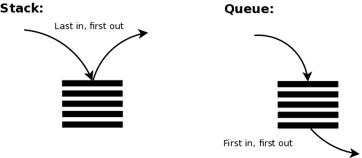

❤️‍🔥 TIL : Today I Learned

:::note 목차

1. 실행 컨텍스트란?
2. VariableEnvironment 와 LexicalEnvironment [ VE, LE ]
3. LexicalEnvironment(1) - EnvironmentRecord(= record)와 호이스팅
4. OuterEnvironmentReference(= outer)

:::

<!--truncate-->

## 실행 컨텍스트란

실행할 코드에 **환경 정보를 제공하는 객체**이다!



(이미지 출처 : [velog - 스택(STACK)과 큐(QUEUE)](https://velog.io/@leejuhwan/스택STACK과-큐QUEUE))

실행컨텍스트를 모아 콜 **스택**에서 처리하게 된다! 콜스택에서는 가장 위에 쌓인 컨텍스트와 관련된 코드를 실행하는 방법이며, 코드의 환경 및 순서를 보장한다.

**컨텍스트 구성 방법**

전역 공간 > `eval()` 함수 > **함수(우리가 실행컨텍스트를 구성하는 방법)**

**컨텍스트 구성 예시**

```js
// ---- 1번
var a = 1;
function firstFunc() {
  function SecondFunc() {
    console.log(a); // undefined
    var a = 3;
  }
  SecondFunc(); // ---- 3번
  console.log(a);
}
firstFunc(); // ---- 2번
console.log(a);
```

예시 코드 순서 :

코드실행 → 전역(in) → 전역(중단) + `firstFunc`(in) → `firstFunc`(중단) + `SecondFunc`(in) → `SecondFunc`(out) + `firstFunc`(재개) → `firstFunc`(out) + 전역(재개) → 전역(out) → 코드종료

※ 전역 컨텍스트는 js 파일이 실행되는 시점에 default 로 생긴다.

**실행 컨텍스트 객체**

- 생성(활성화) 시점 : 하나의 '실행 컨텍스트'가 콜 스택의 맨 위에 쌓이는 순간이 곧 현재 실행할 코드에 관여하게 되는 시점
- 생성시점 : 코드를 실행 하는데 필요한 환경 정보를 수집하고, 실행 컨텍스트 객체에 저장
- 실행 컨텍스트에 담기는 정보
  - `VariableEnvironment`
    1. 현재 컨텍스트 내의 식별자 정보
    2. 외부 환경 정보
    3. 선언 시점 `LexicalEnvironment` 의 snapshot
  - `LexicalEnvironment`
    - `VariableEnvironment` 와 동일하나 변경사항이 실시간 반영
  - `ThisBinding`
    - `this` 식별자가 바라봐야 할 객체

## VariableEnvironment 와 LexicalEnvironment

- 보통 줄여서 VE 와 LE 라고 한다. 담기는 내용은 동일하지만 스냅샷 유지 여부만 다르다. VE : 유지 / LE : 유지하지 않음
- 실행 컨텍스트를 생성할 때, VE 에 정보를 먼저 담고, 이를 그대로 복사하여 LE를 만들고 이후에는 주로 LE를 활용한다.
- 구성요소는 동일하며 `environmentRecord` 와 `outerEnvironmentReference`로 구성된다.
  - `environmentRecord`(=record) : 현재 컨텍스트와 관련된 코드의 식별자 정보가 저장. 함수에 지정된 매개변수 식별자, 함수 자체, `var` 로 선언된 변수 식별자 등
  - `outerEnvironmentReference`(=outer)

## LexicalEnvironment(1) - EnvironmentRecord(= record)와 호이스팅

**개요**

- 현재 컨텍스트와 관련된 코드의 식별자 정보가 저장(수집),
- 수집 대상 정보 = 함수에 지정된 매개변수 식별자, 함수 자체, `var` 로 선언된 변수 식별자 등,
- 컨텍스트 내부를 처음부터 끝까지 순서대로 훑어가며 수집

**호이스팅**

- 변수정보 수집이 완료되어도 아직 실행 컨텍스트가 관여할 코드는 실행 전의 상태이다. (js 엔진은 코드 실행 전 이미 모든 변수정보를 알고 있는 것)

## LexicalEnvironment(2) - 스코프, 스코프 체인, outerEnvironmentReference(=outer)

**주요 용어**

- 스코프 : 식별자에 대한 유효 범위
- 스코프 체인 : 식별자의 유효범위를 안에서부터 바깥으로 차례로 검색해 나가는 것
- `outerEnvironmentReference` : 스코프 체인이 가능토록 하는 것(외부 환경의 참조정보)

**스코프 체인**

- `outer`는 현재 호출된 함수가 선언될 당시의 `LexicalEnvironment`를 참조
- ex) A함수 내부에 B함수 선언 → B함수 내부에 C함수 선언(Linked List)
- 오직 자신이 선언된 시점의 `LexicalEnvironment`를 참조하고 있으므로, 가장 가까운 요소부터 차례대로 접근 가능
- 결론 : 무조건 스코프 체인 상에서 가장 먼저 발견된 식별자에게만 접근이 가능

**전역 변수와 지역 변수**

- 전역변수 : 전역 공간에서 선언한 변수
- 지역변수 : 함수 내부에서 선언한 변수

:::tip 최종 정리

1. 실행 할 코드에 환경을 만들어 주는 것이 실행컨텍스트 = 콜 스택 방식
2. 우리는 보통 코드를 작성할 때 함수 코드를 다룰 때 실행컨텍스트를 구성한다
3. 실행 컨텍스트 객체의 정보 : VE, LE, ThisBinding (VE와 LE의 내용은 동일하다 하지만,)
4. 스냅샷 유지 여부 = VE : 유지 / LE : 유지하지 않음
5. record : js 엔진은 코드 실행 전 이미 모든 변수정보를 알고 있다, 호이스팅 으로 인해
6. outer : 스코프는 `{ }` 와 같은 블럭 안에 유효한 범위를 이야기 하며, 없다면 스코프체인으로 이동한다
7. 스코프 체인 : 해당 스코프에 존재하지 않으면 바깥에서 찾음

:::

{/* 이 글은 Tistory(https://hyoloui.tistory.com/40)에서 옮겨 온 글입니다. 원문 작성일: 2022-12-01 */}
