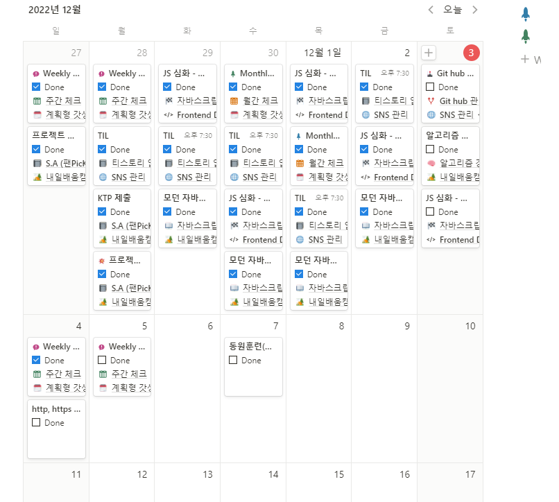

:::note WIL: Weekly I Learned

1. **티스토리** 포스팅 = **매일 TIL 일지**
2. fanpick 프로젝트 = 발표 및 KTP 회고
3. 모던 자바스크립트 = 기초, 브라우저 정독
4. JS 심화 = 강의 3회 정주행

:::

<!--truncate-->

## Weekly review

### 티스토리 포스팅

내용에 들어가는 내용에 핵심적인 부분만 담고 나머지 공부한 내용은 따로 포스팅 해야겠다.

다른 팀원들의 TIL 을 보고 난 후 현재까지 작성했던 TIL 은 내용모두를 상세하게 적어 효율적인 공부를 하지 않는 것 같다고 느꼈다.

TIL 은 오늘 공부한 내용의 핵심만을 요약하여 작성하고 해당 하는 카테고리의 키워드 중심으로 배운 내용을 코드에 작업하는 방법, 작업 내용을 중심으로 작성 하도록 시도 해야겠다!

WIL 또한 LEARN 이기에 배운 내용적인 부분을 다시한번 되새기며 작성하는 방향으로 해야겠다.

---

### Fanpick 프로젝트

발표와 KTP 회고로 마무리가 되었다.

발표는 처음으로 많은 수강생분들 앞에서 줌을 활용해 온라인으로 발표를 했고, 발표를 하면서도 내용적인 부분이 조금 아쉬웠다. 더 디테일하게 코드 중심으로 발표를 했어야 했는데 팀원 별 수행과제(기능) 중심적인 발표가 되었던 것 같다..

아쉬웠지만 이번을 계기로 한층 성장 할 수 있게된 계기가 되었다고 생각한다.

---

### 모던 자바스크립트

가끔 구글링 중 모던 자바스크립트에 나와있는 기초 문법을 통해 작동원리를 이해하고 적용했던 적이 있다. 튜터님들의 '자바스크립트 기초 tutorial' 로 모던 자바스크립트를 추천해주셔서 수강생이 대부분 정독하고 있다.

또 읽으면서 조금씩 자바스크립트의 역사(?) 와 특정 메서드 동작원리 등을 이해 할수 있고, 교과서적인 내용이 많이 담겨있어 깊이있게 학습이 가능하다. 또한 페이지 밑부분에는 실습할 수 있도록 예제들을 활용해 학습이 가능했다.

다음 주차부터 react 강의를 앞에 두고있어, 실습 까지 진행하지 않고 해설을 보며 정독 하고 있다.

### JS 심화

기초문법을 익히고, 코드를 짜면서 어느정도의 감은 생겼지만 이론적인 부분과 깊이 있는 이해가 필요하다고 생각했었으나, 이번 주차 심화 강의가 올라오게 되어 재미있게 시청했다.

하지만 이론적인 부분은 시간이 지나면서 집중력과 호기심을 떨어트리기 마련이다..ㅠㅠ 또 갈수록 내용의 깊이와 다른 코드의 연관이 더해져 머리를 아프게 했다.

강의 중에서 '어려우면 다시 반복하세요' 라는 말에 계속 반복하기로 했다. 사실 'JS심화' 강의에서 이해가 덜 된 상태로 TIL 작성하기가 너무 힘들었다.

그래서 TIL 은 간략히 핵심을 적어놓고, 코드에 적용하고 완전히 이해하면서 해당하는 부분을 포스팅해야겠다고 마음을 먹게 되었다.

공부 내용은

- 데이터 타입
- 실행 컨텍스트
- 명시적 THIS 바인딩
- 콜백함수
- 클로져

가 되었다.

---

하루 15시간 가량 의자에 앉아 보내며 해를 못보는 날이 많아 정신건강과 신체건강 악화가 염려된다....ㅎ

주변 센터를 알아보고 있는데 과연 어느 시간에 해야할 지 고민중이다. 알고리즘, cs, js 스터디도 진행중인데 과연 어느 시간에 소화를 할 수 있을지 계산중이다ㅜㅜ

또 운동을 하면서 음식섭취를 중요시 하는 스타일이라 신경써야 할 부분이 많아지는데.. 차라리 몸이 두 개면 좋겠다😥

그리고 노션을 통해 약, 한 달간 스케줄 관리를 하고 있는데 매우 편리하고 좋은 것 같다.

템플릿을 잘 활용하고 컴퓨터 켜자마자 노션을 열어 작성을 하면 일과를 체크하며 알차게 보낼 수 있다.

다음 한주도 노션을 통해 알찬 일주일 보내고 다시 WIL 로 돌아오겠다!

빠이팅그.

|                          | 1 week                                                                                                                                                              | 2 week                                                     | 3 week                                      | 4 week (project)                                           | 5 week                                                                  |
| ------------------------ | ------------------------------------------------------------------------------------------------------------------------------------------------------------------- | ---------------------------------------------------------- | ------------------------------------------- | ---------------------------------------------------------- | ----------------------------------------------------------------------- |
| 학습 내용 (프로젝트)             | 웹개발 종합반 - HTML, CSS, Javascript, jQuery, JSON, AJAX, Python, Flask, MongoDB (로그인 페이지, 팬명록, 지니뮤직 크롤링, 화성땅 공동구매, 스파르타피디아, 버킷리스트, nohup 배포) | 자바스크립트(Javascript), 파이썬(python), 자료구조와 알고리즘(algorithm) | 버전관리프로그램(Git, github), 자료구조와 알고리즘(algorithm) | Firebase 활용 한 SPA(single page application) Project - fanpick | 프로젝트 마무리, JS 심화 - 데이터 타입, 실행컨텍스트, 명시적 THIS 바인딩, 콜백함수, 클로져, 모던자바스크립트 정독 중 |
| 사용 툴 (default : VS code) | Bootstrap, Git Bash, FileZila, AWS(ec2), gabia                                                                                                                    | Git, Git hub                                               | Git, Git hub, sourcetree, programmers       | Git, Git hub, sourcetree, firebase                         | 강의, 유튜브, 모던자바스크립트 SITE                                                  |

{/* 이 글은 Tistory(https://hyoloui.tistory.com/43)에서 옮겨 온 글입니다. 원문 작성일: 2022-12-03 */}
