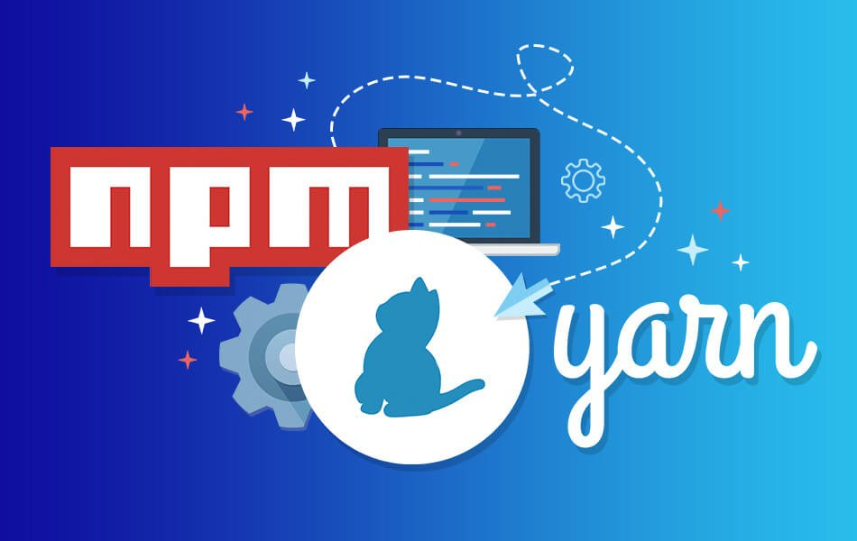

❤️‍🔥 TIL : Today I Learned



## yarn vs npm

우선 둘은 가장 활발하게 사용되는 자바스크립트 런타임 환경인 node.js의 프로젝트 '패키지 관리자' 이다.

<!--truncate-->

1. yarn
2. yarn 설치
3. npm
4. npm 설치
5. 둘의 차이점

## yarn

페이스북에서 개발한 패키지 관리자 이며, 리액트 와 같은 프로젝트를 진행하며 겪는 어려움을 해결하기 위해 개발하였고, npm 레지스트리와 호환 하면서 속도, 안정성 측면에서 npm 보다 향상 되었다.

페이스북 아티클: [Yarn: A new package manager for JavaScript](https://engineering.fb.com/2016/10/11/web/yarn-a-new-package-manager-for-javascript/)

### yarn 설치

yarn 은 npm 을 통해 설치한다. node 와 npm 이 설치 되어있다면 간단하게 터미널에서 설치할 수 있다.

```bash
npm install yarn --global
```

맥 사용자는 brew를 사용해 설치할 수 도 있다.

```bash
brew update
brew install yarn
```

## npm

npm은 Node Package Manager 의 약어 이다. node 를 설치할때 자동으로 설치되니 node 를 설치한 유저라면 기본적으로 같이 설치되어있다고 보면 된다.

npm은 크게 두가지 역할을 하는데,

1. 온라인 플랫폼 : 사람들이 노드 패키지를 만들고 업로드하여, 공유가 가능하다. 라이브러리, 확장프로그램 등과 유사하다
2. 명령 줄 인터페이스 : 온라인 플랫폼과 상호작용을 위해 명령 줄 인터페이스 사용으로 패키지 설치, 제거가 가능하다

### npm 설치

node를 설치하면서 자동적으로 설치가 된다. 하지만 본인 pc 환경에 설치 유무와 버전을 확인하고자 한다면 아래 명령어를 통해 확인이 가능하다.

```bash
node -v
npm -v
```

### 명령어 비교

| 구분                | npm                                  | yarn                         |
| ------------------- | ------------------------------------ | ---------------------------- |
| dependencies 설치   | `npm install`                        | `yarn`                       |
| 패키지 설치         | `npm install [패키지명]`             | `yarn add [패키지명]`        |
| dev 패키지 설치     | `npm install --save-dev [패키지명]`  | `yarn add --dev [패키지명]`  |
| 글로벌 패키지 설치  | `npm install --global [패키지명]`    | `yarn global add [패키지명]` |
| 패키지 제거         | `npm uninstall [패키지명]`           | `yarn remove [패키지명]`     |
| dev 패키지 제거     | `npm uninstall --save-dev [패키지명]`| `yarn remove [패키지명]`     |
| 글로벌 패키지 제거  | `npm uninstall --global [패키지명]`  | `yarn global remove [패키지명]` |
| 업데이트            | `npm update`                         | `yarn upgrade`               |
| 패키지 업데이트     | `npm update [패키지명]`              | `yarn upgrade [패키지명]`    |

## 그래서 둘중 뭐가 좋은데? yarn과 npm의 차이점

**속도**

주요 차이점 중 하나는 패키지 설치 프로세스를 처리하는 방법이다. npm 은 패키지를 한 번에 하나씩 설치하지만, yarn 은 여러 패키지를 동시에 가져오며 설치하도록 세팅되어 패키지 설치 속도 측면에서 yarn 이 우세하다고 볼 수 있다.

**보안**

yarn 은 보안 측면에서 npm 보다 안전하다고 알려져 있다. npm 은 자동으로 패키지에 포함된 다른 패키지 코드를 실행한다. 이로 인해 보안 시스템에 취약하다고 할 수 있는데, 반면 yarn 은 `yarn.lock` 이나 `package.json` 파일에 존재하는 파일만을 설치한다.

보안은 yarn의 핵심 기능 중 하나였으나, 최근 npm의 업데이트로 npm의 보안 업데이트도 크게 향상 되었다고 한다.

**결론**

yarn 과 npm 둘 다 종속성을 관리하고 패키지를 관리하기 좋은 툴 이며, 둘 다 지속적인 관리와 폭넓은 커뮤니티가 형성되어 업데이트를 통한 추가 기능으로 **거의 차이 나지 않게 되었다**.

결론적으로 둘 중에서는 **개인의 취향, 성능(패키지 설치 속도), 커뮤니티에 따라** 편하게 선택하면 된다.

:::tip 최종 정리

1. yarn 은 패키지 설치 속도가 빠르다
2. npm 은 node 설치 시 포함되어 따로 install이 필요 없다
3. 지속적 업데이트로 둘 중 성능적인 면에서 별 차이가 없어 개인 취향에 따르도록 한다.

:::

{/* 이 글은 Tistory(https://hyoloui.tistory.com/44)에서 옮겨 온 글입니다. 원문 작성일: 2022-12-05 */}
