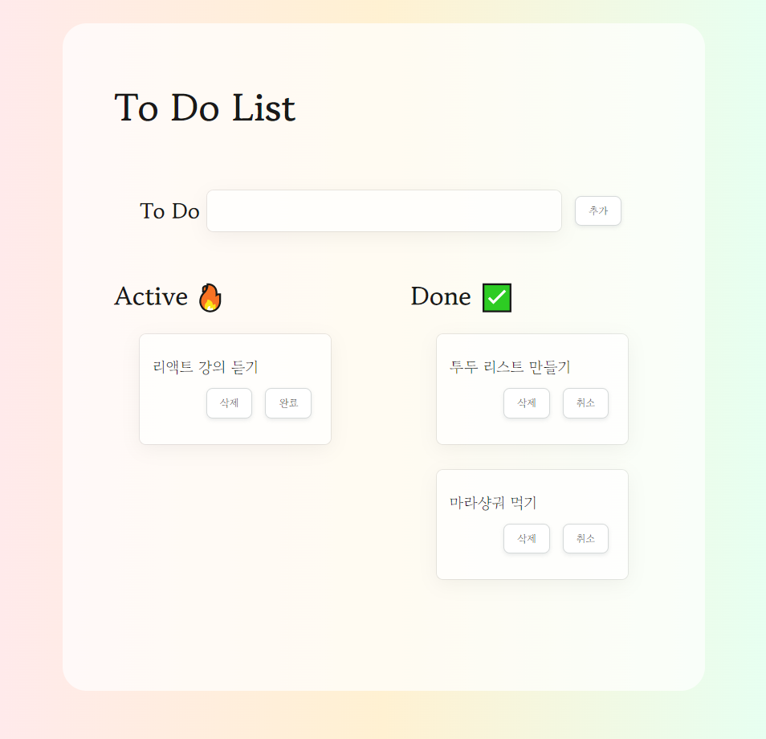
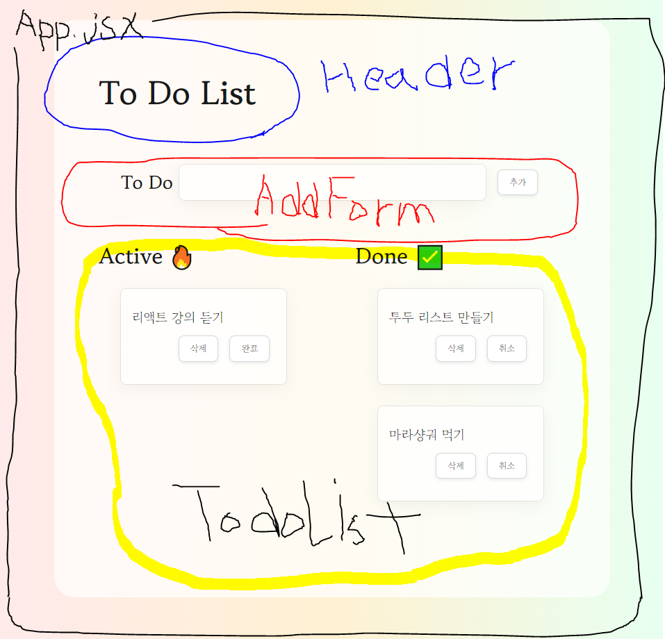
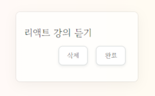

TIL : Today I Learned

<!--truncate-->

## 코드 구조 파악하기

:::note

이번 react-todo-list 과제를 진행 하면서 참조했던 repository를 활용하여 코드 구조를 파악하면서 다시 한번 component, props, state 의 개념에 대해서 설명한다.

참조 - [https://github.com/su-no/react-todo-list](https://github.com/su-no/react-todo-list)

:::



_app.js 원본_



_구조를 component 별로 나눈 형태_

App.jsx 와 Todo.jsx 코드를 보며 설명 하겠다.

### App.jsx

component 파일의 확장명은 js 로 사용해도 되고 jsx 로 사용해도 된다. 하지만 React에 쓰이는 파일이라는 것을 조금 더 명시적으로 표현하기 위해 jsx 를 많이 사용한다.

```jsx title="App.jsx"
import { useState } from 'react'; // useState 사용
import { v4 as uuid } from 'uuid'; // 고유 id값을 넣기 위한 uuid import
import './App.css'; // css file
// Components
import Header from './components/Header/Header'; // 헤더
import AddForm from './components/AddForm/AddForm'; // 인풋,버튼 이 들어있는 폼
import TodoList from './components/TodoList/TodoList'; // 투두리스트 보여주기

// -------------------------------------------------------------------------------------------

// export == 밖으로 전달 할 수 있게 component 앞에 export 한다
export default function App() {
  const [todos, setTodos] = useState(initialTodos); // todos 라는 state

  return (
    <div className="container">
      {/* 제목 */}
      <Header>Hyojin's To Do List</Header>
      {/* Todo 입력하고 추가하는 form */}
      <AddForm setTodos={setTodos} />
      {/* active/done 투두리스트 */}
      <div className="todo-lists">
        {/* active == 아직 완료하지 않은 투두리스트 */}
        <TodoList name="active" todos={todos} setTodos={setTodos} />
        {/* done == 완료한 투두리스트 */}
        <TodoList name="done" todos={todos} setTodos={setTodos} />
      </div>
    </div>
  );
}

// -------------------------------------------------------------------------------------------

// todo 초기값
const initialTodos = [
  {
    id: uuid(),
    isDone: false,
    todo: '리액트 강의 듣기',
  },
  {
    id: uuid(),
    isDone: true,
    todo: '투두 리스트 만들기',
  },
  {
    id: uuid(),
    isDone: true,
    todo: '마라샹궈 먹기',
  },
];
```

3단락으로 분리하여 설명 하겠다.

1. 첫 번째는 App.jsx 에 불러와 연결시켜주기 위한 import 구문이다. 우리가 만드는 component 파일에서는 각 함수 앞에 export를 해주거나, 맨 밑에 `export default 함수명` 구문을 작성해주어서 이 함수를 외부 파일에 연결시키도록 export 하겠다 라는 구문이 있어야 외부 파일에서도 import가 가능하다.
2. 두 번째 단락에서도 마찬가지로 function App 을 export 하고 있으며, state를 사용하기 위해 todos라는 state를 만들었고, `useState(기본값)` 안에 initialTodos를 넣었다. 또한 해당 App에서 보여줄 내용을 return 한다. 맨 위에서 import한 (가져와서 연결시킨) Header, AddForm, TodoList 컴포넌트를 여기에 보여주고 있으며 해당 컴포넌트에 데이터를 전달 하는 props가 잘 작성되어 있다.
3. 마지막 initialTodos는 초기에 보여주고 싶은 todos 의 객체들이 array 안에 들어있다.

### Todo.jsx



_Todo.jsx는 initialTodos 에 들어있는 객체를 각각 카드의 형태로 만들어주는 component 이다_

```jsx title="Todo.jsx"
import React from 'react'; // React 기본 세팅
import Button from '../Button/Button'; // 버튼 연결
import './style.css'; // css 연결

// Todo 함수를 export 하여 다른 파일에서도 읽을수 있도록 만들어주고,
// 파라미터에는 App.jsx 에서 전달된 props 를 구조 분해 할당으로 받아주었다
export default function Todo({ todo, isDone, id, setTodos }) {
  // todo 제거하는 함수
  const deleteTodo = () => {
    // setTodos 하여 해당 todo를 제외한 todos 배열을 업데이트 (삭제버튼이 클릭된 카드가 아닌 todos들만 보여주기)
    setTodos((prev) => prev.filter((t) => t.id !== id));
  };

  // 완료된 todo 취소하는 함수
  const cancelTodo = () => {
    setTodos((prev) =>
      prev.map((t) => {
        // 해당 todo의 isDone을 false로 변경
        if (t.id === id) {
          return { ...t, isDone: false };
        }
        // 다른 todo는 그대로 반환
        return t;
      }),
    );
  };

  // todo를 완료하는 함수
  const doneTodo = () => {
    setTodos((prev) =>
      prev.map((t) => {
        // 해당 todo의 isDone을 true로 변경
        if (t.id === id) {
          return { ...t, isDone: true };
        }
        // 다른 todo는 그대로 반환
        return t;
      }),
    );
  };

  // todo를 각 li 태그로 넣으며 id를 붙여준다
  return (
    <li className="todo__container" id={id} key={id}>
      {/* todo의 내용 */}
      <p className="todo">{todo}</p>
      {/* 버튼 영역 */}
      <div className="buttons">
        {/* 삭제버튼 */}
        <Button handleClick={deleteTodo} value="삭제" />

        {/* 삼항연산자로 isDone을 구분한 취소/완료 버튼 */}
        {isDone ? (
          // 완료된 todo는 취소버튼 표시
          <Button handleClick={cancelTodo} value="취소" />
        ) : (
          // 완료되지 않은 todo는 완료버튼 표시
          <Button handleClick={doneTodo} value="완료" />
        )}
      </div>
    </li>
  );
}
```

여기서 어려웠던 부분은 삭제, 완료 버튼에 setTodos(setState) 를 하는 부분이였다.

하지만 풀어보자면 setTodos 에 인자(prev)로 들어오는 내용은 useState인 initialTodos 이고, initialTodos는 배열 형태로 객체를 만들어 주었으니, map, filter 메서드를 사용 가능하다.

이후에 prev 를 map, filter로 각 데이터에 직접 접근 하게 된다.

여기서 `...t` (spread: 전개 연산자)는 해당 todo의 나머지 데이터들인 id, todo 는 내버려두도록 다시 나열해 주는 것이라고 생각하면 된다. 이후 isDone 이 가진 데이터만 false 라고 바꿔주는 코드이다.

:::tip 최종 정리

1. import는 다른 파일이나 라이브러리 등을 가져와 작성 중인 파일에 적용시킬 수 있도록 연결 하는 구문이다.
2. 내가 만든 컴포넌트도 export 하여 다른 파일에서 적용할 수 있도록 만들어준다.
3. 데이터를 배열 안에 객체 형태로 넣어주어야 활용이 유용하다. map, filter 등
4. setState를 사용할 때는 useState 즉 데이터의 기본 구조가 어떻게 되어있는지를 잘 파악해야 한다.
5. spread (전개 연산자) 는 데이터에서 원하는 데이터를 수정하고, 나머지 데이터는 다시 내버려두도록 활용할 때 유용하다.

:::

{/* 이 글은 Tistory(https://hyoloui.tistory.com/50)에서 옮겨 온 글입니다. 원문 작성일: 2022-12-11 */}
