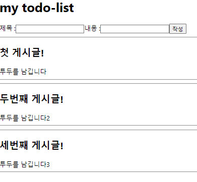
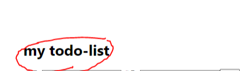
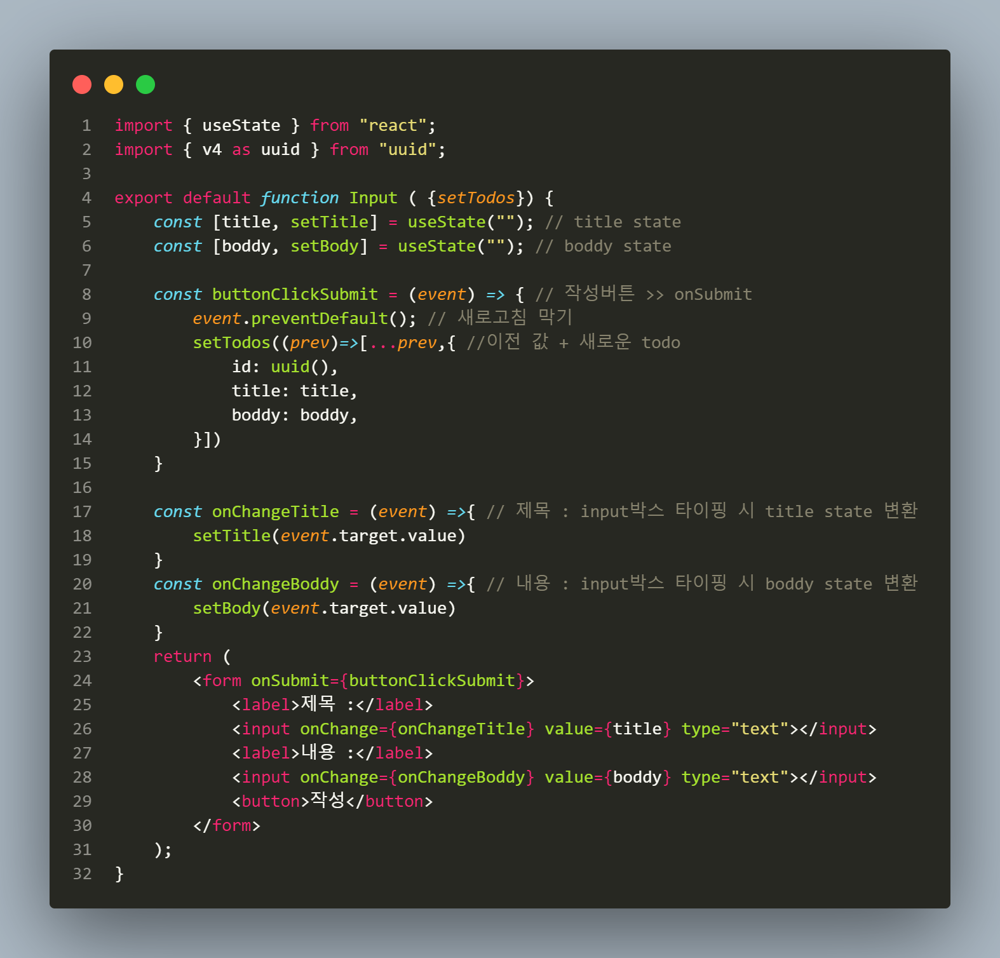
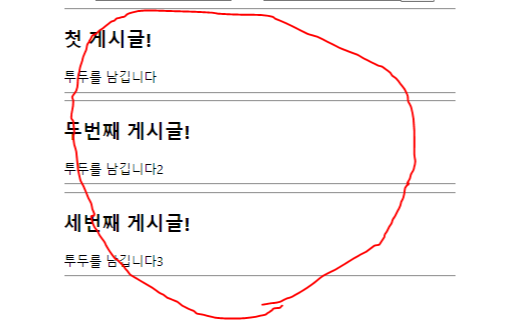

TIL : Today I Learned

[https://youtu.be/0-aYlQErLa8](https://youtu.be/0-aYlQErLa8)

<!--truncate-->

작업 컴포넌트 구조

```text
App.jsx/
  pages/
    Header.jsx
    Input.jsx
    TodoList.jsx
```

## App.jsx

:::note

메인이 되어 하위 컴포넌트를 모두 가지고 있는 컴포넌트. 기본 state를 (데이터 테이블) 갖고 있게 하여 하위 컴포넌트에 state를 props 전달하였다.

:::

```jsx title="App.jsx"
import { useState } from 'react';
import './App.css';
import Header from './pages/Header.jsx';
import Input from './pages/Input.jsx';
import TodoList from './pages/TodoList.jsx';

function App() {
  const [todos, setTodos] = useState(initialTodos); // todos state
  return (
    <main>
      <Header> my todo-list </Header>
      <Input setTodos={setTodos}></Input>
      <TodoList todos={todos}></TodoList>
    </main>
  );
}

// 기본 Todos 데이터
const initialTodos = [
  {
    id: 1,
    title: "첫 게시글!",
    boddy: "투두를 남깁니다",
  },
  {
    id: 2,
    title: "두번째 게시글!",
    boddy: "투두를 남깁니다2",
  },
  {
    id: 3,
    title: "세번째 게시글!",
    boddy: "투두를 남깁니다3",
  },
];

export default App;
```



_이렇게 간단한 구조다!_

## (컴포넌트 폴더) pages/

### Header.jsx

:::note

children 활용하여 하위 컴포넌트에 text 를 내려주는 컴포넌트

:::



```jsx title="Header.jsx"
const Header = ({ children }) => {
  return <h1>{children}</h1>;
};

export default Header;
```

간단하게 children props를 이용하여 App.jsx에 있는 text를 가져올 수 있다.

### Input.jsx

:::note

input 박스의 변화(타이핑)를 감지하여 onChange 함수를 실행하게 하고, 감지한 값을 setState로 넣는다.

:::



```jsx title="Input.jsx"
import { useState } from "react";
import { v4 as uuid } from "uuid";

export default function Input({ setTodos }) {
  const [title, setTitle] = useState(""); // title state
  const [boddy, setBody] = useState(""); // boddy state

  const buttonClickSubmit = (event) => {
    // 작성버튼 >> onSubmit
    event.preventDefault(); // 새로고침 막기
    setTodos((prev) => [
      ...prev,
      {
        // 이전 값 + 새로운 todo
        id: uuid(),
        title: title,
        boddy: boddy,
      },
    ]);
  };

  const onChangeTitle = (event) => {
    // 제목 : input박스 타이핑 시 title state 변환
    setTitle(event.target.value);
  };
  const onChangeBoddy = (event) => {
    // 내용 : input박스 타이핑 시 boddy state 변환
    setBody(event.target.value);
  };
  return (
    <form onSubmit={buttonClickSubmit}>
      <label>제목 :</label>
      <input onChange={onChangeTitle} value={title} type="text"></input>
      <label>내용 :</label>
      <input onChange={onChangeBoddy} value={boddy} type="text"></input>
      <button>작성</button>
    </form>
  );
}
```

여기서 어려웠던 부분은 buttonClickSubmit 이였다.

새로고침 막기를 한 후로 10초간 생각했다... 뭘 해야 넣을 수 있을까?

1. setTodos를 props로 받아오자!
2. setTodos에서 '이전 값' 을 유지해야 한다
3. 새로운 객체를 기존 형식에 맞게 넣어준다

다행히 수업자료를 참고해서 파라미터를 이용해 이전 값을 prev 라는 변수로 받아오고, 변수를 전개 연산자를 통해 나열해 준 후 뒤에 `{ 새로운 데이터 객체 }` 를 넣어준다.

변수명은 prev 가 아니어도 상관 없지만 통상 prev 라고 칭한다.

여기서 prev 때문에 헷갈릴 수 있다. 하지만 (이전 값) == (현재 todos 값) 이라고 생각하면 편하다.

또, 실수한 부분은 `setTodos(() => { })` 이렇게 넣어서 오류가 발생했다. 왜냐하면 우리는 기존에 있는 initialTodos 를 객체형 배열 `[ { }, { }, { } ... ]` 형태로 넣어줬는데 기존 블럭을 지켜주지 않아서 생긴 문제다.

그래서 다시 `setTodos(() => [ , ])` 형식에 맞춰 넣어 문제가 해결 되었다!

### TodoList.jsx

:::note

Input.jsx 에서 initialTodos 에 새로운 todo 를 업데이트 시켜주었다. 하지만 아직 우리는 initialTodos 를 스크린에 렌더링하는 구문을 작성하지 않았다. TodoList 컴포넌트에서 그 역할을 하게 된다.

:::



```jsx title="TodoList.jsx"
export default function TodoList({ todos }) {
  return (
    <section>
      {/* props 로 전달받은 todos 를 하나씩 받아 html 형태로 생성 */}
      {todos.map((todo) => {
        return (
          <div key={todo.id}>
            <hr />
            <h1>{todo.title}</h1>
            <span>{todo.boddy}</span>
            <hr />
          </div>
        );
      })}
    </section>
  );
}
```

여기서는 `map()` 메서드를 사용해 todos를 하나 하나 나열해 주었다.

1. 당연히 필요한 todos 를 props 로 받아온다
2. 넣을 태그 안에 `{todos}` 를 작성하고 map 메서드를 작성한다
3. map을 돌며 하나씩 받아온 객체의 변수명(파라미터) 를 todo로 지정한다
4. `return ( );` 안에 jsx 문법에 맞춰 html 형태를 만든다
5. 넣어준 각 태그에 todo 가 가진 key 값을 지정해 준다.
6. 또한 상위 `<div>` 태그에는 key값을 가지도록 지정해 준다. 미작성 시 에러(react 자체 기능)

:::tip 최종 정리

1. Header.jsx: 상위 컴포넌트인 App.jsx 에서 children 을 props 로 넘겨주지 않아도 하위 컴포넌트의 파라미터에서 children 을 받게 해주면 자동으로 가져온다.
2. Input.jsx: input 태그에서 받은 내용을 state에 전달하고, onSubmit 되면 setState 를 해야 한다. 이때 setState의 인자로 state 내용을 전달하기 위해 `(prev) => [...prev, ]` 구문을 작성해 준다.
3. TodoList.jsx: props로 받은 state를 하나씩 가져오기 위해 `map()` 메서드를 사용하며, return 으로 데이터를 jsx 형식으로 넣어준다. 또 상위 div 에는 key를 붙여줘야 한다.

:::

{/* 이 글은 Tistory(https://hyoloui.tistory.com/58)에서 옮겨 온 글입니다. 원문 작성일: 2022-12-14 */}
