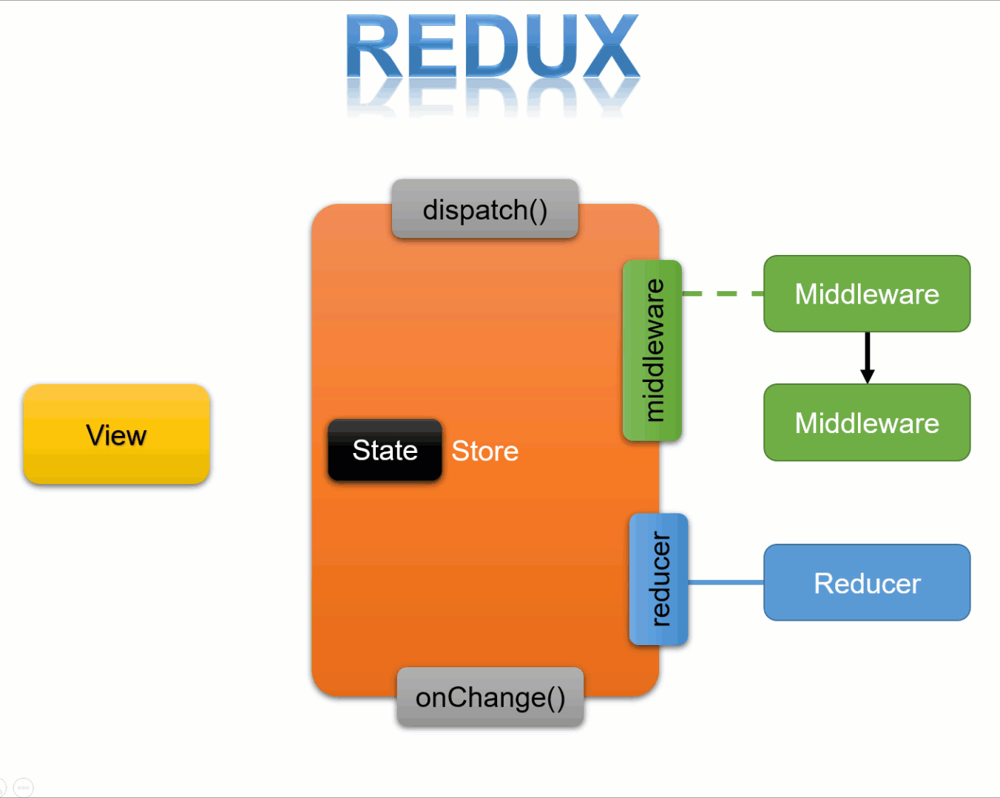

TIL : Today I Learned

1. 리덕스의 정의
2. 리덕스의 핵심 요소
3. 리덕스의 흐름

<!--truncate-->

## Redux 란?

Redux 공식 사이트의 정의: **자바스크립트 앱을 위한 예측 가능한 상태 컨테이너**

- 예측 가능한: 일관적으로 동작하고, 서로 다른 환경(클라이언트, 서버, 네이티브)에서도 실행되며, 테스트하기 쉬운 앱을 작성하도록 도와준다.
- 중앙화된: 앱의 상태와 로직을 중앙화하여 실행 취소/다시 실행, 영속적인 상태 등의 강력한 기능을 사용할 수 있게 한다.
- 디버깅이 쉬운: Redux DevTools는 앱의 상태가 언제, 어디서, 왜, 어떻게 바뀌었는지 쉽게 추적할 수 있도록 해준다.
- 유연한: 어떤 UI 레이어에서도 동작하며, 여러분의 요구에 부합하는 거대한 애드온 생태계를 가지고 있다.

> 프론트엔드 개발자들은 "리덕스"를 전역 상태관리 라이브러리 라고 많이 표현한다.
>
> 전역 상태, 즉 Global State를 의미하고 그것을 관리하게 도와주는 라이브러리 (패키지) 이기 때문이다.

## 리덕스 핵심 요소

- **Action**: State가 변하는 것. "무엇이 일어날지"
- **Reducer**: 변화를 일으키는, 즉 데이터(state)를 수정하는 함수. action을 통해 어떠한 행동을 정의했다면, 그 결과 어플리케이션의 상태가 어떻게 바뀌는지는 특정하게 되는 함수이다.
- **Store**: action과 action에 따라 상태를 수정하는 reducer를 저장하는 어플리케이션에 있는 단 하나의 객체. 스토어는 State 를 수시로 확인해 View 한테 변경된 사항을 알려주는 역할을 한다.
- **Dispatch**: 스토어의 내장 함수 중 하나로 리듀서에게 Action 을 발생하라고 시키는 것. store에서 reducer 함수를 실행시켜 state를 업데이트한다.
- **Subscribe**: 액션이 디스패치 될 때마다 전달해준 함수를 호출한다.
- **Middleware**: 액션을 디스패치 했을 때 리듀서에서 이를 처리하기에 앞서 사전에 지정된 작업들을 실행한다. thunk 와 saga 가 대표.

> useState로 생성한 State는 Local State 이고, 리덕스에서 생성한 State는 Global State 이다.

## 리덕스의 흐름 (cycle 구조)

1. View 에서 액션이 일어난다.
2. dispatch 에서 action이 일어나게 된다.
3. action에 의한 reducer 함수가 실행되기 전에 middleware가 작동한다.
4. middleware 에서 명령 내린 일을 수행하고 난 뒤, reducer 함수를 실행한다. (3, 4번은 아직 몰라도 됩니다!)
5. reducer 의 실행 결과 store에 새로운 값을 저장한다.
6. store의 state에 subscribe 하고 있던 UI에 변경된 값을 준다.

:::tip 최종 정리

1. 리덕스는 useState를 사용했을 때 발생하는 불편함, props Drilling 문제를 해소하는 전역 상태 관리 라이브러리
2. 리덕스에서 생성한 State는 Global State
3. action → dispatch → middleware → reducer 실행 → store 저장 → UI 변경

:::

출처 : [https://velog.io/@annahyr/리덕스-흐름-이해하기](https://velog.io/@annahyr/리덕스-흐름-이해하기)

{/* 이 글은 Tistory(https://hyoloui.tistory.com/63)에서 옮겨 온 글입니다. 원문 작성일: 2022-12-15 */}
