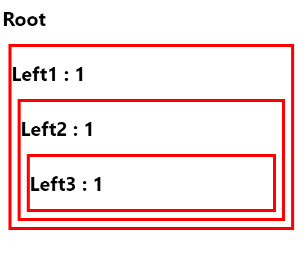
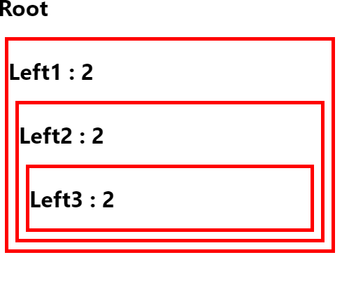
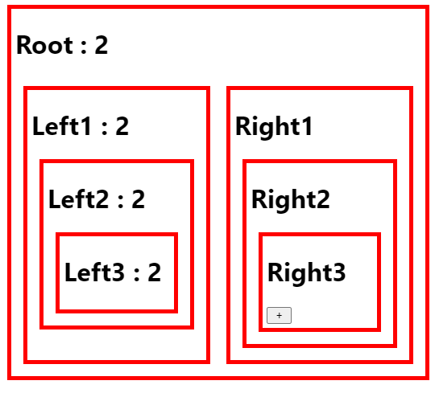
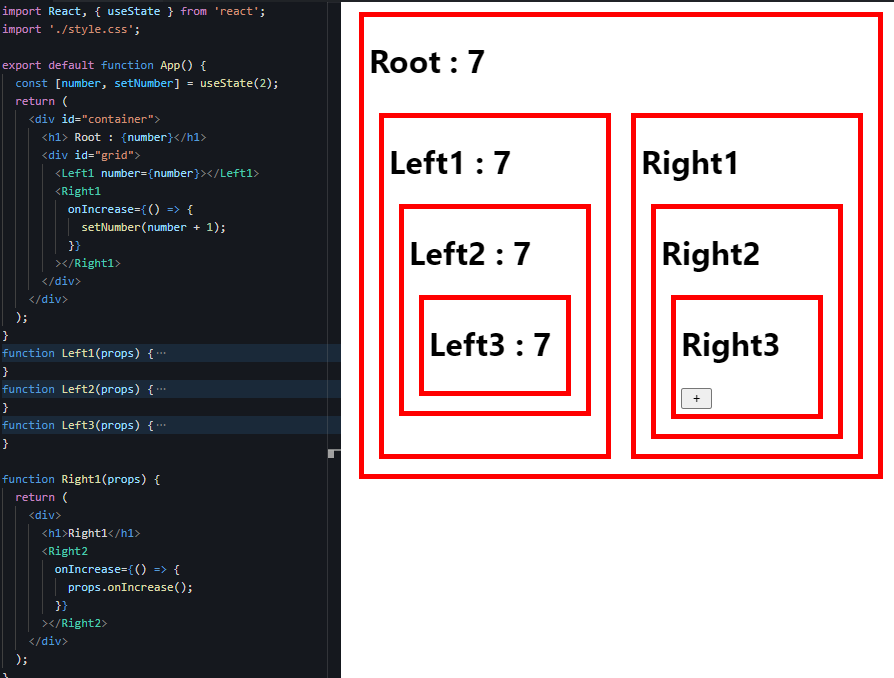

TIL : Today I Learned

:::note

component에서 props 로 state 값을 전달하는 것 == 유선 연결

redux에서 관리하는 state 는 == 무선 연결 (블루투스)

:::

<!--truncate-->

## Prop Drilling

> Props Drilling은 props를 오로지 하위 컴포넌트로 전달하는 용도로만 쓰이는 컴포넌트를 거치면서 React Component 트리의 한 부분에서 다른 부분으로 데이터를 전달하는 과정이다.

### props drilling 예시, 코드



```jsx title="App.jsx"
import React, { useState } from 'react';
import './style.css';

export default function App() {
  const [number, setNumber] = useState(1);
  return (
    <div id="container">
      <h1> Root</h1>
      <Left1 number={number}></Left1>
    </div>
  );
}

function Left1(props) {
  return (
    <div>
      <h1>Left1 : {props.number}</h1>
      <Left2 number={props.number}></Left2>
    </div>
  );
}

function Left2(props) {
  return (
    <div>
      <h1>Left2 : {props.number}</h1>
      <Left3 number={props.number}></Left3>
    </div>
  );
}

function Left3(props) {
  return (
    <div>
      <h1>Left3 : {props.number}</h1>
    </div>
  );
}
```

여기서 useState를 2로 변경하면



이렇게 각 props로 내려준 number가 잘 연결되어 있는 것을 볼 수 있다.

하지만 문제는, Left2 컴포넌트에서 props 가 하위 컴포넌트인 Left3 컴포넌트로 props 전달이 잘못 되거나 전달을 누락했다면 하위 컴포넌트에서는 number 를 내려받을 수 없다.

가령 component 가 100개, 1000개의 하위 컴포넌트로 내려줘야 하는 데이터라면, 우리는 일일이 하위의 하위, 하위의 하위.... 계속 props 로 전달해야 하는 상황이 생긴다.

이러한 state 값을 지금까지는 유선으로 연결 했다면, 무선(블루투스)으로 연결시켜 줄 수 있는 게 바로 redux 이다!

### setNumber 로 state값 변경 하기 - button

말단의 하위 컴포넌트인 Right3 에서 가지고 있는 button 으로 state를 변경하는 과정을 살펴보자.



Left 컴포넌트 구조와 동일하게 Right 컴포넌트 구조를 만들어 주었다.

Right3 컴포넌트에서는 input button 을 만들어 주었고, 이를 클릭했을 때 setNumber 로 state를 변경하려면 어떻게 해야 할까?

```jsx
import React, { useState } from 'react';
import './style.css';

export default function App() {
  const [number, setNumber] = useState(2);
  return (
    <div id="container">
      <h1> Root : {number}</h1>
      <div id="grid">
        <Left1 number={number}></Left1>
        <Right1
          onIncrease={() => {
            setNumber(number + 1);
          }}
        ></Right1>
      </div>
    </div>
  );
}

// Right component
function Right1(props) {
  return (
    <div>
      <h1>Right1</h1>
      <Right2
        onIncrease={() => {
          props.onIncrease();
        }}
      ></Right2>
    </div>
  );
}

function Right2(props) {
  return (
    <div>
      <h1>Right2</h1>
      <Right3
        onIncrease={() => {
          props.onIncrease();
        }}
      ></Right3>
    </div>
  );
}

function Right3(props) {
  return (
    <div>
      <h1>Right3</h1>
      <input
        type="button"
        value=" + "
        onClick={() => {
          props.onIncrease();
        }}
      ></input>
    </div>
  );
}
```

이것도 마찬가지로 props 를 타고 최상위의 setNumber가 되는 onIncrease 함수를 연쇄적으로 받아와야 한다... 상당히 불편하고 불안정하다.



이렇게 버튼을 누를 때마다 state(number) + 1 이 되고 있다.

### 해결 방법

위와 같은 문제를 props drilling 이라고 하며, 해결 방법으로

> 가장 흔하게 쓰이는 '전역 상태관리' 라이브러리인 Redux, Mobx, recoil 등이 있고,

> `{ children }` 을 적극 활용하는 방법이 있다.

다음에는 redux 를 적극 활용하여 프로젝트 리뷰를 진행 하겠다.

:::tip 최종 정리

1. props를 끝도 없이 내려줘야 하기 때문에 이 과정을 props drilling 이라고 한다.
2. state를 변경하는 setState 함수도 마찬가지로 props를 이용하여 전달해야 하위 컴포넌트에서 setState를 할 수 있다.
3. 이러한 문제를 우리는 Redux 를 활용해서 해결할 수 있다.

:::

{/* 이 글은 Tistory(https://hyoloui.tistory.com/65)에서 옮겨 온 글입니다. 원문 작성일: 2022-12-17 */}
