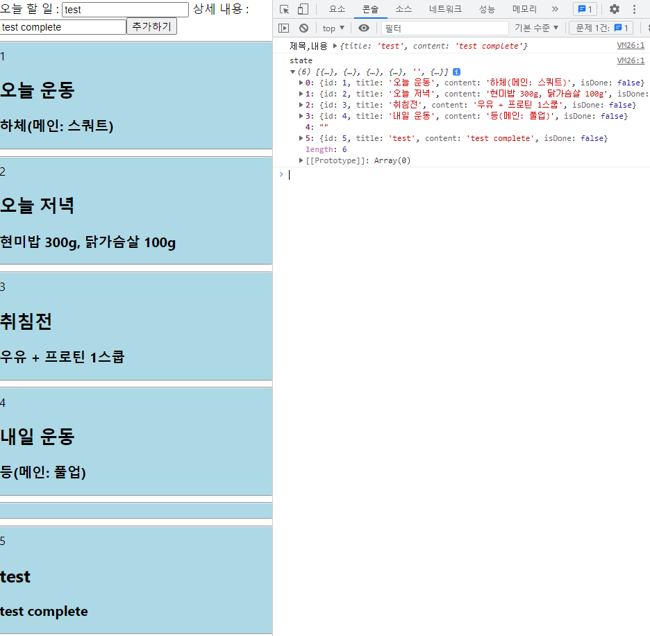
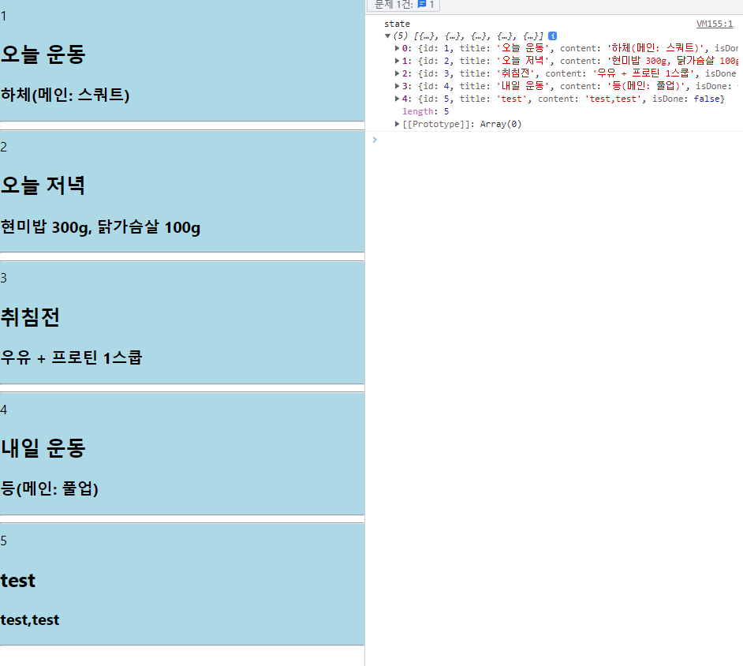

TIL : Today I Learned

<!--truncate-->

## 문제 내용

선발대 과제로 redux 만을 사용하여 흔히 아는 '투두리스트' 앱을 만들고 있던 와중에 생긴 문제였다.

스스로 하드코딩을 연습 겸 해서 코드 작성 중 state로 넣은 데이터를 module에 있는 initialState로 업데이트 시켜주려고 했으나, 전달하는 데이터가 한 박자 느리고 에러가 발생했다..


```jsx
// dispatch 적용
const dispatch = useDispatch();
// 제목, 내용 useState 활용
const [title, setTitle] = useState("");
const [content, setContent] = useState("");

const [todoForm, setTodoForm] = useState(null);

// onChange 활용하여 setState 해주기
const titleInputChange = (event) => {
  setTitle(event.target.value);
};
const contentInputChange = (event) => {
  setContent(event.target.value);
};
// ----------------------------onchange end.

const todoState = useSelector((state) => state.Todo);
const todoId = useSelector((state) => state.Todo.length);
// reducer action 보내기
// form이 onSubmit 되면 redux state 추가
const newTodo = (event) => {
  event.preventDefault();

  //여기서 가지고있는 title, content는 인식 하는데 setTodos로 넘겨줄 때는 인식이 안되는 것 같다...
  console.log("제목,내용", { title, content });
  setTodoForm({
    id: todoId + 1,
    title,
    content,
    isDone: false,
  });
  dispatch(add_todo(todoForm));
};
// 여기서도 한박자 느리다...[{…}, {…}, null, {…}]
console.log("state", todoState);
```

(28 line) setTodoForm 으로 업데이트 한 state를 (36 line) 에서 payload 로 넘겼으나 아직 state가 null 이라고 한다...

<details>
<summary>콘솔에 나온 에러</summary>

```bash
Uncaught TypeError: Cannot read properties of null (reading 'id')
    at index.js:13:1
    at Array.map (<anonymous>)
    at TodoList (index.js:13:1)
    at renderWithHooks (react-dom.development.js:16484:1)
    at updateFunctionComponent (react-dom.development.js:19773:1)
    at beginWork (react-dom.development.js:21796:1)
    ...
```

</details>

에러 메시지가 해석이 가능해서 스스로 여러 시도를 해봤지만 대표적인 2가지만 적어 보겠다.

## 시도한 방법

### 1. null 을 "" 빈 텍스트로 바꿔보기



콘솔이 피를 내뿜지는 않고 있지만, null 을 "" 빈 text 로 바꾸어 줬기 때문에 단순히 에러만 처리 했을 뿐 빈 값이 데이터에 업로드 되고 있었다...

여기서 빈 값이 왜 들어갈지 한참을 고민했고 state를 활용하지 말아야겠다는 생각이 들었다.

### 2. state를 사용하지 않고 변수를 이용해 보기

```jsx
// dispatch 적용
const dispatch = useDispatch();
// 제목, 내용 useState 활용
const [title, setTitle] = useState("");
const [content, setContent] = useState("");

// onChange 활용하여 setState 해주기
const titleInputChange = (event) => {
  setTitle(event.target.value);
};
const contentInputChange = (event) => {
  setContent(event.target.value);
};
// ----------------------------onchange end.

const todoState = useSelector((state) => state.Todo);
const todoId = useSelector((state) => state.Todo.length);
// reducer action 보내기
// form이 onSubmit 되면 redux state 추가
const newTodo = (event) => {
  event.preventDefault();

  // state 말고 newTodo 라는 변수로 할당하여 payload 전달
  const newTodo = {
    id: todoId + 1,
    title,
    content,
    isDone: false,
  };

  dispatch(add_todo(newTodo));
};
```

(24 line) 에서 setTodoForm 으로 업데이트를 하고 업데이트 한 todoForm 이라는 state를 가져와 붙여주려고 했으나 newTodo 라는 변수로 변경하고 곧바로 해결.



곧장 데이터가 업로드 되어 한 번에 추가가 된다!

## 문제 해결 방법 : 2번 솔루션

setTodoForm 으로 업데이트를 하고 업데이트 한 todoForm 이라는 state를 가져와 붙여주려고 했으나 newTodo 라는 변수로 변경하고 곧바로 해결.

:::tip 알게된 것

state를 굳이 사용할 필요 없는 곳에 state를 사용하여 로직이 어수선해 졌고, 1회성으로 사용하는 데이터는 바로 변수로 할당하여 payload 로 넘겨주는 게 간편하고 확실한 방법 이였다!

:::

{/* 이 글은 Tistory(https://hyoloui.tistory.com/73)에서 옮겨 온 글입니다. 원문 작성일: 2022-12-24 */}
