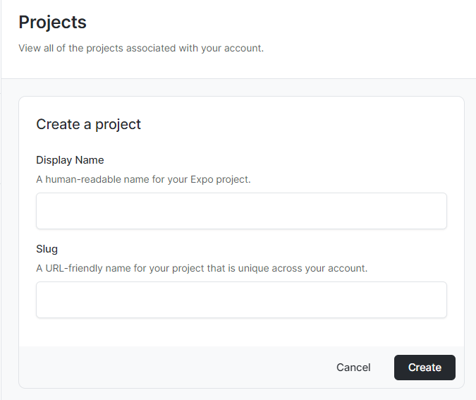
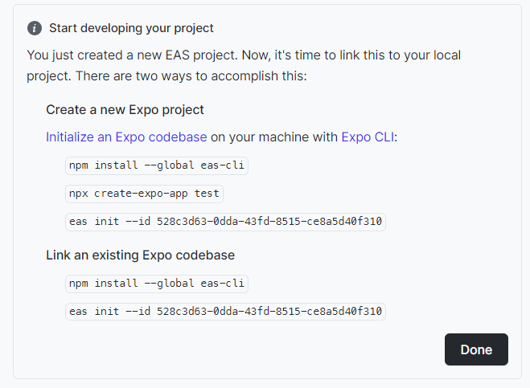
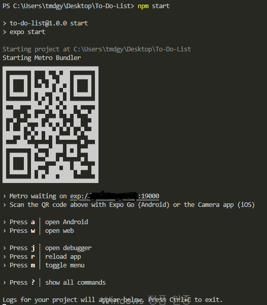
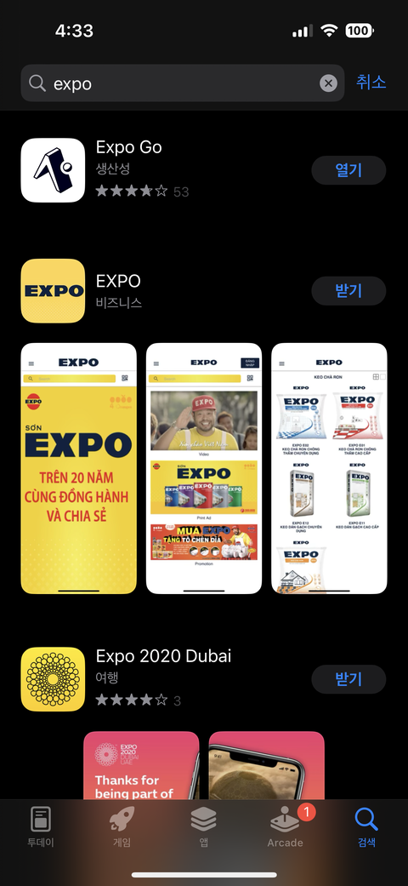

:::note 목적

리액트 네이티브 **프로젝트를 생성**하고, expo 패키지를 활용하여 **쉬운 셋업 및 빠른 초기개발**을 해보자!

:::

:::warning 오류 해결

- expo request time out
- CommandError: ngrok tunnel took too long to connect.

:::

<!--truncate-->

## 1. expo 계정에서 project 생성

[https://expo.dev/](https://expo.dev/)

위 사이트에서 계정을 만들어야 한다.



계정을 생성했다면, Create a project 에서 프로젝트를 생성하면 아래로 넘어간다. 나는 test 라는 프로젝트를 생성했다.



그럼 위처럼 친절하게 프로젝트를 연결하는 명령어를 알려준다! 이제 명령어에 대해 간단히 해석하고 따라해보자.

## 2-1. 전역에 expo 패키지 설치 (전에 설치했다면 생략)

```bash
npm install -g eas-cli
```

위 과정은 내 컴퓨터, 윈도우에 eas 프로그램을 설치하는 과정이라고 생각하자.

## 2-2. Project 생성

여기서 주의할 점은 터미널에서 프로젝트를 생성할 **경로를 다시 한번 확인 후 진행**하길 바란다.

```bash
npx create-expo-app '프로젝트 이름'
```

이 과정은 우리가 리액트 프로젝트를 만들 때 사용한 **create react-app**으로 생성하는 과정과 아주 유사하다.

## 2-3. eas init

위에서 만든 프로젝트를 eas 원격에 연결하는 과정이다!

```bash
eas init --id '프로젝트 id'
```

+ 이 과정에서 처음 eas 명령어를 사용했다면, 명령 창에서는 계정을 연결할 수 있도록 도와줄 것이다.

위에 1번에서 진행했을 때 생성한 계정을 연결해야 한다! 우리가 깃허브를 처음에 연동했을 때와 유사한 과정이다.

정상적으로 init이 되었다면 우리가 프로젝트를 정상적으로 설치하고 연결까지 끝냈다. 이제 구동이 정상적으로 되는지 테스트 해 보자.

## 3. 프로젝트 구동

```bash
npm start
```

여기서는 우리가 다른 프로젝트를 구동한 것과 동일하다. 하지만 나는 여기서 오류가 발생했다. 오류는 밑에서 상세하게 설명하겠다.



이렇게 구동이 된다면 우리가 만든 RN프로젝트가 정상 작동이 된 것이다!

## 4. 내 스마트폰에서 실시간 구동하기

아주 간단하다. 복잡한 것 없다. 본인의 디바이스 스토어에서 expo 앱을 설치하면 된다.



이후에는 카메라, QR 리더를 통해 위에 `npm start` 후 명령창에 생성된 QR 코드를 인식하면 된다!

## + expo request time out 오류 해결

검색 결과 window에서 흔히 발생하는 에러였다.. 네트워크 방화벽 문제로

- 해당 주소를 열어주거나
- 우회를 해야 한다고 한다.

나는 간단하게 우회하는 방법을 통해서 해결했다. 정말 간단하다.

`package.json` 파일에서 `start` 구문에 `--tunnel` 을 추가하면 된다.

before - 해결 전

```json title="package.json"
"scripts": {
  "start": "expo start",
  "android": "expo start --android",
  "ios": "expo start --ios",
  "web": "expo start --web"
},
```

after - 해결 후

```json title="package.json"
"scripts": {
  "start": "expo start --tunnel",
  "android": "expo start --android",
  "ios": "expo start --ios",
  "web": "expo start --web"
},
```

이후에 `npm start` 명령을 입력하니 정상 작동 되었다. 위의 QR 코드 화면처럼 작동이 되면 정상 작동이 되는 것이다!

아래 블로그를 통해 문제를 해결했다.

[expo request time out 이 발생하는 경우](https://ohrora-developer.tistory.com/11)

## + CommandError: ngrok tunnel took too long to connect. 오류 해결

이후에 간혹 이러한 tunnel 에러가 발생했는데.

`CommandError: ngrok tunnel took too long to connect.`

이 과정은 tunnel 시간이 오래 걸렸다는 뜻이다.

<details>
<summary>터미널 메세지</summary>

```bash
PS C:\Users\tmdgy\Desktop\To-Do-List> npm start

> to-do-list@1.0.0 start
> expo start --tunnel

Starting project at C:\Users\tmdgy\Desktop\To-Do-List
Starting Metro Bundler
Tunnel connected.
CommandError: ngrok tunnel took too long to connect.
```

</details>

다시 시도하면 된다. 사실.. 한 5번까지 했던 적도 있다.

:::tip 최종 정리

1. expo에서 프로젝트 생성
2. expo 패키지 설치 (이미 설치 되어있으면 생략)
3. 터미널에서 Project 생성 `npx create-expo-app projectname`
4. eas init `eas init --id 'project id'`
5. `npm start` - 이 과정에서 QR 자동 생성 됨
6. 스마트폰에 'Expo Go' 설치 후 QR 인식

:::

{/* 이 글은 Tistory(https://hyoloui.tistory.com/78)에서 옮겨 온 글입니다. 원문 작성일: 2022-12-30 */}
