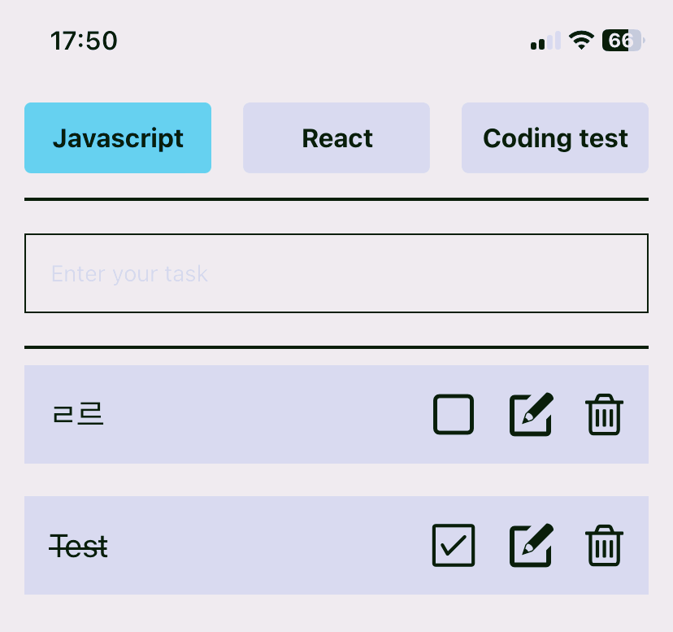

:::note TIL : Today I Learned

**목적**: state가 업데이트 되어야 정상적으로 리액트가 렌더링을 해주는 것에 대한 복기

:::

<!--truncate-->

## 🤢 문제 내용

리액트 네이티브로 **To-Do-List 앱을 만들고 있던 중 생긴 문제**였다.. 체크 아이콘이 클릭 되었을 때의 실행 함수이다.

checkDone 함수

```js
// 체크 아이콘
const checkDone = (todoId) => {
  // 1. id를 매개변수로 받는다.
  // 2. id에 해당하는 배열의 요소를 찾는다.
  // 3. 그 배열의 요소의 isDone 값을 토글링한 후에 setTodos.
  const find = todos.find((todo) => todo.id === todoId);
  find.isDone = !find.isDone;
  console.log(todos);
};
```

나름 로우코드를 해보겠다고 작성했다...

<details>
<summary>실행 결과</summary>

```bash
{"category": "javascript", "id": 1672389870380, "isDone": true, "onEdit": false, "text": "Test"}
{"category": "javascript", "id": 1672389870380, "isDone": false, "onEdit": false, "text": "Test"}
{"category": "javascript", "id": 1672389870380, "isDone": true, "onEdit": false, "text": "Test"}
{"category": "javascript", "id": 1672389870380, "isDone": false, "onEdit": false, "text": "Test"}
```

</details>

로그에 'isDone' 이 토글되어 잘 찍히길래 문제가 없겠구나 싶었다.

그런데 문제는 단순하지 않았다. `setState`를 하지 않았기 때문에 렌더링이 일어나지 않아서

```jsx
return (
  <View style={styles.Todo} key={todo.id}>
    <Text
      style={{
        fontSize: 20,
        textDecorationLine: todo.isDone
          ? "line-through"
          : "none",
      }}
    >
      {todo.text}
    </Text>
    <View style={styles.IconBox}>
      {/* 체크 아이콘 */}
      <TouchableOpacity
        onPress={() => checkDone(todo.id)}
      >
        {todo.isDone ? (
          <AntDesign
            name="checksquareo"
            size={30}
            color="black"
          />
        ) : (
          <Feather
            name="square"
            size={30}
            color="black"
          />
        )}
      </TouchableOpacity>
    </View>
  </View>
);
```

실시간 렌더링이 안되어 다른 컴포넌트로 이동 후 (리액트나, 코딩테스트) 다시 돌아와야 정상적으로 보였다...(새로고침 처럼)



위처럼 `isDone` 이 `true` 라면 "line-through"가 되면서 아이콘도 변해야 하는데 바로바로 렌더링 되지 않았다....

## 🔨 시도한 방법

### 1. 힙의 값을 직접 바꿔버렸다...

```js
// 체크 아이콘
const checkDone = (todoId) => {
  // 1. id를 매개변수로 받는다.
  // 2. id에 해당하는 배열의 요소를 찾는다.
  // 3. 그 배열의 요소의 isDone 값을 토글링한 후에 setTodos.
  const find = todos.find((todo) => todo.id === todoId);
  setTodos((prev) => [
    ...prev,
    todos.map(() => (find.isDone = !find.isDone)),
  ]);
  console.log(find);
};
```

isDone이 두번씩 찍히는 상황... 뭔가 잘못 됨을 깨달았다.

<details>
<summary>실행 결과</summary>

```bash
{"category": "javascript", "id": 1672395837021, "isDone": false, "onEdit": false, "text": "ㄹㄹ"}
{"category": "javascript", "id": 1672395837021, "isDone": true, "onEdit": false, "text": "ㄹㄹ"}
{"category": "javascript", "id": 1672395837021, "isDone": true, "onEdit": false, "text": "ㄹㄹ"}
{"category": "javascript", "id": 1672395837021, "isDone": false, "onEdit": false, "text": "ㄹㄹ"}
{"category": "javascript", "id": 1672395837021, "isDone": false, "onEdit": false, "text": "ㄹㄹ"}
{"category": "javascript", "id": 1672395837021, "isDone": true, "onEdit": false, "text": "ㄹㄹ"}
{"category": "javascript", "id": 1672395837021, "isDone": true, "onEdit": false, "text": "ㄹㄹ"}
{"category": "javascript", "id": 1672395837021, "isDone": false, "onEdit": false, "text": "ㄹㄹ"}
```

</details>

힙이 가지고 있는 값을 바꿔주려고 했고, 콜백 안에서 한번 더 `map`으로 콜백을 요청하고 있는 상황이니 의도와 다르게 이상하게 꼬여버렸다.

얕은 복사를 활용해 보자.

## 🎈 문제 해결 방법 : 2번 솔루션

근본적인 문제로 돌아가자. 지금 현재 상태의 `todos` 값이 전부 필요했다. 그래서 변수로 지금의 `todos`를 가져온 후, 그 안에 있는 데이터 중의 Index 요소를 찾아 해당 데이터만을 바꿔줘보자.

```js
// 체크 아이콘
const checkDone = (todoId) => {
  // 1. id를 매개변수로 받는다.
  // 2. id에 해당하는 배열의 요소를 찾는다.
  // 3. 그 배열의 요소의 isDone 값을 토글링한 후에 setTodos.
  const newTodos = [...todos];
  const find = todos.findIndex((todo) => todo.id === todoId);
  newTodos[find].isDone = !newTodos[find].isDone;
  setTodos(newTodos);
};
```

**말로 풀어보자!**

- 6 새로운 데이터를 얕은복사
- 7 아이디가 같은 값의 인덱스번호 찾기
- 8 복사한 데이터 중 해당 인덱스 번호의 `isDone` 을 토글로 바꿔주기
- 9 `setState` 하여 복사한 데이터를 새로 추가!

그렇게 시도한 결과 위 코드로 해결했다.

## ✨ 알게된 것


:::tip 정리

한 번에 한 코드로 해결하려고 하지 말고, 논리적으로 접근하고 데이터가 어떤 구조로 되어있고 어떤 것을 가지고 있는지를 항상 생각하며 코드를 짜야겠다!

:::

{/* 이 글은 Tistory(https://hyoloui.tistory.com/79)에서 옮겨 온 글입니다. 원문 작성일: 2022-12-30 */}
