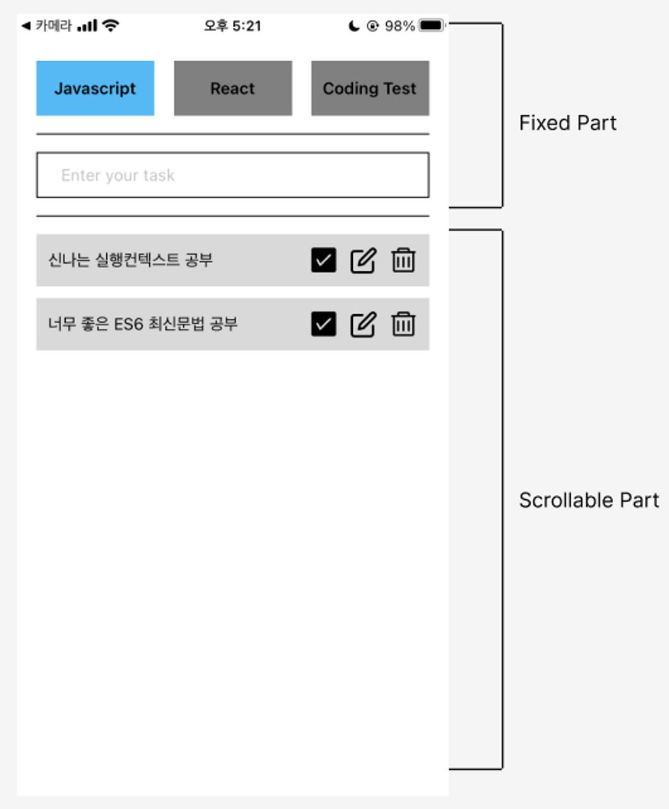
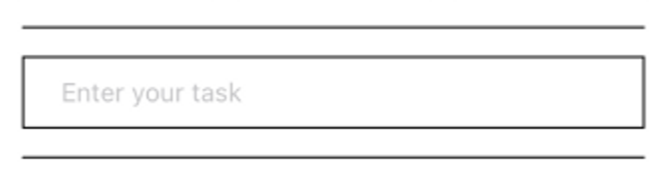
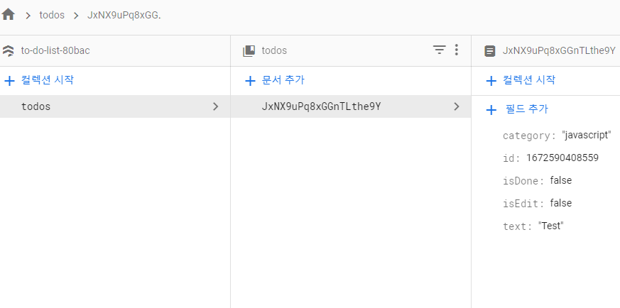

:::note 목적

CRUD : Create API 추가, Firebase : FireStore 연결

:::

<!--truncate-->

## 1. Layout 만들기



위와 같은 레이아웃을 만들어 보겠다! 사실 '투두리스트'를 많이 만들어서 캠프 커리큘럼, 학습의 다양성에 의문점이 있었지만, 프론트엔드 개발자의 기본 자질인 **CRUD의 기본기를 가장 핵심적으로 다루는 학습**이라고 생각한다.

```jsx
return (
  // 노치 제거
  <SafeAreaView style={{ flex: 1 }}>
    <View style={styles.container}>
      {/* 고정 영역 */}
      <View>
        {/* 버튼 영역 */}
        <View style={styles.buttonArea}>
          <TouchableOpacity style={styles.category_btn}>
            <Text style={{ fontSize: 20 }}>Javascript</Text>
          </TouchableOpacity>
          <TouchableOpacity style={styles.category_btn}>
            <Text style={{ fontSize: 20 }}>React</Text>
          </TouchableOpacity>
          <TouchableOpacity style={styles.category_btn}>
            <Text style={{ fontSize: 20 }}>Coding test</Text>
          </TouchableOpacity>
        </View>
        {/* input */}
        <View style={styles.inpuut_area}>
          <TextInput
            value={text}
            style={styles.todo_input}
            placeholder={"Enter your task"}
            onChangeText={setText}
            onSubmitEditing={() => onSubmitInput()}
          />
        </View>
      </View>
      {/* 스크롤 영역 */}
      <ScrollView style={styles.scroll_area}>
        {/* 한개의 투두 */}
        <View style={styles.once_todo}>
          {/* 텍스트 */}
          <Text style={{ fontSize: 18, width: "60%" }}>안뇽</Text>
          {/* 아이콘 영역 */}
          <View style={styles.once_icon_area}>
            {/* 체크 아이콘 (isDone) */}
            <TouchableOpacity style={styles.once_icon}>
              <AntDesign name="checksquareo" size={30} color="black" />
            </TouchableOpacity>
            {/* 수정 아이콘 (isEdit) */}
            <TouchableOpacity style={styles.once_icon}>
              <Entypo name="new-message" size={30} color="black" />
            </TouchableOpacity>
            {/* 삭제 아이콘 (delete) */}
            <TouchableOpacity style={styles.once_icon}>
              <FontAwesome name="trash-o" size={30} color="black" />
            </TouchableOpacity>
          </View>
        </View>
      </ScrollView>
    </View>
  </SafeAreaView>
);
```

다시 한번 복습하자면, ios에서 **카메라 영역으로 인해 layout이 가려지는 문제**로 `<SafeAreaView>` 태그를 사용해준다! 안드로이드에서는 문제가 없지만 첫 작업은 보통 ios로 작업을 해야 2중 작업이 줄어든다. 그래서 '노치 제거' 라는 주석으로 `<SafeAreaView>` 태그 사용의 이유를 주석으로 설명했다.

크게 두 섹션으로 나눌 수 있는데 위 사진에서 알 수 있듯, **고정** 영역(Fixed Part) & **스크롤** 영역(Scrollable Part) 이다.

고정영역은 웹에서의 헤더역할과 같이 다른 영역이 스크롤을 해도 고정되어있게 된다. `<View>` 태그의 기본 속성이다. RN 에서는 `<div>` 태그처럼 많이 사용한다.

하지만, **스크롤**이 되려면 다른 태그를 사용해야 한다. 바로 `<ScrollView>` 태그 이다. 내부 영역의 기본 속성은 `flexDirection: column` 이기 때문에 child 태그들은 자동적으로 scroll이 된다.

또한, button 태그는 스타일 적용이 안되어 잘 사용하지 않는다. 대체로 `<TouchableOpacity>` 태그를 사용한다.

아이콘은 아래 링크에서 원하는 아이콘을 가져왔다.

[@expo/vector-icons directory](https://icons.expo.fyi/)

해당 사이트에서 마음에 드는 아이콘을 선택 후, 렌더링 할 컴포넌트에서 import 구문을 적용시키고, 복사해온 컴포넌트를 붙이면 아주 간편하게 사용할 수 있다.

해당 포스팅에서는 create 부분을 설명하기에 아래에서 설명하겠다.

## 2-1. Create

위 영역(입력창)을 설명 하겠다.



```js
const [text, setText] = useState("");
const [todos, setTodos] = useState([]);

const newTodos = {
  id: Date.now(),
  text,
  isDone: false,
  isEdit: false,
};

const onSubmitInput = () => {
  setTodos((prev) => [...prev, newTodos]);
};
```

우선 컴포넌트 내부에서 사용할 state 는 2가지 이다.

- TextInput이 변경될 때 마다 값을 저장하는 state (`text`)
- 엔터를 눌렀을 때 저장될 배열형태의 state (`todos`)

그리고 새로운 데이터를 가지고 있는 `newTodos` 변수를 지정해 주었고, `isDone`은 나중에 체크 버튼을 눌렀을 때 체크를 위해 미리 할당했고, `isEdit`도 마찬가지로 나중에 수정버튼을 눌렀을 때 감지를 위해 미리 할당했다.

TextInput

```jsx
{/* input */}
<View style={styles.inpuut_area}>
  <TextInput
    value={text}
    style={styles.todo_input}
    placeholder={"Enter your task"}
    onChangeText={setText}
    onSubmitEditing={() => onSubmitInput()}
  />
</View>
```

RN 에서는 기존 react 와 다르게 `onChange`가 아니고 `onChangeText`를 사용하며, `e.target.value` 를 넘겨주지 않아도 자동적으로 setState 가 되는 영역의 value를 넘긴다.

또, `onSubmitEditing`은 `onSubmit` 과 같고 form 태그가 없어도 작동한다.

RN 달달 하다....

## 2-2. 작동 테스트

TextInput에서 value의 값이 정상적으로 변동하는지 콘솔을 찍어보겠다.

```js
const [text, setText] = useState("");
console.log("🚀 ~ file: App.js:15 ~ App ~ text", text);
```

<details>
<summary>실행 결과</summary>

```bash
LOG  🚀 ~ file: App.js:15 ~ App ~ text 1
LOG  🚀 ~ file: App.js:15 ~ App ~ text 12
LOG  🚀 ~ file: App.js:15 ~ App ~ text 123
LOG  🚀 ~ file: App.js:15 ~ App ~ text 1234
LOG  🚀 ~ file: App.js:15 ~ App ~ text 12345
```

</details>

아주 잘 찍힌다. `onSubmitEditing`도 확인 해 보겠다.

<details>
<summary>실행 결과</summary>

```bash
LOG  [{"category": "javascript", "id": 1672588490303, "isDone": false, "isEdit": false, "text": "1"}, {"category": "javascript", "id": 1672588494139, "isDone": false, "isEdit": false, "text": "12"}, {"category": "javascript", "id": 1672588498776, "isDone": false, "isEdit": false, "text": "123"}, {"category": "javascript", "id": 1672588579527, "isDone": false, "isEdit": false, "text": "1234"}, {"category": "javascript", "id": 1672588604936, "isDone": false, "isEdit": false, "text": "12345"}]
```

</details>

배열에 잘 저장이 되고있다! 이제 이 데이터를 firebase로 연결해서 firestore의 DB로 저장해보자.

## 3. Connect firestore

이제 내부 변수에서만 가지고있던 데이터를 firestore에 연결해보겠다. 아래 공식문서를 참고해서 연결했다.

[Cloud Firestore 시작하기 | Firebase](https://firebase.google.com/docs/firestore/quickstart?hl=en&authuser=0)

```js
// Import the functions you need from the SDKs you need
import { initializeApp } from "firebase/app";
import { getFirestore, collection, addDoc } from "firebase/firestore";
// TODO: Add SDKs for Firebase products that you want to use
// https://firebase.google.com/docs/web/setup#available-libraries

// Your web app's Firebase configuration
const firebaseConfig = {
  apiKey: "<YOUR_API_KEY>",
  authDomain: "to-do-list-80bac.firebaseapp.com",
  projectId: "to-do-list-80bac",
  storageBucket: "to-do-list-80bac.appspot.com",
  messagingSenderId: "<YOUR_SENDER_ID>",
  appId: "<YOUR_APP_ID>",
};
// Initialize Firebase
const app = initializeApp(firebaseConfig);
const db = getFirestore(app);
```

위 코드는 정해진 양식이기 때문에 내가 따로 손보거나 건들이지 않았지만, 순서는 아래와 같다.

1. import Firebase API
2. 생성한 project key 작성
3. api와 key 연결
4. Firestore에 해당내용 적용하여 db에 저장할 공간 생성

firebase >> firestore 의 상태이다.



내가 만들어준 `newTodos`에서 만들어준 내용이 잘 들어왔다!!

```js
const newTodos = {
  id: Date.now(),
  text,
  isDone: false,
  isEdit: false,
  category: "javascript",
};
```

## + FireStore 사용 시 설정 (규칙 수정)

```js
rules_version = '2';
service cloud.firestore {
  match /databases/{database}/documents {
    match /{document=**} {
      // 기존 구문
      //allow read, write: if false;
      allow read, write: if true;
    }
  }
}
```

`false` 를 `true` 로 바꿔주기만 하면 된다!

:::tip 최종 정리

1. 내가 생각하기에 투두리스트는 **CRUD의 기본기를 가장 핵심적으로 다루는 학습.**
2. 기존 리액트와 리액트네이티브는 **사용하는 태그가 조금씩 다르다**, 때문에 잘 확인해야함.
3. 기존 react 와 다르게 `onChange`가 아니고 `onChangeText`를 사용.
4. 자동적으로 setState 가 되는 노드영역의 value를 넘긴다. `e.target.value` 안해도 됨!
5. `<form>` 태그 없이 `<TextInput>` 사용 가능하며, `onSubmit` == `onSubmitEditing` 사용.
6. Firebase 내부 FireStore 사용 시 규칙 설정

:::

{/* 이 글은 Tistory(https://hyoloui.tistory.com/81)에서 옮겨 온 글입니다. 원문 작성일: 2023-01-02 */}
