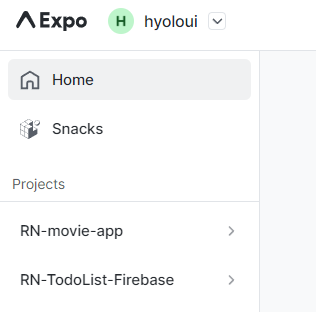
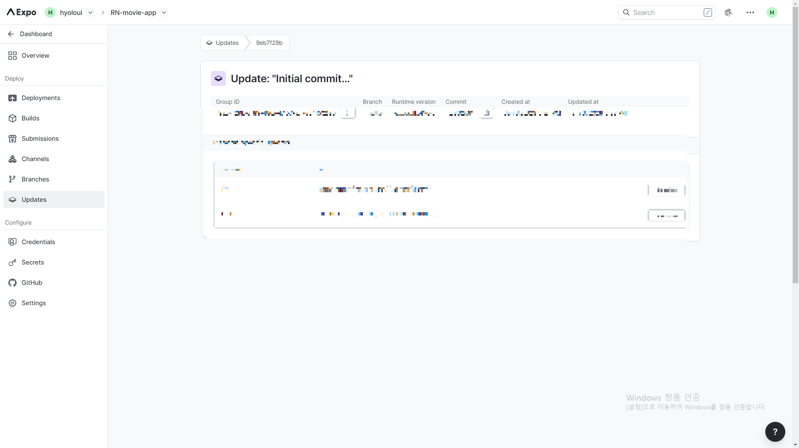
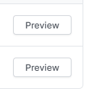
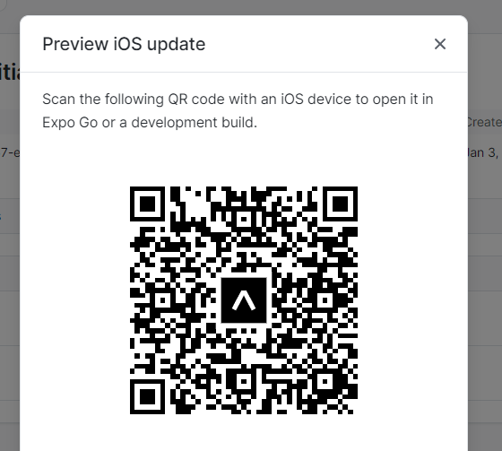

:::note 목적

expo 프로젝트 생성 시 빠른 세팅 (expo dashboard 이용하지 않고 터미널 이용 가능)

:::

:::warning 오류 해결

`eas update:configure` 실행 시 `Error: package.json is outside of the current git repository`

:::

<!--truncate-->

## 1. 공식 홈페이지 참고하여 RN 프로젝트 생성

[Setting up the development environment · React Native](https://reactnative.dev/docs/environment-setup)

위 공식 문서를 참고해도 좋지만 간단한 명령어니 포스팅을 보고 따라해도 무방하다.

터미널에서 경로를 확인한 후 npm 유저 명령어

```bash
npx create-expo-app "프로젝트 이름"
```

yarn 유저 명령어

```bash
yarn create expo-app "프로젝트 이름"
```

둘 중 사용하는 패키지 매니저의 명령어를 이용해 프로젝트를 생성한다!

## 2. eas update:configure

프로젝트 생성이 다 되었다면,

```bash
eas update:configure
```

명령어를 입력한다. 이때 `eas update:configure` 오류가 발생하여 아래 '오류 해결' 부분에 작성해 두었다!

이때 다시 한번 confirm 메세지가 출력 되면, Y를 입력해서 진행하면 되고 로그인을 하라고 출력이 된다면, 당황하지 말고 expo 계정을 로그인해서 연동시키면 된다.

<details>
<summary>실행 결과</summary>

```bash
EAS project not configured.
√ Would you like to automatically create an EAS project for @hyoloui/RN-movie-app? ... yes
√ Created @hyoloui/RN-movie-app (https://expo.dev/accounts/hyoloui/projects/RN-movie-app) on Expo
√ Linked local project to EAS project 354f8f66-07bf-4fcf-89bf-cec2d9a7f187
💡 The following process will configure your project to run EAS Update. These changes only apply to your local project files and you can safely revert them at any time.
> npx expo install expo-updates
√ Configured updates.url to "https://u.expo.dev/354f8f66-07bf-4fcf-89bf-cec2d9a7f187"
√ Configured runtimeVersion for Android with "{"policy":"sdkVersion"}"
√ Configured runtimeVersion for iOS with "{"policy":"sdkVersion"}"
EAS Build is not configured. If you'd like to use EAS Build with EAS Update, run eas build:configure, then re-run eas update:configure to configure eas.json with EAS Update.

All builds of your app going forward will be eligible to receive updates published with EAS Update.

🎉 Your app is configured with EAS Update!

Next steps:

Update a production build:
1. Create a new build. Example: eas build --profile production.
2. Make changes in your project.
3. Publish an update. Example: eas update --channel production.
4. Force close and reopen the app at least twice to view the update.

Preview an update:
1. Publish an update to a branch. Example: eas update --branch new-feature.
2. In Expo Go or a development build, navigate to Projects > [project name] > Branch > Open.
```

</details>

정상 작동시 출력 메세지가 나왔다면 expo에서 다시 한번 확인해 보자.

[Expo](https://expo.dev/)



내가 만든 'RN-movie-app' 프로젝트가 자동으로 생성되었다.

## 3. eas update : 배포하기

```bash
eas update
```

이제 update 명령어를 통해 배포부터 해놓자.

여기서 기본 브랜치인 'master' 브랜치를 생성한다면 바로 엔터를 누르면 된다.

```bash
PS C:\Users\tmdgy\Desktop\study\07_react_native\Rn-movie-app> eas update
EAS Build is not configured. If you'd like to use EAS Build with EAS Update,
 run eas build:configure, then re-run eas update:configure to configure eas.json with EAS Update.
? No branches found. Provide a branch name: » master
```

커밋 메세지도 물어보는데 중요한 내용이 없으니, 엔터로 넘어가자.

```bash
√ No branches found. Provide a branch name: ... master
? Provide an update message. » Initial commit

Generated by create-expo-app 1.1.4.
```

이러한 메세지가 뜬다면 잘 배포가 된 것이고, 아래 Website link로 들어가보자.

<details>
<summary>실행 결과</summary>

```bash
√ No branches found. Provide a branch name: ... master
√ Provide an update message. ... Initial commit

Generated by create-expo-app 1.1.4.
[expo-cli] Starting Metro Bundler
[expo-cli] Android Bundling complete 101600ms
[expo-cli] Bundle                     Size
[expo-cli] ┌ index.ios.js           865 kB
[expo-cli] index.android.js         868 kB
[expo-cli] index.ios.js.map        3.61 MB
[expo-cli] index.android.js.map    3.62 MB
[expo-cli] 💡 JavaScript bundle sizes affect startup time. Learn more: https://expo.fyi/javascript-bundle-sizes
[expo-cli] iOS Bundling complete 101605ms
[expo-cli] Finished saving JS Bundles
[expo-cli] Dumping source maps
[expo-cli] Preparing additional debugging files
[expo-cli] Export was successful. Your exported files can be found in dist
√ Exported bundle(s)
√ Uploaded: No changes detected
√ Channel: master pointed at branch: master
√ Published!

Branch             master
Runtime version    (가림)
Platform           (가림)
Update group ID    (가림)
Android update ID  (가림)
iOS update ID     (가림)
Message            Initial commit

Generated by create-expo-app 1.1.4.
Commit             f5832c907212f62157996ba108ffa0ca7ffa4b10*
Website link       https://expo.dev/accounts/hyoloui/projects/RN-movie-app/updates/9eb7f29b-af89-480e-b157-e57e84f5329b
```

</details>



그럼 이렇게 프로젝트 배포된 링크가 나오고,



Preview 버튼을 눌러 내가 배포한 주소의 expo QR code가 나온다.



## 4. 프로젝트 구동

이제 모든 준비가 끝났다.

```bash
npm start
```

npm 유저는 위 명령어를 입력하고,

```bash
yarn start
```

yarn 유저는 위 명령어를 통해 프로그램을 구동 시킨다!

<details>
<summary>실행 결과</summary>

```bash
> rn-movie-app@1.0.0 start
> expo start

Starting project at C:\Users\tmdgy\Desktop\study\07_react_native\Rn-movie-app
Starting Metro Bundler

(QR 코드)

› Metro waiting on exp://192.168.25.16:19000
› Scan the QR code above with Expo Go (Android) or the Camera app (iOS)

› Press a │ open Android
› Press w │ open web

› Press j │ open debugger
› Press r │ reload app
› Press m │ toggle menu

› Press ? │ show all commands

Logs for your project will appear below. Press Ctrl+C to exit.
```

</details>

이렇게 빠르게 RN 프로젝트 생성과, 구동까지 해보았다.

간혹 window 유저에서 발생하는 에러를 겪었기 때문에, 만약 프로젝트 구동 후, QR code 인식 중 에러가 발생한다면 아래 포스팅의 **에러 해결** 부분을 참고해 보자.

[2022.12.30 - [React-Navtive] - 리액트 네이티브 - 새로운 프로젝트 만들기 (expo), 에러 해결](https://hyoloui.tistory.com/78)

## + 오류 해결

`eas update:configure` 에서 `Error: package.json is outside of the current git repository`

<details>
<summary>실행 결과</summary>

```bash
PS C:\Users\tmdgy\Desktop\study\07_react_native> eas update:configure
Error: package.json is outside of the current git repository (project ro

디렉터리: C:\Users\tmdgy\Desktop\study\07_react_native
```

</details>

`eas update:configure` 명령어를 입력 한 뒤 이와 같은 에러가 발생한다면 경로를 다시 확인해보자. 내가 만든 프로젝트 안에 있어야 `eas update`가 가능하다!

:::tip 최종 정리

1. `npx create-expo-app`, `yarn create expo-app` 명령어로 RN 프로젝트 생성
2. 경로 설정 후, `eas update:configure` 명령어로 프로젝트 자동 생성
3. `eas update`로 배포
4. `npm start`, `yarn start`로 프로젝트 구동
5. `Error: package.json is outside of the current git repository` 에러는 경로 설정이 잘못 되어서 발생하는 문제

:::

{/* 이 글은 Tistory(https://hyoloui.tistory.com/87)에서 옮겨 온 글입니다. 원문 작성일: 2023-01-03 */}
