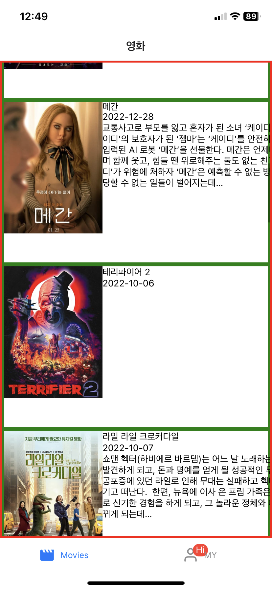

:::note 목적

1. Open API 받아오기 연습
2. DB 활용하기 연습
3. 번역본 적용 - 새로운 시도
4. 오류해결 적용 한 결과 화면

:::

:::warning 오류 해결

번역본 적용시 빈 텍스트

:::

<!--truncate-->

## 1. Open API 받아오기

영화 정보 api 연결

[The Movie Database (TMDB)](https://www.themoviedb.org/)

위 사이트에서 공개된 api를 활용한 데이터로 movies 앱에 데이터를 가져왔다.

```js
const [nowPlayings, setNowPlayings] = useState([]);

const BASE_URL = "https://api.themoviedb.org/3/movie";
const API_KEY = "<YOUR_API_KEY>";

const getNowPlayings = async () => {
  const { results } = await fetch(
    `${BASE_URL}/now_playing?api_key=${API_KEY}&language=en-US&page=1`
  ).then((res) => res.json());
  setNowPlayings(results);
};
```

1. 데이터를 넣어 줄 `nowPlayings` 라는 빈 배열의 스테이트를 만들어주고,
2. 함수를 만들어 `fetch` 함수를 비동기 처리 하여 url로 데이터를 받아오면 json 형태로 변환시켜준다
3. setState 하여 가져온 `results` 값을 넣어준다!

## 2. DB 활용하기

데이터를 받아 온 `nowPlayings` 라는 배열을 활용하자.

```jsx
{nowPlayings.map((movie) => (
  <Slide key={movie.id} movie={movie} />
))}
```

너무나도 자주 쓰는, 배열 메서드인 **`map()` 을 통해 요소를 하나씩** 가져와서 데이터를 넣어줬으나 나는 refactoring 과정에서 **Slide라는 컴포넌트로 prop을 통해 데이터를 넘겼다**.

그렇게 다른 영역의 데이터들도 위와 같은 형태로 데이터를 넘겨 api 연결을 완성했다.

(원문에는 결과 영상이 있었으나 동영상 서비스가 종료되어 옮기지 못했습니다.)

## 3. 번역본 적용하기

위처럼 헤더는 '영화' 라고 한글이 적혀있는데 내용이 **영어라서 마음에 들지 않았다**.

**api 문서를 찾아보니 `language` 라는 카테고리**가 있어 살펴보았다. 데이터를 가져올 때 url 의 내용 안에도

`language=en-US`

라고 적혀있었기 때문에 api 문서 형식에 맞춰서

`language=ko-Korean`

로 구문을 변경시켰다!

(원문에는 결과 영상이 있었으나 동영상 서비스가 종료되어 옮기지 못했습니다.)

## + 오류 해결

before - 해결 전




### 오류 해결 방법

나는 곧장 json 을 받아오는 url을 직접 입력해 get을 어떤 형태로 받아오는지 궁금했고, 이미지처럼 내용을 받아오는 `overview`라는 녀석이 빈칸으로 있었다.

```json
{
  "id": 740952,
  "original_language": "en",
  "original_title": "Savage Salvation",
  "overview": "",
  "popularity": 2064.805,
  "poster_path": "/fJRt3mmZEvf8gQzoNLzjPtWpc9o.jpg",
  "release_date": "2022-12-02",
  "title": "새비지 샐베이션",
  "video": false,
  "vote_average": 5.4,
  "vote_count": 22
}
```

원래 받아오는 데이터가 없는 건가(?) 하고, 다시 한번 원본 json(영어)을 열었더니

```json
{
  "id": 740952,
  "original_language": "en",
  "original_title": "Savage Salvation",
  "overview": "Newly engaged Shelby John and Ruby Red want a fres...",
  "popularity": 2064.805,
  "release_date": "2022-12-02",
  "title": "Savage Salvation",
  "video": false,
  "vote_average": 5.4,
  "vote_count": 22
}
```

근데 원본은 `overview`를 가지고 있었다... 아마 번역 문제로 해당 내용이 들어오지 않는 것 같다는 추측을 했다.

그래서 아래 구문을 넣어주기로 판단했다.

```jsx
<Text>
  {card.overview === ""
    ? "해당 영화의 번역을 준비중입니다. 빠른 시일 내에 번역하겠습니다. 감사합니다"
    : card.overview}
</Text>
```

> 위 내용이 빈칸이라면 "해당 영화 ~. 감사합니다" 를 출력하고, 아니라면 `overview` 를 넣어줘!

## 4. 오류 해결 적용 한 결과화면

(원문에는 결과 영상이 있었으나 동영상 서비스가 종료되어 옮기지 못했습니다.)

:::tip 최종 정리

1. api를 활용하려면 json에 내용이 어떻게 구성되어있는지 먼저 살펴보자
2. 컴포넌트를 분리하여 구성한다면 prop를 잘 활용하자
3. 원인 모를 에러가 났다면 브라우저에 url 요청(주소창 입력)하여 json 원본을 살펴보자
4. 간단하게 js를 활용하여 에러를 핸들링 하자

:::

{/* 이 글은 Tistory(https://hyoloui.tistory.com/89)에서 옮겨 온 글입니다. 원문 작성일: 2023-01-05 */}
