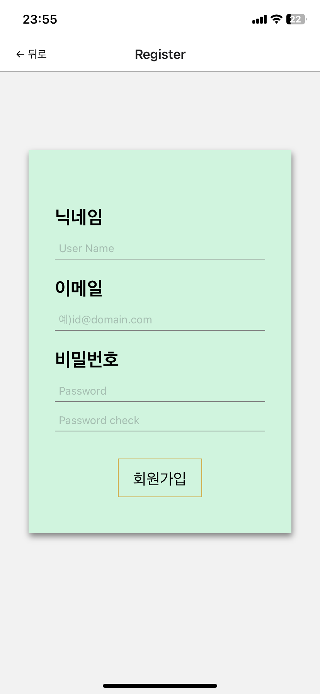

:::note 🎯목적

Firebase - **Authentication** : **회원가입** 기능 학습 및 적용 >> Firebase : FireStore 연결

:::

:::warning 🤢 오류 해결

- **스크롤 문제** `<KeyboardAwareScrollView/>` 라이브러리 태그로 해결
- 휴먼에러..

:::

<!--truncate-->

---

## 1. UI Layout 만들기



```jsx
<KeyboardAwareScrollView
  extraScrollHeight={150}
  style={{ paddingHorizontal: 30 }}
>
  <AuthRegisterContainerView>
    <Text style={{ color: 'red', height: 20 }}>{alertText}</Text>
    <View>
      <TitleText>닉네임</TitleText>
      <InputBox
        value={displayName}
        onChangeText={setDisplayName}
        placeholder="User Name"
        ref={focusName}
      />
    </View>

    <View>
      <TitleText>이메일</TitleText>
      <InputBox
        value={email}
        onChangeText={setEmail}
        placeholder="예)id@domain.com"
        ref={focusEmail}
      />
    </View>

    <View>
      <TitleText>비밀번호</TitleText>
      <InputBox
        value={password}
        onChangeText={setPassword}
        placeholder="Password"
        ref={focusPw}
        // 배포시 활성화
        // autoComplete="password"
        // textContentType="password"
        // secureTextEntry={true}
      />
      <InputBox
        value={passwordCheck}
        onChangeText={setPasswordCheck}
        placeholder="Password check"
        ref={focusPwCheck}
        // 배포시 활성화
        // autoComplete="password"
        // textContentType="password"
        // secureTextEntry={true}
      />
    </View>

    <Buttons onPress={() => onSubmitRegister()}>
      <ButtonsText>회원가입</ButtonsText>
    </Buttons>
  </AuthRegisterContainerView>
</KeyboardAwareScrollView>
```

UI를 만들면서 키보드 활성 시에 높이가 고정되어있는 이슈로 스크롤이 되지않아 `<KeyboardAwareScrollView/>` 라는 라이브러리를 사용했다..

이 문제로 퍼블리셔로 재직하던 직장에서 골머리를 썩은 적이 있는데 팀원중 한분이 **라이브러리를 추천** 해주셔서 아주 간단하게 해결되었다.. (에러 해결 참고)

그렇게 라이브러리로 가져온 태그로 상위를 감싸주었고, 크게 **닉네임, 이메일, 비밀번호, 비밀번호 2차 확인** **부분으로 나누었다**

하지만 프로젝트 기능사항으로 입력값에 대한 **유효성 검사를 통해 메세지를 입력해주는 Text가 필요**해서 `setState`를 활용해 Text 를 미리 넣어 주었다 ( 아래 상세내용 작성 )

---

## 2. 유효성 검사

```js
// 유효성 검사 진행
if (!displayName) {
  alertTextTimer('닉네임을 입력해 주세요');
  focusName.current.focus();
  return;
} else if (!email) {
  alertTextTimer('이메일을 입력해 주세요');
  focusEmail.current.focus();
  return;
} else if (email.indexOf('@') == -1) {
  alertTextTimer('이메일 형식이 아닙니다.');
  focusEmail.current.focus();
} else if (!password) {
  alertTextTimer('비밀번호를 입력해 주세요');
  focusPw.current.focus();
  return;
} else if (!passwordCheck) {
  alertTextTimer('비밀번호 재입력 입력해 주세요');
  focusPwCheck.current.focus();
  return;
} else if (password.length < 6) {
  alertTextTimer('비밀번호는 6자리 이상 입력해주세요!');
  focusPw.current.focus();
} else if (password !== passwordCheck) {
  alertTextTimer('비밀번호를 다시 확인해 주세요');
  focusPwCheck.current.focus();
  return;
}
```

위처럼 해당 내용의 값이 없는상태 즉, `false == !state`를 활용해서 **빈값에 대한 유효성검사를** 진행했고, **빈값에 대한 포커스**를 진행시켜주기 위해 **useRef Hook을 사용**해서 해당 **TextInput 태그에 `focus()` 함수를 실행** 시켜 주었다.

나머지는 보이는 메세지와 같다

여기서 내가 만들어 사용한 **alertTextTimer** 함수를 소개하겠다

```js
const alertTextTimer = (message) => {
  setAlertText(message);
  setTimeout(() => setAlertText(''), 3000);
};
```

위에서 언급했던 부분의 유효성검사 메세지를 받도록 state를 **인수로받은 텍스트로 update**를 시켜주었고, `setTimeout`을 통해 해당 **텍스트는 3초가 지나면 사라지도록** 해주었다

:::note

원문에 있던 동영상은 서비스 종료로 재생할 수 없습니다.

:::

---

## 3. authentication >> 회원가입 api

```js
await createUserWithEmailAndPassword(auth, email, password)
  .then(async (userCredential) => {
    console.log('🚀 userCredential', userCredential);
    const user = userCredential.user;
    // update 닉네임
    await updateProfile(auth.currentUser, {
      displayName,
    })
      .then(() => {
        reset({
          index: 0,
          routes: [{ name: 'Tabs', params: { screen: 'Home' } }],
        });
      })
      .catch((error) => {
        const errorCode = error.code;
        const errorMessage = error.message;
        alertTextTimer('🚨: update profile error', errorCode, errorMessage);
      });
  })
  .catch((error) => {
    const errorCode = error.code;
    const errorMessage = error.message;
    if (errorMessage.includes('email-already-in-use')) {
      alertTextTimer('🚨', '이미 가입된 이메일입니다.');
      focusEmail.current.focus();
      return;
    }
    alertTextTimer('🚨', errorCode, errorMessage);
  });
```

Authentication의 API 인 **`createUserWithEmailAndPassword` 함수를 사용해 회원가입**을 진행시켰다. Authentication을 연결한 변수인 `auth`와 state로 TextInput 에서 받아오는 `email` 과 `password` 이렇게 3개를 인자로 받아오고 **API가 정상 작동했을 때,**

**`updateProfile` 이라는 API**로 해당 유저의 프로필의 닉네임을 업데이트 시켜주었다.

여기서 email과 password, displayName 은 es6 문법이 적용되어 기존에 **`email: email` 을 반복하지 않아도** 알아서 들어가도록 **키와 밸류가 동일하다면** **함축형을 인지해 자동으**로 위와같이 할당해 줄 수 있다.

또한, `.catch`문을 이용해 에러를 유효성검사에서 활용한 함수를 적용하여 어떠한 에러가 났는지를 명확하게 알려줄 수 있었다

---

## 4. 회원가입 정상작동

```js
.then(() => {
  reset({
    index: 0,
    routes: [{ name: 'Tabs', params: { screen: 'Home' } }],
  });
})
```

작동이 정상적으로 이루어 진다면 `.then` 함수들이 작동될 것이다

그래서 회원가입이 완료가 되면 ux적으로 편리하도록 **`reset` 함수를 활용해 다시 Home 의 상태로** 돌아가게 해준다

이 전에는 `navigate`를 사용해서 Home으로 핸들링을 했었는데 tabs 부분이 나오지 않고, 컴포넌트만 렌더링 되었던 현상으로 다시 **`reset`을 활용해 refactoring**을 진행했다!

---

## + 오류 해결

before - 해결 전, after - 해결 후 (동영상은 서비스 종료로 재생할 수 없습니다.)

### + 오류 해결 방법

[GitHub - APSL/react-native-keyboard-aware-scroll-view: A ScrollView component that handles keyboard appearance and automatically](https://github.com/APSL/react-native-keyboard-aware-scroll-view)

라이브러리 공식 깃허브에 상세한 내용이 나와있다. 짧게 요약하자면,

```bash
npm i react-native-keyboard-aware-scroll-view --save
```

- 위 명령어를 통해 인스톨

```js
import { KeyboardAwareScrollView } from 'react-native-keyboard-aware-scroll-view';
```

- 사용하고자 하는 컴포넌트에서 `import { KeyboardAwareScrollView }`

```jsx
<KeyboardAwareScrollView>
  <AuthRegisterContainerView>. . .</AuthRegisterContainerView>
</KeyboardAwareScrollView>
```

- import 한 태그로 상위 태그 감싸주면 끝!

---

:::tip 최종 정리

1. 유효성검사에 통과되지 않는다면 실행할 **`alertTextTimer()`** 함수 만들어주었다 ( 메세지 보여주고 사라지기 ) 그 후 `useRef` Hook을 활용해 `focus()` 가 실행되어 해당하는 TextInput으로 자동적으로 커서가 생기게 했다
2. **`createUserWithEmailAndPassword`** 함수는 auth key / email / password 이 세개가 필수 값이다
3. 닉네임인 `displayName` 은 함께 전달하지 못하기 때문에 회원가입 직후 `updateProfile` 함수로 같이 닉네임을 넣어주었다
4. 회원가입이 완료가 되면 ux적으로 편리하도록 **`reset` 함수를 활용해 다시 Home 의 상태로 돌아가게 해준다**
5. **`KeyboardAwareScrollView` 라이브러리**로 키보드 활성시 **높이 이슈 간단하게 해결**

:::

{/* 이 글은 Tistory(https://hyoloui.tistory.com/92)에서 옮겨 온 글입니다. 원문 작성일: 2023-01-09 */}
