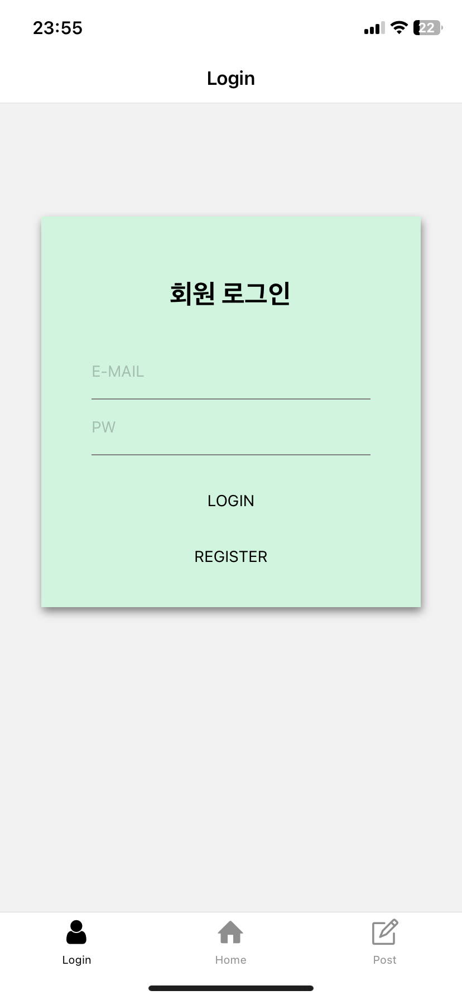

:::note 🎯목적

Firebase - **Authentication** : **로그인 / 로그아웃** 기능 학습 및 적용 >> Firebase : FireStore 연결

:::

:::warning 🤢 오류 발견 (미해결)

- 로그아웃 후 `currentUser`가 null이 되어 마이페이지 tabs 클릭시 에러가 출력

:::

<!--truncate-->

---

## 1. UI Layout 만들기



```jsx
<KeyboardAwareScrollView
  style={{ paddingHorizontal: 30 }}
  extraScrollHeight={150}
>
  <AuthLoginContainerView>
    <TitleText>회원 로그인</TitleText>
    <Text style={{ color: 'red', height: 20 }}>{alertText}</Text>
    <IDInput
      value={email}
      onChangeText={setEmail}
      placeholder="E-MAIL"
      ref={focusEmail}
      onSubmitEditing={() => focusPw.current.focus()}
    />
    <PWInput
      value={password}
      onChangeText={setPassword}
      placeholder="PW"
      ref={focusPw}
      onSubmitEditing={() => onSubmitLogin()}
      // autoComplete="password"
      // textContentType="password"
      // secureTextEntry={true}
    />
    <Buttons>
      <ButtonsText onPress={() => onSubmitLogin()}>LOGIN</ButtonsText>
    </Buttons>
    <Buttons onPress={() => navigate('Stacks', { screen: 'Register' })}>
      <ButtonsText>REGISTER</ButtonsText>
    </Buttons>
  </AuthLoginContainerView>
</KeyboardAwareScrollView>
```

회원가입 UI와 마찬가지로 `<KeyboardAwareScrollView/>` 라는 라이브러리를 사용했다..

라이브러리로 가져온 태그로 상위를 감싸주었고, **ID(아이디), Password(비밀번호), Login(로그인), Register(회원가입)** **부분으로 나누었다**

**스타일은 Emotion**을 사용했다

회원가입기능, 로그인 실행 함수에서 **유효성 검사**가 진행되는데 해당 부분의 로직이 전체적으로 코드가 길고 가독성이 떨어져 유효성검사를 하는 부분을 따로 나누어 **리펙토링** 해 주었다

---

## 2. 유효성 검사

```js
const textConfirm = () => {
  if (!email) {
    focusEmail.current.focus();
    alertTextTimer('이메일을 입력해 주세요');
    return true;
  } else if (email.indexOf('@') == -1) {
    alertTextTimer('이메일 형식이 아닙니다.');
    focusEmail.current.focus();
    return true;
  } else if (!password) {
    alertTextTimer('비밀번호를 입력해 주세요');
    focusPw.current.focus();
    return true;
  } else if (password.length < 6) {
    alertTextTimer('비밀번호는 6자리 이상 입력해주세요!');
    focusPw.current.focus();
    return true;
  }
};
```

위 코드에서도 회원가입과 같이 유효성검사를 통과하지 못했을 때 `alertTextTimer` 라는 함수로 UI부분에 삽입해 **문제 부분을 텍스트로 보여주고**,

```js
const alertTextTimer = (message) => {
  setAlertText(message);
  setTimeout(() => setAlertText(''), 3000);
};
```

`useRef`를 활용해 해당하는 영역(TextInput)이 **focus가 되도록** 만들어주었다. focus == 마우스로 클릭하여 입력상태로 만든것!

:::note

원문에 있던 동영상은 서비스 종료로 재생할 수 없습니다.

:::

---

## 3. authentication >> 로그인 api

```js
// LOGIN API
const onSubmitLogin = () => {
  // 유효성 검사 진행
  if (textConfirm()) {
    return;
  }
  // Firebase : authentication API
  signInWithEmailAndPassword(auth, email, password)
    .then((userCredential) => {
      const user = userCredential.user;
      Alert.alert('🎉로그인 성공', `${user.displayName}님 환영합니다`, [
        {
          text: 'OK',
          onPress: () =>
            reset({
              index: 0,
              routes: [{ name: 'Tabs', params: { screen: 'Home' } }],
            }),
        },
      ]);
    })
    .catch((error) => {
      const errorCode = error.code;
      const errorMessage = error.message;
      console.log('errorMessage:', errorCode, errorMessage);
      if (errorMessage.includes('user-not-found')) {
        alertTextTimer('가입되지 않은 회원입니다.');
        return;
      } else if (errorMessage.includes('wrong-password')) {
        alertTextTimer('비밀번호가 올바르지 않습니다.');
      }
    });
};
```

첫번째로 유효성검사 함수를 실행해 조건과 일치하여 검사에 걸린다면 그대로 `return` 되어 다른 코드 실행없이 종료된다

**`signInWithEmailAndPassword`** API를 import하여 함수를 실행하고 인자로

- **auth**(firebase authentication)
- **email** (TextInput에서 setSate하여 입력받은 state값)
- **pasword** (TextInput에서 setSate하여 입력받은 state값)

를 넘겨준다!

`.then` `.catch` 문을 활용해 실행이 된다면 **알럿(알림창)으로 알려주고**, 확인( OK ) 버튼을 (`onPress()`)누르면 `reset` 함수로 **홈화면으로 이동**되게 하고,

에러가 발생한것을 `catch`문으로 잡아 콘솔에 에러메세지를 띄워 **자주 발생하는 에러**에 대해 firebase가 내려주는 텍스트를 조건문으로 검사하고, `include`를 통해 유효성검사와 같은 효과처럼 **유저에 친화적인 text**를 보여줄 수 있었다

---

## + 오류 발견

마이페이지 screen

로그아웃 기능 구현중 로그아웃이 되어 `auth.currentUser`가 감지되지 않으면, 마이페이지 클릭했을 때 로그인페이지로 이동하는 것을 구현하고 있었다.

하지만 로그아웃이 되면 `currentUser`가 null이 되어 마이페이지 tabs 클릭시 에러가 출력되었다.

해당 에러는 내일 해결하고 자세히 다루도록 하겠다!

---

:::tip 최종 정리

1. 로직은 회원가입과 매우 유사
2. 유효성검사 함수 분리하여 코드 간소화 진행!
3. 로그인이 완료되면 alert으로 알려주고, navigate 기능인 `reset`을 활용하여 Home화면으로 이동
4. **KeyboardAwareScrollView 라이브러리 사용** : 하단 링크 참조

:::

[GitHub - APSL/react-native-keyboard-aware-scroll-view: A ScrollView component that handles keyboard appearance and automatically](https://github.com/APSL/react-native-keyboard-aware-scroll-view)

{/* 이 글은 Tistory(https://hyoloui.tistory.com/93)에서 옮겨 온 글입니다. 원문 작성일: 2023-01-11 */}
