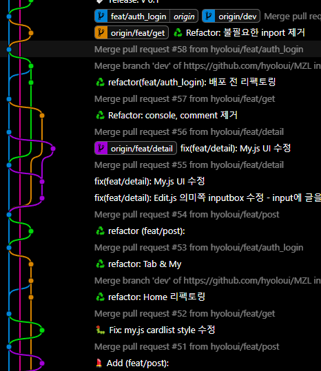
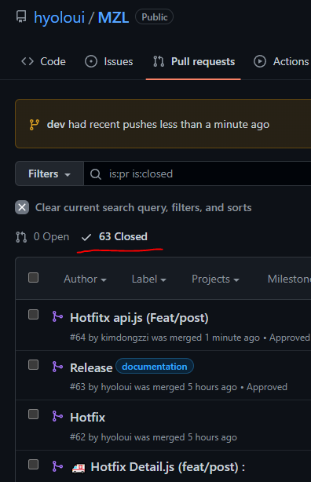
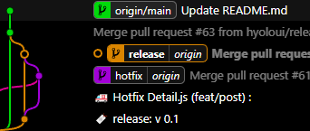

:::note 목적

- expo project 초기 셋업 리뷰
- 브랜치 history 리뷰
- eas update: 배포 과정
- pull request와 컨벤션을 제대로 활용한 협업 경험

:::

:::warning 오류 해결

좋아요 부분 UI가 다크모드 미적용으로 디버깅 - hotfix branch 활용

:::

<!--truncate-->

## 1. 프로젝트 초기셋업

프로젝트 시작 전 **초기셋업**을 내가 진행하게 되어

```bash
npx create-expo-app RN-turkey-project
```

명령어로 **Expo 프로젝트를 셋업**하여 깃허브 repository에 push 하였다.

여기서 혼자 하는 프로젝트라면 `eas update`를 하여 깃허브와 expo 프로젝트를 연동시킨 후 작업을 하도록 하였겠지만, **eas update**를 미리 한다면 `app.json` 파일에 고유 id 가 작성되어 expo 에서 **충돌이 발생**하므로 미리 배포를 하지 않았다.

[2022.12.30 - [React-Navtive] - 리액트 네이티브 - 새로운 프로젝트 만들기 (expo), 에러 해결](https://hyoloui.tistory.com/78)

위 포스팅에서 expo 프로젝트의 과정을 상세히 설명해 두었다. 이번에도 다시 참고하여 TIL이 빛을 발했다!

정상적으로 `expo start`가 진행되어 안심하고 repository를 생성하고 push 할 수 있었다.

## 2. 브랜치의 여정

이후, **깃허브 컨벤션**을 잘 지켜 팀원들이 원활하게 작업을 진행하고 각자의 작업이 끝나면 각자의 `feat/` 브랜치에서 `dev` 브랜치로 **Pull Request 를 활용**해 코드의 변동사항, 충돌을 해결하며 무사히 프로젝트를 완성할 수 있었고,

`dev` 브랜치에서는 **각 브랜치에서 PR 후 merge** 되고, 작업 Task 가 모여 하나하나 코드를 쌓아가는 방식이 되었다. 작업이 끝나고 디버깅, 리펙토링 까지 마쳐 모든 **작업은 마무리**가 되었다.



**eas update를 dev**에서 한다면 추후 코드 수정이 불가피 할 때 여러 **충돌**과 애로사항이 생기기 때문에 **`release` 라는 브랜치**를 생성하여 `dev` 내용을 가져와 `release` 브랜치에서 **eas update**를 하여 배포를 진행했다.

1. `eas init --id 'id'` 명령어를 통해 `app.json`에 id가 작성되도록 한다
2. `eas update` 명령어로 배포를 진행한다
3. 배포 진행 후 expo 사이트에서 해당 **프로젝트에 접속**해 update가 잘 되었는지 확인 **또는** 터미널에서 보여지는 **링크를 따라 updates 링크로 이동**한다
4. 배포 **QR 코드를 스캔**하여 테스트를 진행한다

## 3. 훌륭한 Pull Request 활용



이렇게 우리 팀에서 진행된 **pull request는 63건**에 달했고, **`dev`를 최신화** 하고 팀원 모두가 각자의 브랜치에 자주 pull을 진행하고 작업을 했기 때문에 **충돌이 거의 일어나지 않았다**!

이번을 계기로 PR의 위력과 효율성에 대해 다시금 깨닫게 되었고, 협업을 진행하면서 **모두가 변동사항에 대해 확인하고 코드리뷰**를 할 수 있었던 점이 너무 좋은 경험이 되었다.

## + 오류 : debug ui style 발견

오류가 아닌 단순한 debug 여서 크게 놀라지는 않았다. 하지만 브랜치의 구조를 다시 한번 곱씹었다.

`dev` 브랜치에는 모든 작업내용을 가지고 있고, `release` 브랜치에는 배포 내용을 가지고 있다.

하지만 다른 팀원이 `release` 브랜치에서 debug 작업을 진행 한다면 expo id의 충돌이 일어나는 상황이었다.

## + 오류 해결 : hotfix branch 생성



긴급하게 오류를 해결 할 `hotfix` 라는 브랜치를 생성했고, 디버깅한 내용을 `hotfix`에 PR을 날려 1차적인 충돌을 막았다. 그리고 `hotfix`에서 테스트하고 debug 가 fix 되어 `release` 브랜치에 PR을 날려 다시금 코드를 받아와 `eas update`를 하여 반영된 코드를 배포했다.

:::tip 최종 정리

1. 셋업, 중요한 내용, 그날 배우며 신선한 내용, 기록하고 싶은 내용은 TIL을 꼭 작성하자. 난 천재가 아니기에 과거의 내가 이해한 내용을 다시 상기한다면 훨씬 효율적인 복습이 된다
2. `eas update` 하기 전에 새로 브랜치를 생성해주고, 해당 브랜치와 다른 브랜치의 expo id 의 충돌을 예방하자
3. 깃허브 컨벤션, 브랜치 분업을 잘 지켜 깔끔한 history를 남기자. 우선 개발을 즐겁게 하게 되며 모두가 코드를 리뷰할 수 있고 공유할 수 있는 pull request는 협업에서 상당히 효율적이다
4. 오류도 디버그도 다시 만날 가능성이 있기 때문에 기록을 남기자

:::

{/* 이 글은 Tistory(https://hyoloui.tistory.com/95)에서 옮겨 온 글입니다. 원문 작성일: 2023-01-12 */}
