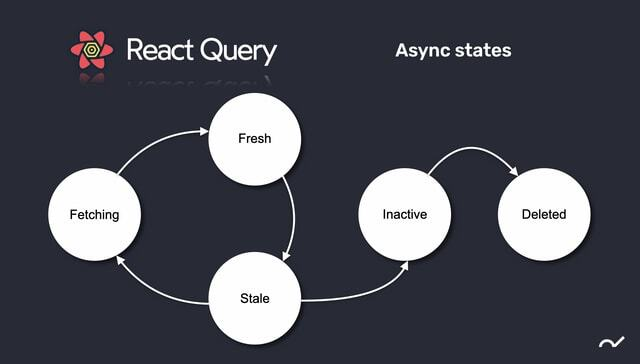

:::note WIL: Weekly I Learned

이번 주 끝낸 일!

1. **티스토리** 포스팅 = **매일 TIL 일지** ( 프로젝트 [목표, 오류] 세분화)
2. Project : MZL (MZ-Languagae) = **프로젝트 완성** ( 배포 >> 발표 )
3. React query 강의 및 실습 = (외부 API 활용)

:::

<!--truncate-->

---

## Project review

이번 '왕초보 mz 완성' 이라는 컨셉의 프로젝트는 IOS 와 안드로이드 환경에서의 개발을 동시에 진행 할 수 있는 **React-native**를 활용한 **하이브리드 앱**을 만들었다.

UI는 낯선 태그들로 다들 복잡하다고 느꼈기 때문에 아주 심플하게 구성하고 로직에 대해 더 집중적인 작업을 진행했다.

기존 프로젝트에서 CRUD 를 구현하면서 회원가입, 로그인 기능에 대한 경험이 없어 이번에는 **회원가입, 로그인, 마이페이지 등에 대해 작업**을 맡게 되었다.

firebase의 Authentication API를 활용하니 뚝딱뚝딱 금방 만들어져서 신기하고 재미있었다.

기본적인 로직이 CRUD와 비슷했다.

- Create - **회원가입**
- Read - **마이페이지**
- Update - **회원 정보수정**
- Delete - **로그아웃, 회원탈퇴**

그래서 API만 잘 활용하면 어렵지 않았다. 다만 회원가입이 되었을 때 에러가 발생하여 시간소요가 컸고 TIL에 상세하게 적었다.

[Tistory - Project : MZL - 로그아웃, 마이페이지 이동 시 에러해결](https://hyoloui.tistory.com/94)

또, 각 **TextInput**을 사용하는 **회원가입, 로그인** 부분에서는 **유효성 검사**를 진행했다.

```js
const alertTextTimer = (message) => {
  setAlertText(message);
  setTimeout(() => setAlertText(''), 3000);
};

const textConfirm = () => {
  if (!email) {
    focusEmail.current.focus();
    alertTextTimer('이메일을 입력해 주세요');
    return true;
  } else if (email.indexOf('@') == -1) {
    alertTextTimer('이메일 형식이 아닙니다.');
    focusEmail.current.focus();
    return true;
  } else if (!password) {
    alertTextTimer('비밀번호를 입력해 주세요');
    focusPw.current.focus();
    return true;
  } else if (password.length < 6) {
    alertTextTimer('비밀번호는 6자리 이상 입력해주세요!');
    focusPw.current.focus();
    return true;
  }
};
```

- 단순하게 유효성 검사를 하는 것 보다 `alertTextTimer` 함수가 **파라미터로 받은 각 텍스트를 setState**하고, `setTimeout` 함수를 이용해 경고창을 띄워주면 코드는 간편하지만 사용자의 번거로움을 덜어주고, **매끄러운 ux**가 되도록 코드를 작성했다!
- **3초가 지나면 다시 state를 비워** 경고 텍스트가 사라지도록 구성하였다.
- ux를 고려하여, Alert를 띄우는게 아닌, Text를 **state**로 띄워주도록 했다.

---

## Study review

아쉽게도 프로젝트 기간이 짧아서 내가 맡게 된 부분에서는 이번에 배운 **React-query**를 사용하지 않았다..

상태관리 라이브러리인 **Redux**를 **비동기 서버통신** 할 수 있는 **React-thunk**, 그것보다 **더 쉽게** 비동기 서버통신을 할 수 있게 해주는 **React-query**는 아주 유용하고 편리한 라이브러리 였는데,



출처 : https://freestrokes.tistory.com/170

아쉽지만 실습으로 만족해야했고, 다음주차에 이어지는 챕터인 **타입스크립트**로 넘어가게 된다.

주말에는 실습했던 영화리뷰 앱을 만들며 **React-query 복습**을 진행하고,

간단하게라도 **Typescript**를 **예습**할 예정이다.

---

- Python
- Javascript
- SPA(JS single page application)
- React JS
- RTK
- React-thunk
- React-query
- React-native

지금까지 쉴틈 없이 빡빡하게 잘 달려왔다. 잘하고 있다는 매니저님의 위로에 더 힘을 내서 수료까지 내 도전의 결실을 맺고싶다.

🦾 빠이팅그.

---

| 2023년 1월                | 1 week                                                                 | 2 week (project)                                      | 3 week | 4 week |
| ------------------------ | ---------------------------------------------------------------------- | ----------------------------------------------------- | ------ | ------ |
| 학습 내용 (프로젝트)             | RN 심화 강의 수강중(react-query, firebase 연동 등), 프로젝트(MZL) 진행중 | RN 프로젝트 '왕초보 mz 완성: mz-language' 배포 >> 발표 |        |        |
| 사용 툴 (default : VS code) | npm, RN, expo, react-query, github                                     | npm, RN, expo, react-query, github                    |        |        |

{/* 이 글은 Tistory(https://hyoloui.tistory.com/97)에서 옮겨 온 글입니다. 원문 작성일: 2023-01-13 */}
