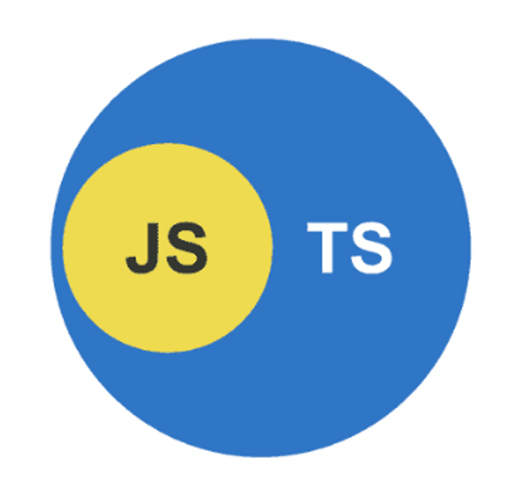
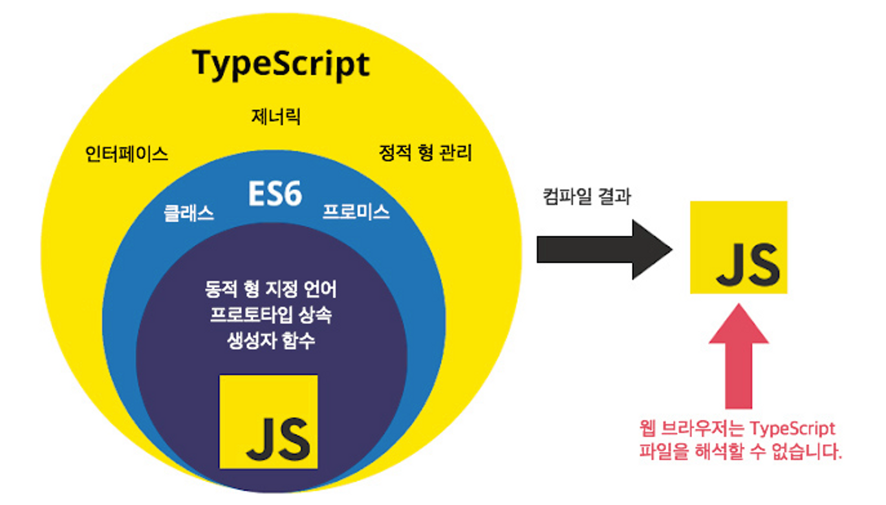

:::note 목적

Typescript (학습노트) 개념, 개발 환경 세팅에서 컴파일 과정까지

:::

<!--truncate-->

## 1. 타입스크립트란?



우리가 기존에 사용하던 javascript는 **동적타입**이지만, typescript는 **정적타입**이다.

**생산성**(유지보수)과 편의를 위해 타입을 추가한 언어라고 생각하면 된다.

ms 에서 개발하였고, 꾸준히 인기와 수요가 상승하고 있다.

## 2. Time

**Javascript는 변수의 타입이 런타임에 결정된다**

**Typescript는 변수의 타입이 컴파일타임에 결정된다**

**컴파일타임? 런타임?**

- 컴파일 타임 (compile time) : 작성한 소스코드가 어떠한 것(js, binary 등)으로 **변환되는 과정**
- 런타임 : 프로그램이 **실행되는 과정**

IDE(VS Code)에서는 컴파일 타임에서 **에러가 날 상황을 빨간줄로 미리** 알려준다.

따라서 Javascript는 여러분의 react 프로젝트를 실행하기전 어떤 오류가 있을 지 알 수 없으나, Typescript는 에러가 날 상황을 미리 여러분의 IDE(vscode)가 알려준다.

| Compiled                       | Interpreted          |
| ------------------------------ | -------------------- |
| 컴파일이 필요 O               | 컴파일이 필요 X      |
| 컴파일러가 필요 O             | 컴파일러가 필요 X    |
| 컴파일하는 시점 O (= **컴파일 타임**) | 컴파일하는 시점 X    |
| 컴파일된 결과물을 실행         | 코드 자체를 실행     |
| 컴파일된 결과물을 실행하는 시점 | 코드를 실행하는 시점 O (= 런타임) |

출처: [velog - TypeScript](https://velog.io/@limdumb/TypeScript)

자바스크립트는 우리가 실제로 **동작을 해야 오류를 발견**할 수 있지만, 타입스크립트의 경우는 컴파일이 되기 전 **개발 과정에서 미리 에러를 발견**할 수 있다.

## 3. Typescript를 왜 쓸까?

| 비교       | 장점                                                                                                                                                                                                                                  | 단점                                                       |
| ---------- | ------------------------------------------------------------------------------------------------------------------------------------------------------------------------------------------------------------------------------------- | ---------------------------------------------------------- |
| typescript | 1. 생태계가 크다<br />2. Microsoft에서 개발한 vscode와 잘 맞는다<br />3. 여러분이 사용하는 대부분의 lib에서 타입 정의 파일을 제공한다<br />4. 유지보수가 JS보다 유리하다<br />5. 적은 양의 코딩을 할 때 쉽고 빠르게 가능<br />6. 프로젝트 사이즈가 커지면 유지보수가 어렵다 | 1. Javascript에 비해 어렵다                                |
| javascript | 1. 다른 언어에 비해 쉽다<br />2. 적은 양의 코딩을 할 때 쉽고 빠르게 가능                                                                                                                                                              | 1. 런타임 시 오류가 검출<br />2. 프로젝트 사이즈가 커지면 유지보수가 어렵다 |

## 4. 생산성(유지보수)가 왜 유리할까?

아래 코드를 typescript에 **작성과 동시에 에러가 발생**한다, 하지만 javascript에서는 **실행해야 에러가 발생**한다.

```ts
const me = {
  name: 'seunghyo',
  gender: 'man',
};

console.log(person.age);
```

- **에러 발생**
  - 정적 타입 언어인 TS는 IDE(vsc)에서 person의 타입을 알기에 에러를 발생시킨다.
  - 동적 타입 언어인 JS는 IDE(vsc)에서 알 수 없다.
- **자동 완성** 기능을 지원하기 때문에 오타, 빠른 사용성을 제공받는다

## 5. 개발 환경 세팅 >> 컴파일

**터미널**에 아래 명령어를 **입력하여 설치**를 진행한다

```bash
# 사용할 프로젝트에 설치할 경우
npm install typescript
```

```bash
# 전역(내 컴퓨터)환경에 설치할 경우
npm install -g typescript
```

터미널에 아래 명령어를 입력하여 작업 **폴더 내부에 'typescript compiler' 설치**한다

```bash
npx tsc --init
```

<details>
<summary>실행 결과</summary>

```bash
PS C:\Users\tmdgy\Desktop\study\08_typescript> npm install -g typescript

added 1 package, and audited 2 packages in 3s

found 0 vulnerabilities
PS C:\Users\tmdgy\Desktop\study\08_typescript> npx tsc --init

  target: es2016
  module: commonjs
  strict: true
  esModuleInterop: true
  skipLibCheck: true
  forceConsistentCasingInFileNames: true

You can learn more at https://aka.ms/tsconfig
```

</details>

터미널에 위처럼 출력되면 정상적으로 **개발 환경이 세팅** 된 것이다!



**컴파일 과정**은 무척 쉽다! 이제 폴더 내부에 '파일이름.ts' 를 생성 후 본인의 작업을 마치고,

```bash
npx tsc
```

위 명령어를 입력하면, 기존에 tsc 명령어로 생성한 `tsconfig.json`과 내가 작업한 `hello.ts`와 `hi.ts` 이렇게 세가지를 만들었지만, 내가 생성하지 않은 **JS파일이 생기고** js 파일을 열어보면 생소한 구문으로 **컴파일이 된 것을 확인** 할 수 있다.

```ts title="hello.ts"
export const hello = () => {
  console.log("hello");
};
```

```js title="hello.js"
"use strict";
Object.defineProperty(exports, "__esModule", { value: true });
exports.hello = void 0;
const hello = () => {
  console.log("hello");
};
exports.hello = hello;
```

:::tip 최종 정리

1. 자바스크립트 == 동적타입, **타입스크립트 == 정적타입**
2. Typescript는 **변수의 타입이 컴파일타임에 결정**된다
3. 타입스크립트는 **에러를 미리 발생**해주며 **자동완성** 기능으로 생산성 향상
4. [**환경세팅**] 프로젝트, 전역에 typescript 설치(install) >> 컴파일러(tsc) 설치 >> 컴파일(npx tsc)

:::

{/* 이 글은 Tistory(https://hyoloui.tistory.com/98)에서 옮겨 온 글입니다. 원문 작성일: 2023-01-16 */}
