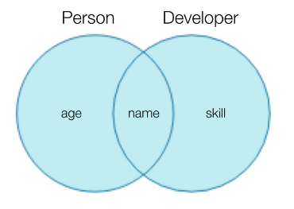

:::note 목적

TS Interface extension(인터페이스 확장), 정리 및 복습

:::

<!--truncate-->

## 1. 인터페이스 확장

**타입 별칭**과 **인터페이스**의 차이점은 타입의 확장 가능 여부이다.

**인터페이스는 확장이 가능**한데 **타입 별칭은 확장이 불가능**하다.

이 때문에, type 보다는 interface로 선언해서 사용하는 것을 추천한다.

방법은 두가지 이다

### 1. extends

`interface 새로운 인터페이스명 extends 붙일 인터페이스명`

```ts
// interface extension

interface Person {
  name: string;
  age: number;
}
interface Korea extends Person {
  birth: "korea";
}
//          vv 아래 내용과 동일하다
interface Korean {
  name: string;
  age: number;
  birth: "korea";
}
```

### 2. 선언적 확장

interface 인터페이스명을 재선언 하는 것

```ts
interface teset {
  title: string;
}

interface teset {
  ts: number;
}

// 같은 interface 명으로 teset를 다시 만든다면, 자동으로 확장이 된다.

const text: teset = {
  title: "header",
  ts: 12,
};

console.log("👉👉  text", text); // 👉👉  text { title: 'header', ts: 12 }
```

## 2. 인터페이스 확장 활용 하기

```ts
interface Korean {
  name: string;
  age: number;
  birth: "korea";
}
interface Developer {
  job: "developer";
}
interface KorandDev extends Korean, Developer {
  // 타입을 선언하지 않아도 아래처럼 들어오게 된다
  // name: string;
  // age: number;
  // birth: "korea";
  // job: "developer";
}
const test0: KorandDev = {
  name: "승효",
  age: 27,
  birth: "korea",
  job: "developer",
};
console.log("👉👉  test0", test0);
//👉👉  test0 { name: '승효', age: 27, birth: 'korea', job: 'developer' }
```

## 3. intersection Type: 여러 타입을 모두 만족하는 하나의 타입



```ts
// intersection type
interface Person {
  name: string;
  age: number;
}

interface Develop {
  name: string;
  skill: string;
}

type Devjob = Person & Develop;

const abcPerson: Devjob = {
  name: "john",
  age: 12,
  skill: "html",
};
console.log("👉👉  abcPerson", abcPerson);
```

:::tip 최종 정리

1. 타입별칭과 인터페이스의 가장큰 차이점은 확장 가능 여부이다.
2. type 보다는 interface로 선언해서 사용하는 것을 추천.
3. 확장 방법은 [ `extends` 활용, 선언적 확장 ] 2가지로 분류된다.
4. intersection Type 을 사용할 때 중복되는 속성이 있어도 된다.

:::

{/* 이 글은 Tistory(https://hyoloui.tistory.com/105)에서 옮겨 온 글입니다. 원문 작성일: 2023-01-19 */}
