:::note 🎯목적

- Git hub : Pull request 개념 정리
- 적용 : Pull request 활용, 팀원들과 코드 리뷰하기

:::

<!--truncate-->

---

## 1. PR은?

프로젝트의 Contribute로 등록되지 않는다면 Fork 하여 repository를 복사해 나의 깃허브 repo로 가져오는 방법이 있지만.

해당 포스팅 내용에서는 팀원으로써 같이 프로젝트에 참여 한다고 가정한다.

우리는 contributor 가 되어 프로젝트를 클론하여 작업한 후 주된 기능이 모여있는 `dev` 나 `develop` 브랜치로 '**내 작업 내용을 반영해 주세요**' 하고 요청하는 것 이다.

이렇게 요청하는 것이 Pull Request 를 보낸다, 날린다고 한다

PR을 통해 코드 **충돌을 최소화**하고, push 권한이 없는 오픈소스 프로젝트에 기여할 때 많이 사용하며,

PR을 사용해야 하는 이유는 프로젝트 코드에 **변동이나 작업 내용을 보며 서로의 의견을 comment로 주고받을 수 있고**, 더 효율적이고 **질높은 코드를 완성**할 수 있도록하기 위함이다.

---

## 2. PR 요청

먼저 git hub 에서 해당 프로젝트의 repository 페이지를 열고

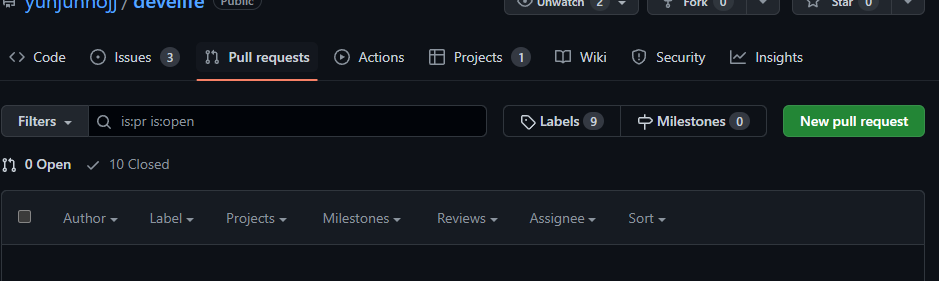

우측에 보이는 'New pull request' 버튼을 클릭한다

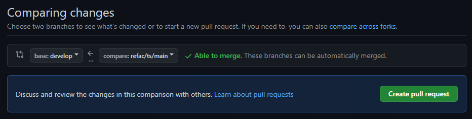

이후 위에 `base` 와 `compare` 를 잘 확인해야 한다

:::warning

실수로 main에 PR날리는 실수가 있으니 항상 조심하자!

:::

PR 보낼 브랜치 `<<` 내가 작업한 브랜치

우측에 보이는 'Create pull request' 버튼을 클릭한다

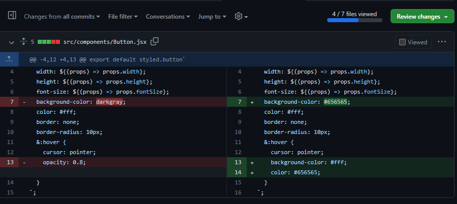
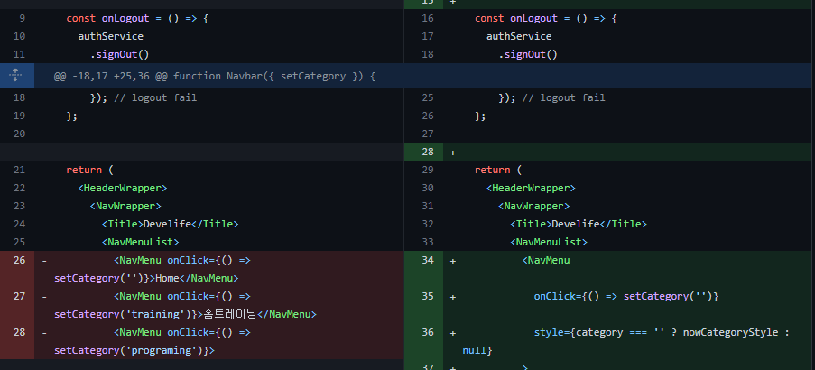

위 처럼 어떤 내용이 변경되었는지 검토할 수 있다.

검토가 완료된 파일은 우측상단 Review change 버튼 아래 보이는 Viewed 체크박스를 클릭해 다음 파일로 넘어가 검토를 진행하면 된다

자 모든 파일이 검토가 되었다면 Review change 버튼을 클릭하여 간단한 코멘트를 남기고

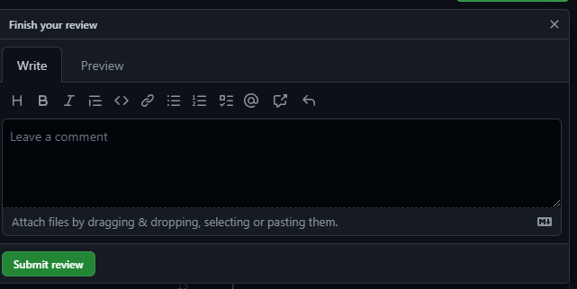

Submit review 버튼을 클릭해 PR 요청을 완료한다

---

## 3. PR 검토

위처럼 누군가 새로운 PR 요청을 했다면, repository 내부의 pull request 라는 항목에 새로운 PR이 생겼을 것이다.

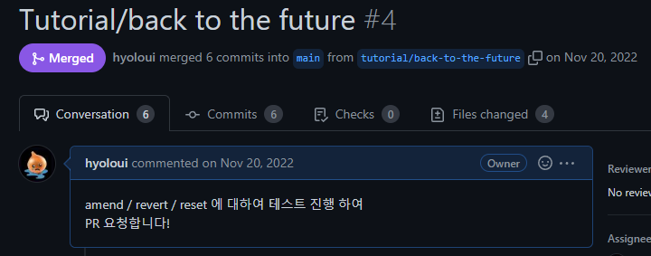

해당 하는 PR 페이지로 이동하여 코멘트를 확인 한 후 Files changed 탭에서 4개의 변동된 파일에 대해서 자세히 들여다보자.

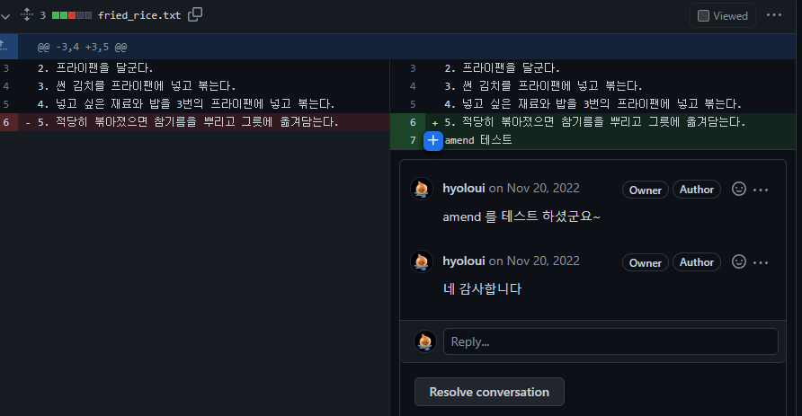

코드내용에 코멘트를 남길 수 있으며, 좌측에 표시되는 line number를 **드래그하여 영역 지정도 가능**하다

이로써 '**모든 변경사항 + 코드 리뷰**'를 함께 공유할 수 있게 되었다.

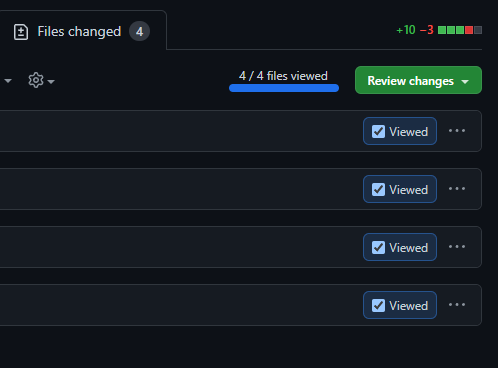

이렇게 하나씩 **검토를 진행**하고, 4개 파일의 모든 변경사항에 대해 검토가 끝났다.

---

## 4. PR 수락

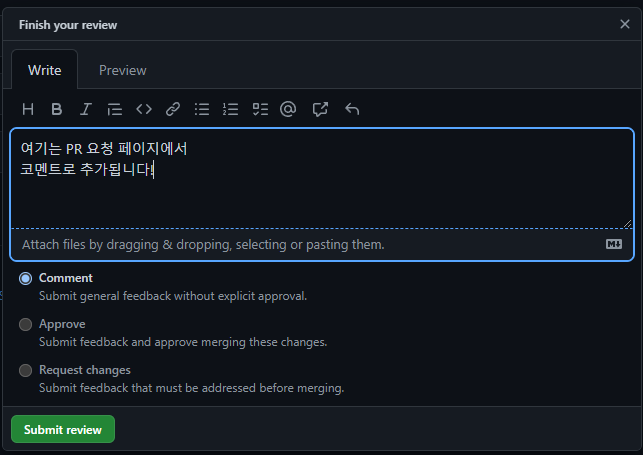

위에서 File change에 대한 검토가 완료되었다면 Review change 버튼을 클릭해 PR의 상태를 업데이트 할 수 있다.

- Comment : 검토 후 피드백 댓글만 남김.
- **Approve** : 피드백 댓글과 승인이 이루어 짐.
- Request changes : 해당 PR 요청자에게 피드백 댓글을 남기고 수정하도록 요청.

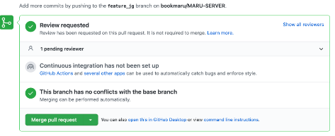

PR요청과 **Approve** '승인'이 이루어지면 PR 페이지에 위와 같은 Merge pull request 버튼이 생긴다! (+ repository Rule에서 인원수, 제한 설정 가능)

버튼을 클릭하면

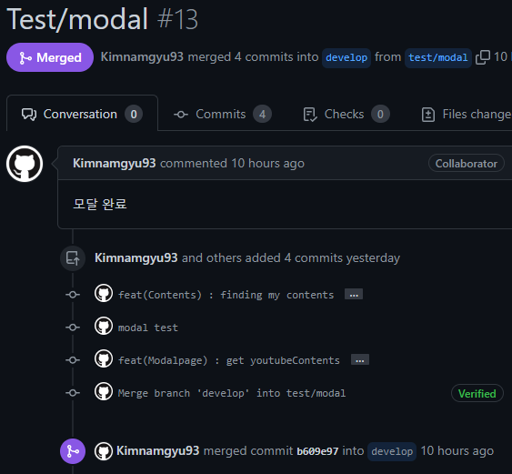

보라색 **Merge 상태**로 변하면서 merge되었다는 것을 확인 할 수 있다.

추가로 github에서는 브랜치 삭제 여부를 묻는 **delete branch 버튼**을 생성한다. 해당 브랜치에서의 추가 작업이 없다면

되도록 삭제하여 목적에 맞는 브랜치를 생성하고, 해당 브랜치에서 작업하고를 반복해

깔끔한 PR과 코드리뷰를 쌓아가길 바란다!

---

## + 팀원들과 코드 리뷰

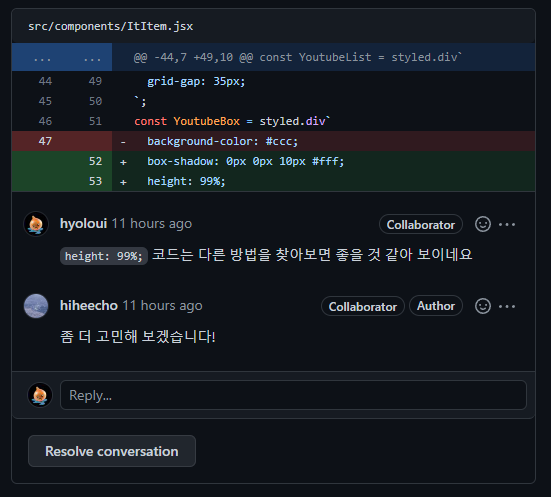

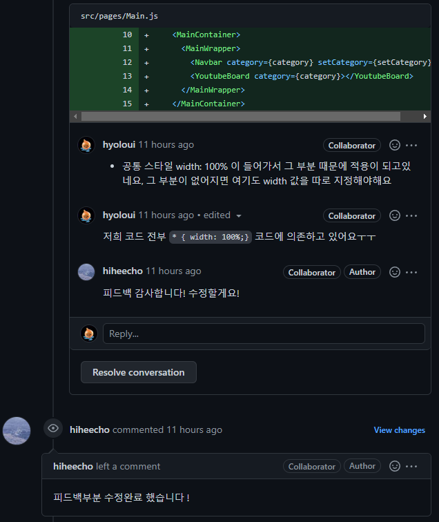

---

:::tip 최종 정리

1. pull request 는 ' 내 작업내용을 반영해 주세요 ' 하고 요청하는 것.
2. PR 하여 코드의 질을 높이자, 코드리뷰 + 좋은 솔루션을 얻기 위해.
3. PR 전 내가 작업한 브랜치에서 원격(origin) 브랜치로 push가 되어있어야 함.
4. PR요청은 깃허브 페이지에서 내 작업 내용을 검토한 후 코멘트를 추가할 수 있다
5. 제한사항 내에서 본인, 타인이 File Change를 확인하고 comment, approve, request change 할 수 있다.
6. approve 가 되었다면 merge pull request 가 가능하고, merge pull request가 끝나면 반영이 완료 된 것.
7. delete 브랜치로 추가작업이 없는 브랜치는 삭제하자

:::

{/* 이 글은 Tistory(https://hyoloui.tistory.com/110)에서 옮겨 온 글입니다. 원문 작성일: 2023-01-27 */}
