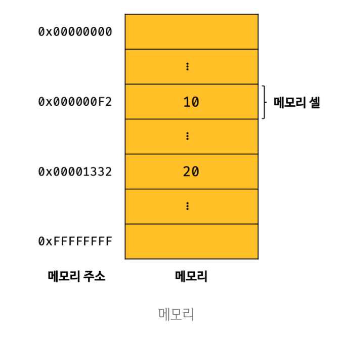
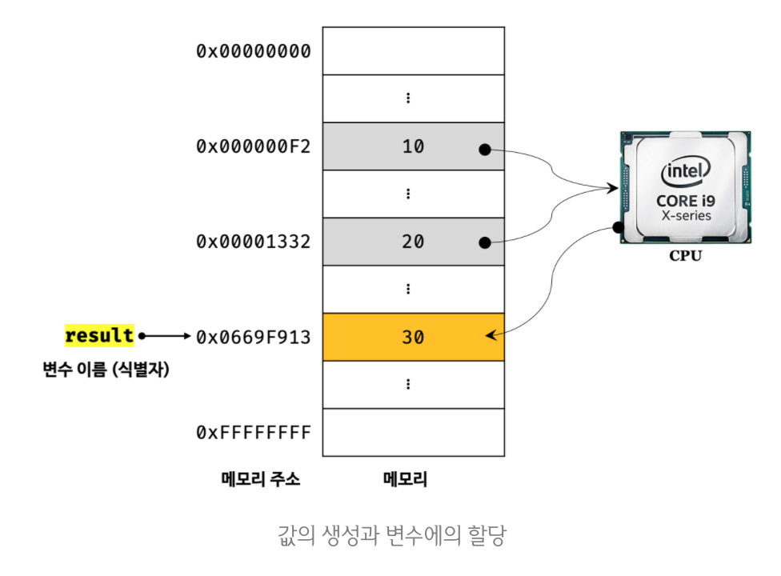
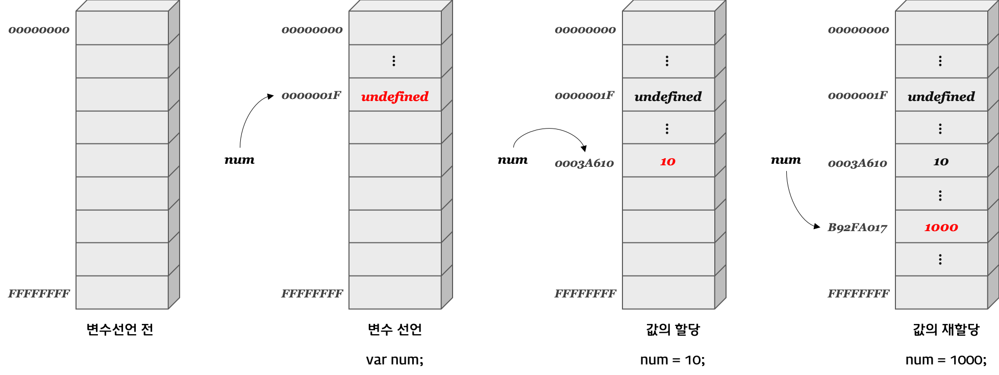
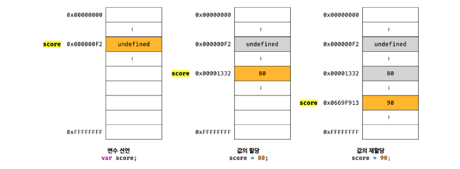

❤️‍🔥 TIL : Today I Learned

:::note

프로그래밍 언어에서 데이터를 관리하기 위한 핵심 개념

:::

<!--truncate-->

## 변수

> **하나의 값을 저장하기 위해 확보한 메모리 공간 자체 또는 그 메모리 공간을 식별하기 위해 붙인 이름을 말한다.**

### 변수란 무엇인가? 왜 필요한가?

애플리케이션은 데이터를 다룬다. 아무리 복잡해도 **데이터를 입력(input)받아 처리하고, 결과를 출력(output)** 하는 것이 전부다.

컴퓨터는 **CPU를 사용해 연산**하고, **메모리를 사용해 데이터를 기억**한다.

**메모리**

메모리(memory)는 데이터를 저장할 수 있는 메모리셀의 집합체다. 1바이트 단위로 데이터를 저장(save)하거나 읽어(read) 들인다.



각 셀은 그림의 왼쪽에 보이는 것 처럼 **메모리 주소**를 갖는다. **메모리 공간의 위치**를 나타낸다.

컴퓨터는 모든 데이터를 2진수로 처리하고, **데이터의 종류(숫자, 텍스트, 이미지, 동영상 등)와 상관없이 모두 2진수로 저장**된다.

위 그림에서는 편의상 10진수로 표기했지만, 메모리에 저장되는 **모든 값은 2진수로 저장된다는 것을 기억**하자.

- 변수명(변수 이름) : 메모리 공간에서 저장된 값의 위치를 가리키는 상징적인 이름
- 변수 값 : 메모리 공간에 저장된 값
- 할당 : 메모리에 공간에 값을 저장하는 것
- 참조 : 메모리에 저장된 값을 읽어들이는 것

### 식별자



변수 이름을 식별자(identifier)라고도 한다. 식별자는 어떤 값을 구별해서 식별할 수 있는 **고유한 이름**을 말한다.

식별자는 값이 아니라 **메모리 주소**를 기억하고 있다.

식별자라는 용어는 변수이름에만 국한해서 사용하지 않는다. 변수, 함수, 클래스 등의 이름은 모두 식별자다. 또한 식별자는 **네이밍 규칙**을 준수해야 하며, **선언(declaration)** 에 의해 자바스크립트 엔진에 식별자의 존재를 알린다.

### 변수선언(declaration)

**메모리공간을 확보** 하고 변수 이름과 확보된 메모리 **공간의 주소를 연결**해서 값을 **저장할 수 있게 준비**하는 것이다.



- 변수를 사용하려면 반드시 **선언**이 필요하다.
- 변수 선언할 때는 `var`, `let`, `const` 키워드를 사용한다.
- 변수 선언에 의해 확보된 **메모리 공간**은 자바스크립트 엔진에 의해 **`undefined` 라는 값이 암묵적으로 할당** 되어 초기화 된다.

**변수 선언단계**

1. 선언단계 : 변수 이름을 등록해서 자바스크립트 엔진에 변수의 존재를 알린다.
2. 초기화 단계 : 값을 저장하기 위한 메모리 공간을 확보하고 암묵적으로 `undefined`를 할당해 초기화 한다.

## 변수 선언의 실행 시점과 변수 호이스팅

```js
console.log(score);

var score;
```

위 코드에서는 왜 `ReferenceError`(참조 에러)가 나지 않고 `undefined`가 출력이 될까..

그 이유는 코드가 실행되는 시점, 즉 런타임이 아니라 그 이전 단계에서 먼저 실행되기 때문이다. 실행하기에 앞서 먼저 소스코드의 **평가과정**을 거치면서 소스코드를 **실행하기 위한 준비**를 한다.

이러한 과정으로 변수 선언문이 코드의 선두로 **끌어 올려진 것처럼 동작**하는 자바스크립트 고유의 특징을 변수 **호이스팅**이라 한다.

### let 과 const도 호이스팅이 될까?

`let`과 `const`도 **호이스팅**이 된다. 🙆‍♀️ 그럼 왜 `ReferenceError`가 발생하는걸까? ⇒ 변수 할당 단계의 차이

- `var` 변수 : 1. 선언-초기화 → 2. 할당
- `let`, `const` 변수 : 1. 선언 → 2. **TDZ** → 3. 초기화 → 4. 할당

:::note TDZ

`let`/`const` 선언은 실행중인 실행컨텍스트의 어휘적 환경으로 범위가 지정된 변수를 정의한다. 변수는 그들의 어휘적 환경에 포함될 때 생성되지만 어휘적 바인딩이 실행되기 전까지는 엑세스 할 수 없다. **[TDZ]**

:::

### 값의 할당

할당 연산자 `=` 를 사용하여 변수에 값을 할당한다.

값의 할당은 소스코드가 순차적으로 실행되는 시점인 런타임에 실행된다. 변수 선언은 런타임 이전에(평가) 실행되고 값의 할당은 런타임에 실행된다.

변수의 선언과 값의 할당을 하나의 문(statement)으로 단축 표현해도 자바스크립트 엔진은 변수의 선언과 값의 할당을 2개의 문으로 나누어 각각 실행한다. 따라서 변수에 `undefined` 가 할당되어 초기화 되는 것은 변함이 없다.

### 값의 재할당

재할당은 이미 값이 **할당되어 있는 변수에 새로운 값을 또다시 할당**하는 것을 말한다.



여기서 중요한 점은 재할당할 때 이전 값 80이 저장되어 있던 메모리 공간을 지우고 메모리 공간에 재할당 값 90을 새롭게 저장하는 것이 아니라 새로운 메모리공간을 확보하고 그 메모리 공간에 숫자 값 90을 저장한다.

### 식별자 네이밍 규칙

- 식별자는 특수문자를 제외한 문자, 숫자, 언더스코어(`_`), 달러기호(`$`)를 포함할 수 있다.
- 단, 식별자는 특수문자를 제외한 문자, 숫자, 언더스코어(`_`), 달러기호(`$`)로 시작해야한다. 숫자로 시작하는 것은 허용하지 않는다.
- 예약어는 식별자로 사용할 수 없다.

**예약어** (`*` 표시는 식별자로 사용 가능하나 strict mode에서는 사용 불가)

| | | | | | |
| --- | --- | --- | --- | --- | --- |
| `await` | `break` | `case` | `catch` | `class` | `const` |
| `continue` | `debugger` | `default` | `delete` | `do` | `else` |
| `enum` | `export` | `extends` | `false` | `finally` | `for` |
| `function` | `if` | `implements*` | `import` | `in` | `instanceof` |
| `interface*` | `let*` | `new` | `null` | `package*` | `private*` |
| `protected*` | `public*` | `return` | `super` | `static*` | `switch` |
| `this` | `throw` | `true` | `try` | `typeof` | `var` |
| `void` | `while` | `with` | `yield*` | | |

## 네이밍 컨벤션 (Naming Convention)

**카멜 케이스 (camelCase)** : 보통 자바스크립트의 변수나 함수명

```js
const firstName;
```

**스네이크 케이스 (snake_case)**

```js
const first_name;
```

**파스칼 케이스 (PascalCase)** : 보통 자바스크립트의 클래스명

```js
const FirstName;
```

**헝가리언 케이스 (typeHungarianCase)**

```js
const strFirstName; // type + identifier
const $element = document.querySelector("#myId"); // DOM Node
const observable$ = fromEvent(document, "click"); // RxJS 옵저버블
```

:::tip 최종 정리

- 변수명(변수 이름) : 메모리 공간에서 저장된 값의 위치를 가리키는 상징적인 이름
- 변수 값 : 메모리 공간에 저장된 값
- 할당 : 메모리에 공간에 값을 저장하는 것
- 참조 : 메모리에 저장된 값을 읽어들이는 것

:::

본 포스팅은 [모던 자바스크립트 Deep Dive](https://book.naver.com/bookdb/book_detail.nhn?bid=16710547)를 공부하면서 정리한 내용입니다.

{/* 이 글은 Tistory(https://hyoloui.tistory.com/113)에서 옮겨 온 글입니다. 원문 작성일: 2023-01-30 */}
