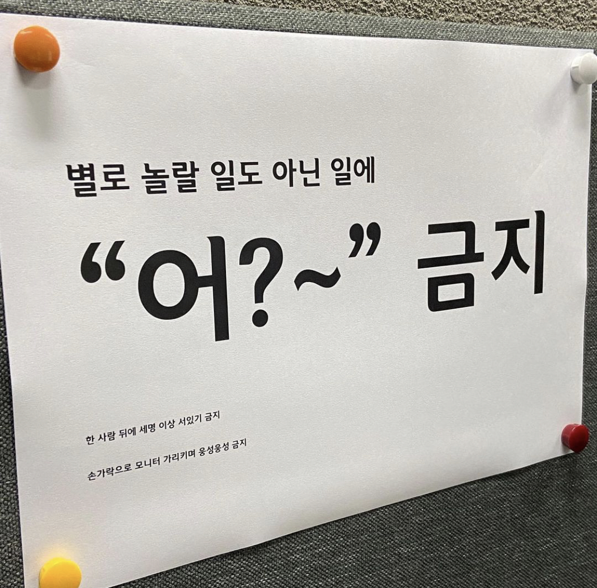

:::note WIL: Weekly I Learned

이번 주 한 일!

1. Project : Codefolio = **프로젝트 진행중** ( 1.0.0 > 1.1.0 version 배포 )

:::

---



<!--truncate-->

## Project review

기획 & 디자인 회의를 하며..

사실 우리의 mvp가 잦은 변동이 생기고 타겟(고객)층이 명확하지 못한 문제점이 제기되어 긴 기획 회의 끝에 의견을 좁히는 과정이 순탄하지는 않았다.

하지만 이것 또한 충분한 경험이라고 생각한다.

디자이너 관점, 기획자 관점, 개발자 관점을 두루 생각하게 되는 계기가 되었고, 또 의견 조율하는 과정에서의 커뮤니케이션과 기획 의도를 명확하게 전달하는 부분에서의 시행착오를 겪게 되었다.

이후 페이지 작업에 돌입해서 각자 컴포넌트별로 작업하여 나누었던 테스크를 합쳐 페이지를 구성하게 되었다.

나는 Post-page를 구성했고, 그 과정에서 다른 팀원이 작성한 공용/하위 컴포넌트를 하나하나 뜯어보고 이해하는데 적지 않은 시간이 필요했다. 또한 해당 컴포넌트에서 처리하는 로직의 의도와 목적을 정확히 간파해야 하는 수고를 피부로 느꼈고,

각 컴포넌트에서 **확장성을 고려한 작업**을 해야하고, **의존성의 중요성**에 대해 뼈저리게 느끼게 되었다.

왜나하면, 해당 컴포넌트를 다른 페이지에서 사용하게 될 경우, 다른 의도로 페이지를 구성해야 하는 문제들이 끊임 없이 발생하는 개발 단계에서 변동에 직면 하게 된다면 컴포넌트의 구조를 다시 변경(유지 보수)하고 로직 처리부분에 큰 소요가 발생한 다는 것을 느꼈다.

:::tip

**공용 및 하위 컴포넌트는 의존성이 없이 UI만 처리**하도록 하는 것이 좋다.

:::

이후 Post 페이지에서 이루어지는 **supabase API**를 이용하여 **서버 통신을 연결**했고, toast UI Editor 에서 유저가 입력하는 코드를 컬러처리 해주기 위해 plugin인 **code syntax highlight plugin과 prism(library)을 적용** 해 주었다. (추후 react-query로 리펙토링)

그리고 이미지를 처리하기 위해 가장 많은 사용자와 커뮤니티를 가진 이미지 **압축 라이브러리인 compressImg를 적용**해 주었고, 로그아웃과 이후에 이루어지는 GNB 조건부 렌더(로그인 감지하여 Login & Logout)를 만들었다.

그리고 전에 컴포넌트에서 만들었던 `DropDown` 컴포넌트에서 이루어지는 로직이 의존성이 너무 강하고, 다른 컴포넌트에서 사용할 일이 없었기 때문에 post 에 종속된 컴포넌트로 이관을 시켰다.

또 문제점으로, 생년 월일을 선택하지 않은 기본값일 때 선택 안함을 보여줘야 했는데 string이라면 간편하게 추가하면 되지만 우리 프로젝트느 SQL로 정규화 된 데이터를 사용하기에 함부로 바꿀 수 없었다. 그리하여 null 일 경우 '선택되지 않음'으로 직접 핸들링 하였다.

이후 MyPage의 배경색을 `input type="color"` 로 color picker 기능을 추가하였고, 다시 뷰어에서 보여주는 것 까지 문제없이 작업이 되었다.

그렇게 1.0.0 version이 Vercel에서 잘 deployed 되었고, 추가적인 버그와 자잘한 오류를 수정해 1.0.1 version 까지 deployed 되었다.

```js
import { Viewer } from "@toast-ui/react-editor";                  // 893.6k (gzipped: 265.8k)
import codeSyntaxHighlight from "@toast-ui/editor-plugin-code-syntax-highlight";  // 13.4k (gzipped: 4.2k)
import Prism from "prismjs";                                      // 19.7k (gzipped: 7.3k)
```

위처럼 **toast UI의 무거운 파일 크기**를 인지해 2.0.0 버전이 나올 때 다시 한번 고민하고 팀원들과의 의견을 종합해 결정 할 소요가 생겼다.

Detail 페이지에서 작성된 코드를 리더님이 리펙토링 하였는데 약 60%의 로딩 속도 개선이 있었다.

react-query에서 제공하는 `isLoading` 로직을 `if( !a || !b || c)` loading UI 로 구성하고 하위 컴포넌트에서 각각 이루어지던 서버통신을 최상위 컴포넌트에서 한번만 실행하고 하위로 필요한 데이터만 전달 하였다.

깊은 감동이 밀려왔다.

1.0.1 version 이후 version에서 내가 작성한 코드를 **해결해야 할 문제**는 아래와 같다.

1. Color picker에서 cover image 로 변경
2. Editor에서 이미지를 작성했다가 삭제 했을 때 storage에서 삭제
3. Editor에서 이미지 업로드시 유효성 검사 및 용량 제한
4. 각종 버그, style 디테일 수정

---

최종 프로젝트이다 보니 정말 일분 일초 팀원들과 함께 몰입하니 어떻게 시간이 이렇게 빠르게 지나가는지 모르겠다.

사실 잠도 많이 없고, 피곤함을 잘 못느끼는 터라 나는 괜찮았지만 팀원들이 힘들어도 모두 같이 열심히 해줘서 너무 좋은 경험을 하고 있다는 생각이 든다.

🦾 A반 챌린지팀 빠이팅!!

---

| 2023년 2월                | 1 week                                           | 2 week (project)                                                                                                    | 3 week                                                                                                                                                                       | 4 week |
| ------------------------ | ------------------------------------------------ | ------------------------------------------------------------------------------------------------------------------- | ---------------------------------------------------------------------------------------------------------------------------------------------------------------------------- | ------ |
| 학습 내용 (프로젝트)             | Next.js 학습 및 실습 (강의), 모던 자바스크립트 발표 및 TIL 정리 | 유저 플로우 설계, API 설계, 라이브러리 선정, 컴포넌트 설계, DB 설계, 라우팅 설계, 폴더구조 설계, ESLint 설정 >> init, 24H 헤커톤 진행 | 기획 마무리, 페이지 구성(컴포넌트 병합), 각 컴포넌트와 기능별 task 관리, github issue로 작업 객관화, post-page, supabase 연동, 로그아웃 후 조건부 렌더링, mypage background, toast-ui text editor |        |
| 사용 툴 (default : VS code) | Next.js(ssr, ssg, isr) / Typescript              | 생략.                                                                                                                 | 생략,                                                                                                                                                                        |        |

{/* 이 글은 Tistory(https://hyoloui.tistory.com/128)에서 옮겨 온 글입니다. 원문 작성일: 2023-02-23 */}
