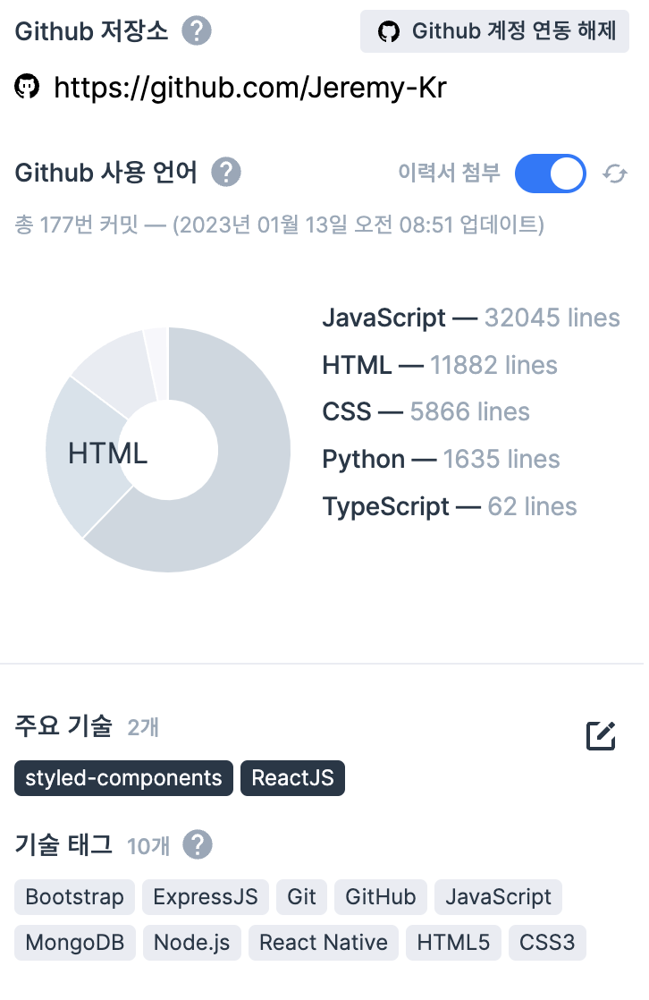

[3주차까지의 후기 및 소감](https://www.notion.so/2f91add647204b07bcbfb4de6506d243)

<!--truncate-->

---

## 1. MVP 중간발표 자료(기입)

- [codefolio-중간발표](https://drive.google.com/file/d/1KOrHStRDEbr5ntKfacaeIZujRm3_U3Iy/view?usp=share_link)

---

## 2. 기술적 의사결정 & 트러블슈팅 기록

- [라이브러리 선정](https://www.notion.so/134c5edeb0d74724a7c381ca08e10c1f)
- [캐러셀 라이브러리 선정 · Issue #44 · react-challengers/Codefolio](https://github.com/react-challengers/Codefolio/issues/44)
- [toast UI Editor 작성중 영역 (노란 박스) 사용 여부 의사결정 · Issue #162 · react-challengers/Codefolio](https://github.com/react-challengers/Codefolio/issues/162)
- [Recoil VS Jotai · Discussion #197 · react-challengers/Codefolio](https://github.com/react-challengers/Codefolio/discussions/197)
- [Toast UI Editor VS Tiptap VS ETC... · Discussion #198 · react-challengers/Codefolio](https://github.com/react-challengers/Codefolio/discussions/198)

---

## 3. 중간발표 피드백 기록

- 월요일에 대면 피드백을 꼼꼼히 기록해두고, 개선이 필요한 사항에 적용해봅시다.(추후 작성)

---

## 4. 중간 발표 후 회고

**1) 미구현 된 MVP 기능**

- 검색 기능 (자동완성 지원)
- 알람기능 (좋아요 및 댓글에 대한 알람)

**2) 추가/개선 할 기능과 그 이유**

- (추가) 게시글 및 사람 추천 뱃지 : 단순한 좋아요가 아닌, 프로젝트나 사람에 대한 긍정적인 피드백을 주기 위해
- (추가) github api 추가 : 외부 API를 사용해 데이터를 가져오는 경험 + 부트캠프 컨셉에 맞는 API 적용
- (개선) react-query로 리팩토링 진행
- (개선) atom 원자단위 리팩토링 진행
- (논의) Toast UI Editor에서 타 Editor로 변경하여 라이브러리 용량, 성능 개선
- (논의) Recoil to Jotai 리팩토링 논의
- (스타일) 디자인 완성본 적용, 인터렉션

**3) 추가/개선할 기능을 어떻게 구현 할 것인지**

- 게시글 및 사람 추천 뱃지 : 좋아요 기능에 type 추가, post table에 column 추가

- github api 추가 : 개인의 사용언어, 프로젝트별 기여 정도를 대략적으로 파악할 수 있게끔 구성

---

## 5. 앞으로의 계획 및 우선순위

| 순위 | 구분   | 앞으로의 계획 (구체적으로)             |
| ---- | ------ | -------------------------------------- |
| 1    | MVP    | 검색 기능 구현하기                     |
| 2    | MVP    | 알람 기능 구현하기                     |
| 3    | 개선   | react-query로 리펙토링 진행하기        |
| 4    | 개선   | atom 원자단위 리펙토링 진행하기        |
| 5    | 스타일 | 디자인 완성본 적용 및 인터렉션 고도화 하기 |

---

## 6. 이번주(23.03.03)까지 해야할 일

- 팀 전체
  - [ ] 1.1.0 version Issue task 세분화 하기
    - [ ] [1.1.0 버전 · Issue #171 · react-challengers/Codefolio](https://github.com/react-challengers/Codefolio/issues/171)
  - [ ] 추후 디벨롭 계획 작성하기
  - [ ] **잘 쉬기!(중요)**

{/* 이 글은 Tistory(https://hyoloui.tistory.com/129)에서 옮겨 온 글입니다. 원문 작성일: 2023-02-25 */}
