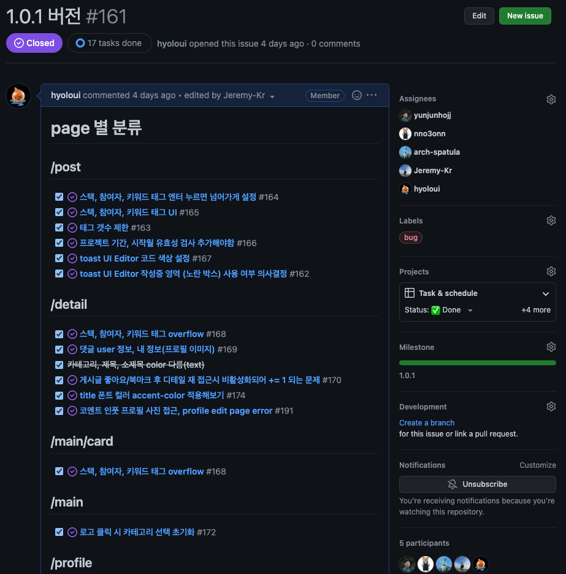
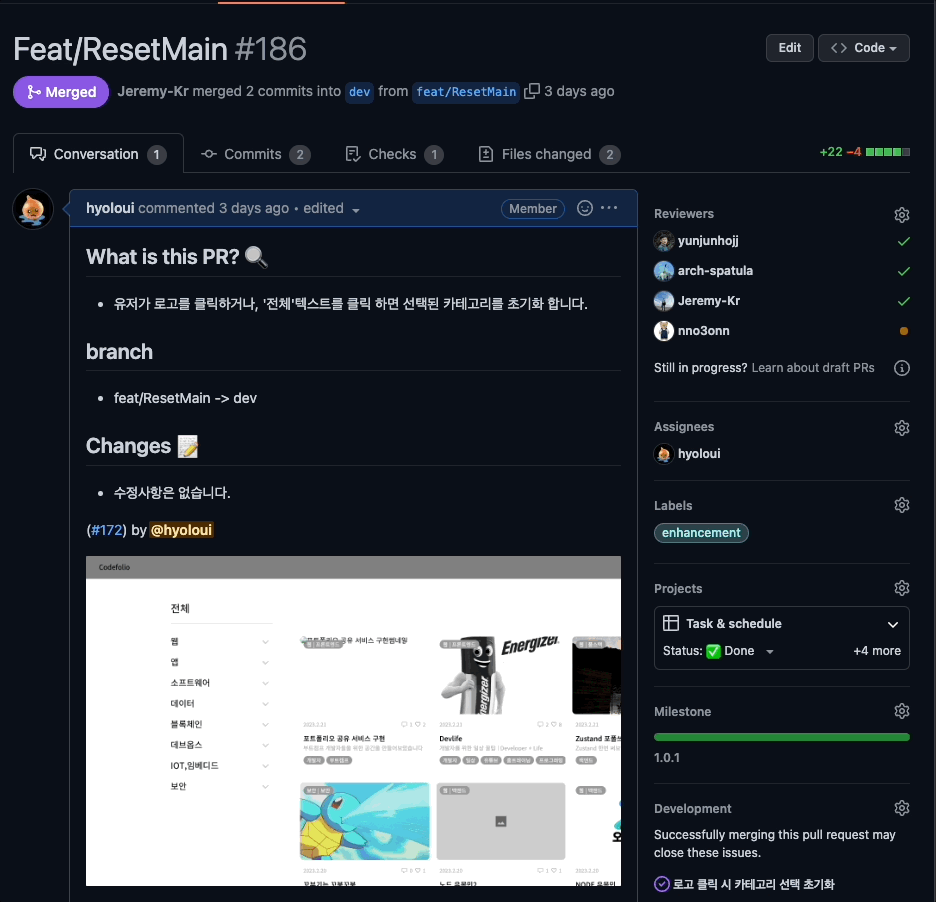

:::note WIL: Weekly I Learned

이번 한 일!

1. Project : Codefolio = **프로젝트 진행중** ( 폴더링, 중간 발표, KTP 회고 )

배운 내용

- 컴포넌트 별 작업 후 페이지에 적용
- supabase 연동하여 서버통신
- Next에서의 dev dependency array

:::

<!--truncate-->

---

## Project review

테스크 관리, 프로젝트 프로세스가 잘 진행되는 깊은 팀 프로젝트 경험을 하고 있습니다.

더욱 발전 되도록 기여하고 싶습니다!

3주차 중간 발표 튜터님 피드백

- 최종 발표시 + 부가설명이 필요.
- readme 데이터 모델링 추가.
- 트러블 슈팅 아주 칭찬합니다.
- 버그 개선하여 최종 발표까지 준비 잘 하길.

중간 발표에서는 캠프 측에서 7분의 발표시간을 꼭 준수해달라고 요청하여(타 팀원의 발표시간 보장) 최대한 내용을 압축하여 발표 준비를 했으나, 장점을 가미하여 발표했으면 좋겠다는 피드백이 있어 조금 더 신경써서 발표자료 준비를 해야겠다.

readme 데이터 모델링은 디자인과 기획이 계속 변동되어 테이블에서도 잦은 변동이 있어 모델링 내용을 제외했다. 하지만 결정이 되고 나면 세부적으로 작성할 예정이다.

트러블슈팅으로는 단순하게 에러, 디버깅이 아닌 성능개선 부분에 중점을 두었고, 이러한 부분에서 칭찬을 받았다. 앞으로 이런 부분을 상기하며 트러블슈팅이 이루어지도록 유지해야겠다.(keep going!)

버그 개선은 테스트를 진행하며 알아차린 부분도 있고, 유저 피드백 등에서 나타난 버그가 있었으나 리펙토링, 라이브러리 교체 등으로 개선 될 예정이다.

개인적으로, 우리가 가장 잘 하고 있는 점은 테스크 관리라는 것이다.

Github의 project, issue 등 유용한 기능들을 사용하여 테스크(업무) 분담을 하고, Assigness에 담당자를 지정하고 작업 완료 후 PR로 해당하는 이슈를 연동하여 어떠한 부분을 해결하였는지 스크린샷과 gif 등을 이용해 더욱 개선사항을 보여주곤 했다.

---

## WIL

디자인과 기획 회의를 마주하며 각자가 추구하는, 머릿속에 그리고있는 mvp가 정확히 일치하기가 힘들다는 것을 느꼈다. 이 부분은 명확한 의사전달과 시각 자료가 필요하다고 느끼며 경험했다.

Page에 공용 컴포넌트, 사용 될 컴포넌트를 가져와서 붙이고 조합하면서 배운 것은 내 코드를 보고 한눈에 이해할 수 있도록 작업해야 한다는 부분이고, js doc 과 같은 기능(주석) 등으로 해당 컴포넌트에서 이루어지는 로직을 짧은 시간에 효율적으로 이해할 수 있도록 해야한다는 것을 몸소 느꼈다.

또한 공용 컴포넌트에는 로직에 의존성이 없도록 UI적인 부분만을 담당해야 추후 리펙토링 소요가 줄어들고, 나중에 복잡해 지지 않는다는 점이다. 처음 작업했던 dropdown 컴포넌트는 사용되는 page가 한정적이였기 때문에 prop만 전달한다면 type을 이용해 로직도 같이 내보내주는 컴포넌트를 만들어 놓았는데.. 다른 페이지에서 사용할 일이 생긴다면 종속성을 추가해야하고 로직도 하위 컴포넌트에 붙여줘야 하는 소요 등 매우 비효율적인 컴포넌트가 되어버렸다는 것을 느꼈다.

supabase api를 사용함에 있어서 각자 컴포넌트에서 get요청을 하는 부분이 엄청나게 많아졌는데 상위 컴포넌트에서 한번 데이터를 받아오고 하위 컴포넌트에서 내려받는 부분을 통해 성능개선을 이루었는데 자주 사용하는 api는 util로 미리 빼두는 것이 더 효율적이라는 것을 배웠다.

next에서의 라이브러리 적용 시 처음 해야하는 install 후 적용이 안되어 삽질을 꾀나 했는데 개발 환경이 dev이다 보니 dev dependency로 변경해야 했다. 또 dev에서 이루어지는 것은 배포시 제외하여 자동으로 모듈화 되어진다는 것을 배웠다. typescript를 브라우저가 인식할 수 없는 부분과 일맥상통한다.

---

열정적인 팀원들의 개발 속도와 디자인너님의 작업 속도가 조금 차이나서 실망스러운 부분도 있지만, 우리는 결국 끝까지 잘 해낼 것이라고 믿는다!

🦾 빠이팅그.

---

| 2023년 2월                | 1 week                                           | 2 week (project)                                                                                                    | 3 week (project)                                                                                                                                                             | 4 week (project)                                                  |
| ------------------------ | ------------------------------------------------ | ------------------------------------------------------------------------------------------------------------------- | ---------------------------------------------------------------------------------------------------------------------------------------------------------------------------- | ----------------------------------------------------------------- |
| 학습 내용 (프로젝트)             | Next.js 학습 및 실습 (강의), 모던 자바스크립트 발표 및 TIL 정리 | 유저 플로우 설계, API 설계, 라이브러리 선정, 컴포넌트 설계, DB 설계, 라우팅 설계, 폴더구조 설계, ESLint 설정 >> init, 24H 헤커톤 진행 | 기획 마무리, 페이지 구성(컴포넌트 병합), 각 컴포넌트와 기능별 task 관리, github issue로 작업 객관화, post-page, supabase 연동, 로그아웃 후 조건부 렌더링, mypage background, toast-ui text editor | 1.0.1 version deploy, 버그 수정, 폴더링, 리펙토링(detail), 1.1.0 version task 준비, 중간발표 및 KTP 회고 |
| 사용 툴 (default : VS code) | Next.js(ssr, ssg, isr) / Typescript              | 생략.                                                                                                                 | 생략,                                                                                                                                                                        | 생략,                                                               |

{/* 이 글은 Tistory(https://hyoloui.tistory.com/130)에서 옮겨 온 글입니다. 원문 작성일: 2023-02-25 */}
