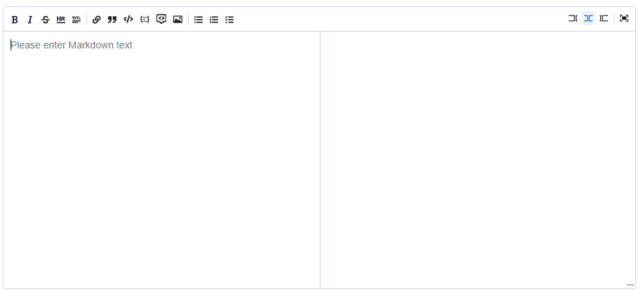
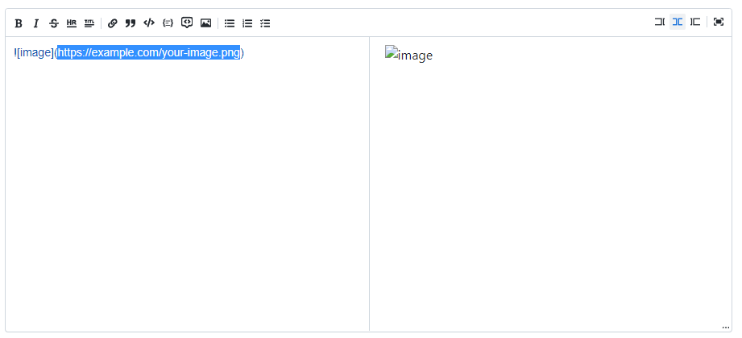
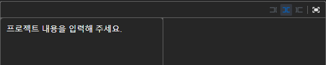
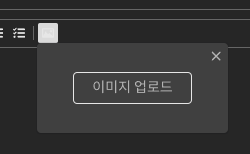
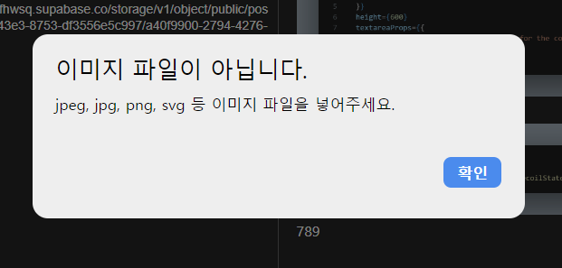
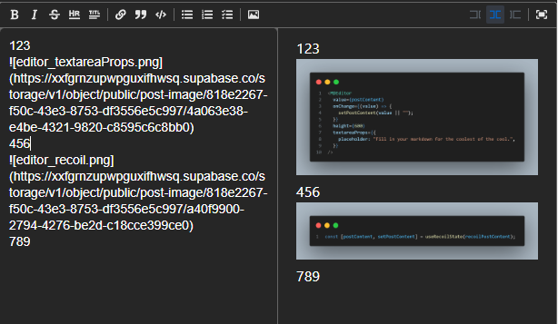

:::note 🎯목적

Post, Edit post, Detail - 페이지 별 텍스트 에디터 변경

- 기존 : Toast UI Editor
- 변경 : **UIW Markdown Editor**

:::

:::tip 🥸 장-단점에 따른 결정

- Toast UI Editor : 이미지 업로드 기능이 있으나 번들 사이즈가 무겁고 SSR 지원이 안됨.
- **UIW Markdown Editor** : 마크다운 기본 내장, 번들사이즈 가볍고, 이미지 업로드 기능 없음

:::

**UIW Markdown Editor 툴바 커스텀**하여 **사진 업로드 및 삽입**, 드래그 앤 드랍, 붙여넣기 기능 구현 기록

<!--truncate-->

### 목차

1. 에디터 적용
2. 에디터 커스텀
3. 이미지 업로드
4. 이미지 삽입
5. 드래그 앤 드랍, 붙여넣기 구현
6. 결과 화면

---

## 1. 에디터 적용

```tsx
import "@uiw/react-md-editor/markdown-editor.css";
import "@uiw/react-markdown-preview/markdown.css";
import dynamic from "next/dynamic";
import { useState } from "react";

const MDEditor = dynamic(
  () => import("@uiw/react-md-editor"),
  { ssr: false }
);

const PostEditor = () => {
  const [value, setValue] = useState("**Hello world!!!**");

  return (
    <div>
      <MDEditor value={value} onChange={setValue} />
    </div>
  );
};

export default PostEditor;
```

우선 공식문서를 참고해서 MDEditor를 가져온다. 하지만 `useState` 를 사용해서 `PostEditor` 컴포넌트에서만 데이터를 가지고 있는게 아니기 때문에 기존 처럼 Recoil 로 상태를 전역으로 바꾸어 준다.

```tsx
const [postContent, setPostContent] = useRecoilState(recoilPostContent);
```

전역 데이터인 `recoilPostContent` 적용

```tsx
<MDEditor
  value={postContent}
  onChange={(value) => {
    setPostContent(value || "");
  }}
  height={600}
  textareaProps={{
    placeholder: "Fill in your markdown for the coolest of the cool.",
  }}
/>
```

위에서 사용했던 state의 기본 값으로 placeholder 처럼 사용하지 않고 에디터에서 지원하는 `textareaProps`를 사용하여 권장 방식대로 placeholder를 사용해야 한다.

\+ 왜냐하면 실수로 게시버튼 클릭 시 initial State가 전달되는 것을 방지하기 위함

---

## 2. 에디터 커스텀



위는 기존 에디터가 기본적용된 에디터의 상태이다.

하지만 유저가 사진을 업로드 하려고 사진 아이콘을 클릭 하면,



Markdown 형식으로 Image url을 작성하고, 작성한 url이 존재해야 보여줄 수 있다. (에디터에서 제공하는 기존 url도 존재하지 않는 url 임..)

프로젝트 특성상 사진을 많이 게시해야하는데에 불편함을 많이 느끼겠다는 판단을 했고, 이 부분을 수정해 보고자 했다.

그래서 toolbar를 수정 할 수 있는 속성으로 `commands`를 사용해야 하기 때문에 `commands`를 추가해서 커스텀 해야했다.

```tsx
<MDEditorStyled
  value={postContent}
  onChange={(value) => {
    setPostContent(value || "");
  }}
  height={600}
  textareaProps={{
    placeholder: "프로젝트 내용을 입력해 주세요.",
  }}
  commands={[]} // 커스텀 속성
/>
```

10번 줄에 주석을 달아놓은 구문(`commands`)을 추가하니



이렇게 **툴바가 모두 초기화** 되어버렸다...

그래서 기본 속성으로 사용하고 있는 `commands` 속성을 다시 가져왔다.

```tsx
commands={[
  commands.bold,
  commands.italic,
  commands.strikethrough,
  commands.hr,
  commands.title,
  commands.divider,

  commands.link,
  commands.quote,
  commands.code,
  commands.divider,

  commands.unorderedListCommand,
  commands.orderedListCommand,
  commands.checkedListCommand,
  commands.divider,
]}
```

이제 여기서 하나의 커스텀된 사진업로드 아이콘을 추가하기 위해 그룹을 하나 만들어서 **커스텀 해줘야했다....**

```tsx
commands.group([], {
  name: "image",
  groupName: "image",
  icon: (
    <svg width="12" height="12" viewBox="0 0 20 20">
      <path
        fill="currentColor"
        d="M15 9c1.1 0 2-.9 2-2s-.9-2-2-2-2 .9-2 2 .9 2 2 2zm4-7H1c-.55 0-1 .45-1 1v14c0 .55.45 1 1 1h18c.55 0 1-.45 1-1V3c0-.55-.45-1-1-1zm-1 13l-6-5-2 2-4-5-4 8V4h16v11z"
      />
    </svg>
  ),
  children: (handle: any) => {
    // API가 any를 지정합니다.
    return (
      <CustomImageContainer>
        <ImageContainerCloseButtonWrapper>
          <Image
            src="/icons/close.svg"
            width={16}
            height={16}
            alt="닫힘버튼"
            onClick={() => handle.close()}
          />
        </ImageContainerCloseButtonWrapper>
        <label htmlFor="file">
          <ImageUploadButton>
            <ImageUploadText />
          </ImageUploadButton>
        </label>
        <ImageInput
          type="file"
          id="file"
          value=""
          multiple
          accept="image/*"
          onChange={(e) => {
            onImagePasted(e.target.files);
            handle.close();
          }}
        />
      </CustomImageContainer>
    );
  },
  buttonProps: { "aria-label": "Insert image" },
  // ...
});
```

그룹명을 지정하고, 기존에 사용하던 아이콘을 그대로 가져와서 넣어주었다.

또 자식으로 아이콘을 클릭하면 일어나게 될 **모달을 띄워줘야 했다.** ( input 에서 image 파일을 업로드하고 받아줘야 하므로 )



위처럼 생성된 모달에서 input으로 이미지파일을 받게되면 `onChange`를 통해 **`onImagePasted` 라는 함수를 실행하고 모달을 close** 한다.

```tsx
<ImageInput
  type="file"
  id="file"
  value=""
  multiple
  accept="image/*"
  onChange={(e) => {
    onImagePasted(e.target.files);
    handle.close();
  }}
/>
```

아래에서 이미지 storage에 업로드하는 과정을 설명 하겠다.

---

## 3. 이미지 업로드(supabase storage)

이미지를 업로드 하면 받아서 저장하고 있는 storage가 필요했고, 저장한 이미지주소를 반환하여 Editor 에 전달해야한다. **(storage, url 필요)**

하지만 프로젝트 특성상 **이미지 여러개를 한꺼번에 올리고 싶은 경우**도 고려해야한다. 이럴 때는 input에 **`multiple`** 속성을 추가하면 **여러장의 파일을 중복 선택** 할 수있다.

자 중복을 고려해서 들어온 파일이기 때문에 콘솔에 들어온 파일을 출력해보면

```bash
FileList {0: File, length: 1}
```

**FileList라는 객체**로 들어온 것을 알 수 있다.

```bash
FileList {0: File, 1: File, length: 2}
```

2개 이상의 파일이 업로드 되어도 오류 없이 FileList에 잘 들어왔다. 그렇다면 이제 이 객체를 받아 Array 형태로 저장한 후 순서대로 Storage에 저장해야 한다.

\+ 배열 형태로 저장하는 이유는 아래에서 설명한다.

```tsx
const files: File[] = [];

if (dataTransfer instanceof FileList) {
  for (let index = 0; index < dataTransfer.length; index += 1) {
    const file = dataTransfer[index];

    // 이미지 유효성 검사 후 경고 모달 생성(파일 사이즈, 확장자)
    if (!validateFile(file)) {
      setShowModal(true);
      return;
    }
    files.push(file);
  }
}
```



파일을 하나씩 배열로 받으면서 **유효성 검사**를 진행했다. 검사에 통과하지 못하면 **알림 모달을 띄운다**!

```tsx
files.map(async (file) => {
  const fileId = uuidv4();

  const uploadResult = await uploadImage(
    file,
    "post-image",
    `${isPostId}/${fileId}`
  );
  if (!uploadResult) return;

  const insertString = ``;
  const resultString = insertToTextArea(insertString);

  setPostContent(resultString || "");
});
```

위에서 만들어준 이미지파일의 배열을 하나씩 순회하면서 **서로 다른 id를 삽입**해야 했기 때문에 배열의 형태로 **`uuid`를 활용 해 id를 넣어주고 하나씩 Storage에 업로드** 하는 함수를 통해 업로드 했다.

또 12번째 줄에 있는 `insertToTextArea` 함수는 업로드한 이미지 URL주소를 실제로 에디터에 삽입을 하는 함수인데 이 부분이 어려웠다.

---

## 4. 이미지 삽입(insertToTextArea)

서버에 업로드가 되었다면 다시 Markdown의 **텍스트 형태로 업로드한 URL주소**를 넣어주어야 **에디터에서 해당 사진을 읽어**올 수 있다.

하지만 내가 입력하던 (커서가 있는) 자리에 정확히 이미지를 넣지 않는다면, 게시글을 작성중인 곳이 아닌 글의 중간에서 업로드를 하는 경우라면 작성중이던 **글의 마지막 부분**에 이미지가 업로드 되면서 **의도하지 않은 위치**에 **이미지가 업로드** 되었다.

그래서 그 **위치를 찾아주기 위한 함수**를 만들어 줘야 했다.

```tsx
const insertToTextArea = (intsertString: string) => {
  const textarea = document.querySelector("textarea");
  if (!textarea) return null;

  let sentence = textarea.value;
  const len = sentence.length;
  const pos = textarea.selectionStart;
  const end = textarea.selectionEnd;

  const front = sentence.slice(0, pos);
  const back = sentence.slice(pos, len);

  sentence = front + intsertString + back;

  textarea.value = sentence;
  textarea.selectionEnd = end + intsertString.length;
  return sentence;
};
```

작성중인 부분의 앞부분(`front`)과 뒷부분(`back`)의 중간에 이미지URL을 넣어주고 늘어난 텍스트 길이(`insertString.length`)만큼 `selectionEnd`를 뒤로 밀어준다.

이렇게 **글의 중간에 이미지 삽입**도 가능하게 되었다.

위 과정을 마친다면 다시 `setPostContent`함수를 통해 이미지URL이 추가된 데이터를 업데이트 한다.

---

## 5. 드래그 앤 드랍, 붙여넣기 구현

이미지를 업로드 하는 방식에서 **드래그 앤 드랍**을 적용해 보고 싶다는 생각이 들었고 기술적 의사결정이 필요하지 않았기 때문에 스스로 결정하고 적용했던 추가 구현이였다.

또한 사용자가 **붙여넣기**를 하는 과정에서 사진이 있을 수 있기때문에 해당 부분도 추가로 구현했다.

기존의 `onChange`와 같이 html 속성으로 기본 속성이 있었다. 타입은 아래와 같다

```ts
(property) onDrop: (event: DragEvent<HTMLDivElement>) => void
(property) onPaste: (event: ClipboardEvent<HTMLDivElement>) => void
```

```tsx
<MDEditorStyled
  value={postContent}
  onChange={(value) => {
    setPostContent(value || "");
  }}
  height={600}
  onPaste={handleOnPaste}
  onDrop={(event) => {
    event.preventDefault();
    onImagePasted(event.dataTransfer);
  }}
  textareaProps={{
    placeholder: "프로젝트 내용을 입력해 주세요.",
  }}
  commands={[
    ...
  ]}
/>
```

크롬의 기본 `DragEvent` 가 일어나면서 **새탭으로 사진이 열리는 현상**이 있어서 `preventDefault();` 로 기본 내장 기능을 초기화 해주었다.

이후 기존처럼 이미지를 업로드 했을 때와 드래그 앤 드랍으로 이미지를 업로드 했을 때 **다른 타입의 객체가 출력**되었다.

```bash
FileList {0: File, length: 1}
DataTransfer {dropEffect: 'none', effectAllowed: 'all', items: DataTransferItemList, types: Array(1), files: FileList}
```

위 = **FileList**는 이미지 업로드 버튼(input)으로 가져왔을 때, 아래 = **DataTransfer**는 드래그 앤 드랍과 붙여넣기로 가져왔을 때 이다.

이미지 업로드 함수의 파라미터에 타입을 우선 추가해 주고, 함수 내부에서 조건 처리를 해주었다.

```tsx
if (dataTransfer instanceof DataTransfer) {
  for (let index = 0; index < dataTransfer.items.length; index += 1) {
    const file = dataTransfer.items[index].getAsFile();

    if (file && !validateFile(file)) {
      setShowModal(true);
      return;
    }
    files.push(file as File);
  }
}
```

기존 과 같이 여러 파일이 들어올 수 있기 때문에 하나씩 for문을 돌면서 `getAsFile`이라는 함수를 사용해서 해당 `items`를 파일로 변환해 주었다. 이후에는 유효성검사를 진행 하고,

서버에 전송될 `files` 배열에 하나씩 추가해 주었다.

드래그 앤 드랍과 붙여넣기로 업로드하면 에디터에는 `` 형태로 이미지 주소가 삽입되고, 오른쪽 미리보기에서 사진이 보인다.

---

## 6. 결과 화면



---

## 😎 참고 링크

- 팀원 투표 결과 [Toast UI Editor VS Tiptap VS ETC... · react-challengers/Codefolio · Discussion #198](https://github.com/react-challengers/Codefolio/discussions/198)
- Toast UI Editor [TOAST UI :: Make Your Web Delicious!](https://ui.toast.com/tui-editor)
- UIW Markdown Editor [Markdown Editor for React.](https://uiwjs.github.io/react-md-editor/)

---

:::tip 최종 정리

1. 에디터를 변경하고 **이미지 업로드 기능을 추가로 구현**했습니다.
2. 추가로 **파일 중복 선택이 가능**하게 `multiple`이 작동하게 `fileList` 를 받아줍니다.
3. 받아온 이미지를 `fileList` 에서 하나씩 **유효성 검사 후 storage에 업로드** 합니다.
4. 서버에 업로드하고 생성된 URL을 다시 받아 **정확한 위치에 이미지를 삽입** 시켜주었습니다.
5. 드래그 앤 드랍, 붙여넣기를 할 때 에도 이미지가 업로드 될 수 있도록 **고도화** 하였습니다.

:::

{/* 이 글은 Tistory(https://hyoloui.tistory.com/135)에서 옮겨 온 글입니다. 원문 작성일: 2023-03-23 */}
