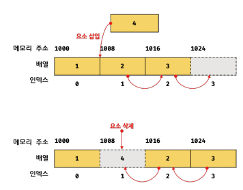

TIL : Today I Learned

> 둘은 같은 배열이 아닌 다른 자료구조이다.

<!--truncate-->

## 자료구조 배열 vs 자바스크립트 배열

### 자료구조 배열

여기서 말하는 자료구조의 배열은 **밀집 배열**로, 메모리 공간이 빈틈없이 연속적으로 나열되어 연속 배열이라고도 한다.

데이터 구조 배열은 동일한 데이터 유형 요소의 고정 크기 시퀀스를 저장하는 메모리 블록이다.

밀집 배열의 요소에 액세스하는 것은 요소가 인접한 메모리 위치에 저장되기 때문에 매우 빠르다. 또한 배열을 반복하거나 해당 요소에 대해 연산을 수행하는 것과 같은 작업도 매우 효율적이다.

| 메모리 주소 | 1000 | 1008 | 1016 |
| --- | --- | --- | --- |
| 배열 | 1 | 2 | 3 |
| 인덱스 | 0 | 1 | 2 |

### 자바스크립트 배열(Array)

위에 설명한 밀집 배열은 요소를 위한 각각의 메모리 공간이 동일하지만, 자바스크립트에서의 배열은 동일한 크기를 갖지 않아도 되며, 연속적으로 이어져 있지 않을 수도 있다.

배열의 요소가 연속적으로 이어져 있지 않은 배열을 **희소 배열**이라고 한다.

```js
const arr = [1, 2, 3, 'four', false, , null];
```

자바스크립트는 희소 배열을 문법적으로 허용한다.

자바스크립트 배열은 크기를 쉽게 조정할 수 있는 반면 밀도가 높은 배열은 메모리에 고정된 크기를 할당해야 한다. 또한 JavaScript 배열은 다양한 유형의 요소를 저장할 수 있으므로 조밀한 데이터 구조 배열보다 더 유연하다.



### 성능 차이

그렇다면 둘의 성능 차이는 어디에서 나는 것일까? 메모리에 데이터를 할당할 때를 생각해 보자. 메모리는 데이터의 타입에 따라 데이터의 크기를 지정하기 때문에 둘은 **요소를 할당하는 과정에서 계산**이 느려질 수 있다.

데이터가 어떤 타입인지 자바스크립트 엔진이 런타임에 **동적으로 판단**을 해야 하기 때문이다. (타입마다 메모리 크기가 다름) 자바스크립트는 동적 언어이기 때문에 우리가 배열에 어떠한 데이터 타입도 추가하여 사용할 수 있지만, 자료구조에서 말하는 밀집 배열은 배열의 요소가 정적으로 지정되어 있어 메모리 크기를 고정하기 때문이다.

하지만 자바스크립트의 배열은 동적으로 확장하거나 축소할 수 있다.

| 작업 | 밀집 배열 | 자바스크립트 배열 |
| --- | --- | --- |
| 요소에 액세스하기 | 매우 빠름 | 느려질 수 있음 |
| 배열 반복 | 매우 효율적 | 느려질 수 있음 |
| 배열 크기 조정 | 복사 없이는 불가능 | 쉬움 |
| 모든 유형의 요소 저장 | 불가능 | 가능 |
| 메모리의 고정 크기 | 예 | 아니요 |

:::tip 최종 정리

1. 자료구조에서의 배열은 메모리 크기가 고정이다.
2. 자바스크립트에서의 배열은 메모리 크기가 동적으로 유연하다. (런타임에 각 요소의 타입을 결정하는 동적 언어이기 때문)
3. 메모리의 크기가 고정되어 있다면 한 가지 타입으로 요소가 액세스되어 반복이 빠르다.
4. 메모리 크기가 유동적이라면 요소마다 타입을 지정하여 메모리 크기를 요소마다 지정하여 크기를 계산해야 한다.
5. 성능이 중요한 문제이고 요소의 크기와 유형이 미리 알려진 경우 자료구조의 밀집 배열이 좋다.
6. 유연성과 사용 용이성이 더 중요한 경우 JavaScript 배열이 더 나은 선택이 될 수 있다.

:::

{/* 이 글은 Tistory(https://hyoloui.tistory.com/141)에서 옮겨 온 글입니다. 원문 작성일: 2023-03-28 */}
