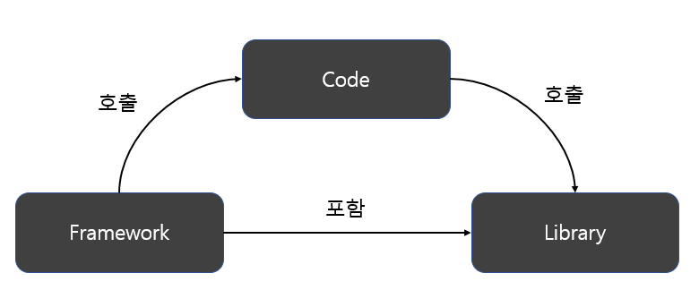

❤️‍🔥 TIL : Today I Learned

:::note

프레임워크란 무엇이고 라이브러리란 무엇일까, 둘의 차이가 뭘까

:::

<!--truncate-->

## 프레임워크란?

> 소프트웨어 특정 문제를 해결하기 위해 상호 협력하는 클래스와 인터페이스의 집합

프레임워크는 뼈대나 기반구조를 뜻하는데, application 개발 시 필수적인 코드, 알고리즘, 데이터베이스 연동 등과 같은 기능들을 위해 어느정도 뼈대(구조)를 제공합니다. 그래서 뼈대 위에 우리가 코드를 작성해 application을 완성 시켜야 합니다.

## 라이브러리란?

> 단순 활용이 가능한 도구들의 집합

라이브러리는 특정 기능에 대한 도구나 함수들을 모은 집합입니다. 또 우리가 개발하는데 필요한 것들을 모아둔 것 입니다. 개발자라면 누구나 한번쯤은 써봤을 것이고, 자기도 모르게 써보았을 것 입니다.

## 그래서 둘의 차이점은?

:::note

둘의 가장 큰 차이는 Flow(흐름)에 있습니다. 즉 Flow에 대한 제어 권한이 어디에 있는냐의 차이입니다.

:::

- 프레임워크는 전체적인 흐름을 자체적으로 가지고 있고, 우리는 그 안에 필요한 코드를 작성합니다
- 반면 라이브러리는 사용자가 흐름에 대해 제어를 하며 필요한 상황에 가져다 쓰는 것 입니다.

정리하면 **프레임워크에는 제어의 역전(inversion of Control)이 적용**되어 있다는 것 입니다.

> 제어의 역전이란 어떤 일을 하도록 만들어진 프레임워크에 제어의 권한을 넘김으로써 클라이언트 코드가 신경써야 할 것을 줄이는 전략입니다. 일반적으로 우리는 프로젝트를 생성하고 Main 함수를 만들어 시작지점을 형성합니다. 그리고 Main 함수에서 프로그램의 흐름을 정하는 것은 우리의 몫으로 우리가 어떤 순서를 부여하냐에 따라 흐름을 제어하는 것이 일반적인 사고 입니다.
>
> 하지만 여기서 프레임워크는 일반적인 사고와 반대되는 모습을 보여주는데 Flow를 프레임워크 자체가 갖고 있으니 우리의 코드를 프레임워크 안에 넣어서 개발을 진행 합니다.
>
> 일반적으로 우리가 가지고 있어야하는 권한을 프레임워크에게 주었기 때문에 우리는 이를 제어의 역전 이라고 합니다.

:::tip 최종 정리

1. 프레임워크 - 소프트웨어 특정 문제를 해결하기 위해 상호 협력하는 클래스와 인터페이스의 집합
2. 라이브러리 - 단순 활용이 가능한 도구의 집합
3. **프레임워크에는 제어의 역전(inversion of Control)이 적용 되어있습니다.**

:::

\+ 리액트가 프레임워크가 아닌, 라이브러리인 이유는 위에 프레임워크의 특성인 제어의 역전이 적용되지 않았기 때문입니다.

리액트 라이프 사이클을 예시로 했을 때 기본적인 틀은 정해져 있지만 `componentDidMount()`, `useEffect`등 을 통해 렌더링 과정을 제어할 수 있고 애플리케이션을 구조화하거나 라우팅, 데이터 관리 또는 서버 측 렌더링과 같은 작업을 처리하는 방법을 지시하지는 않습니다.

{/* 이 글은 Tistory(https://hyoloui.tistory.com/147)에서 옮겨 온 글입니다. 원문 작성일: 2023-03-29 */}
