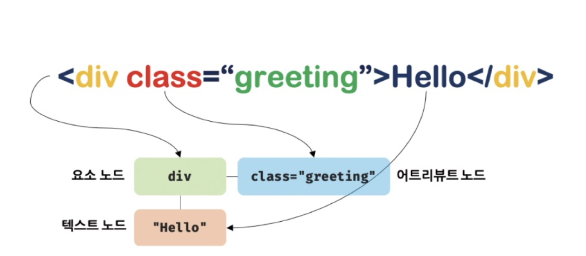
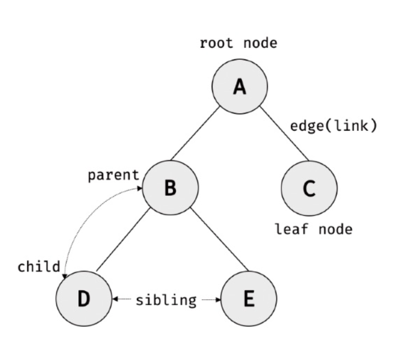
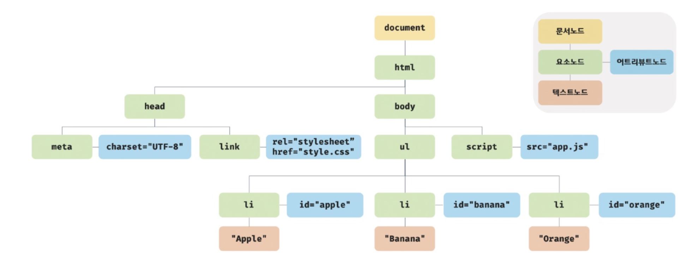
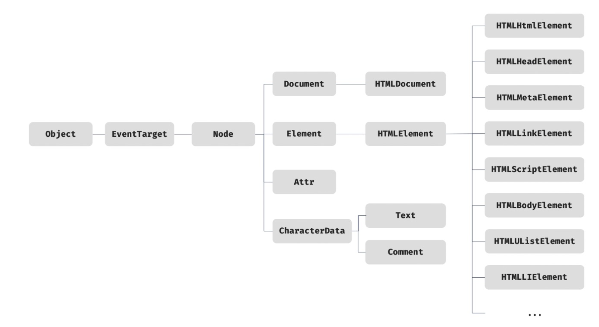
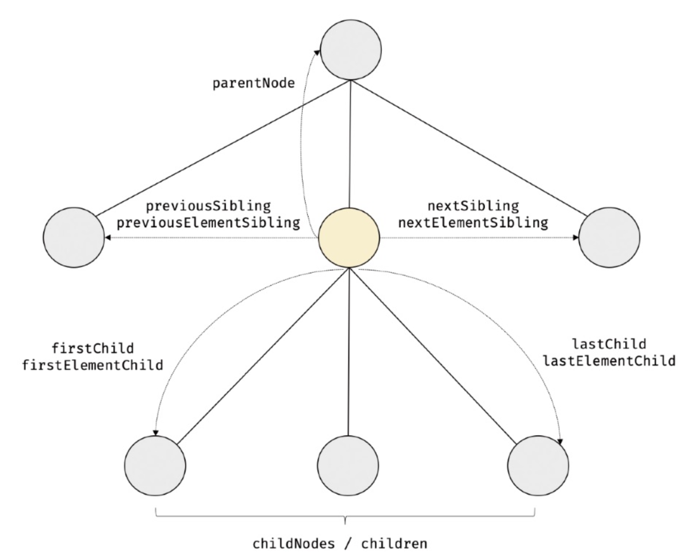
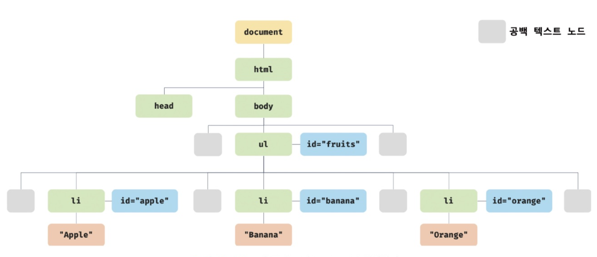

TIL : Today I Learned

> DOM(Document Object Model)은 HTML 문서의 계층적 구조와 정보를 표현하며 이를 제어할 수 있는 API, 즉 프로퍼티와 메서드를 제공하는 트리 자료구조다.

<!--truncate-->

## DOM

### 1. 노드

**HTML 요소와 노드 객체**

HTML 요소는 렌더링 엔진에 의해 파싱되어 DOM을 구성하는 **요소 노드 객체로 변환**된다. 이때 HTML 요소의 **어트리뷰트는 어트리뷰트 노드로**, HTML 요소의 **텍스트 콘텐츠는 텍스트 노드로 변환**된다.



HTML 문서는 위와 같은 **요소들의 집합**으로 이뤄지며, 요소 간에는 중첩 관계에 의해 계층적인 **부자(부모) 관계가 형성**된다.



이러한 관계를 반영하여 모든 노드 객체들을 **트리 자료구조**로 구성하며 이것을 **DOM 또는 DOM 트리**라고 한다. 최상위의 **부모 노드가 없는 노드는 루트(root) 노드**, **자식 노드가 없는 노드를 리프(leaf) 노드**라 한다.

**노드의 객체 타입**

렌더링 엔진이 **파싱을 마치면** 아래와 같이 **DOM을 생성**한다.



이처럼 DOM은 노드 객체의 계층적인 구조로 구성된다. **노드 객체는 종류가 있고 상속 구조를 갖는다.** 노드 객체는 총 12개의 종류(노드 타입)가 있다. 이 중 중요한 노드 타입은 4가지이다.

1. **문서 노드**: DOM 트리의 최상위에 존재하는 루트 노드로서 `document` 객체를 가리킨다.
2. **요소 노드**: HTML 요소를 가리키는 객체다.
3. **어트리뷰트 노드**: 지정된 HTML 요소의 요소 노드와 연결되어 있다. 참조하거나 변경하려면 요소 노드에 먼저 접근해야 한다.
4. **텍스트 노드**: HTML 요소의 텍스트를 가리키는 객체다. 요소 노드가 문서의 구조를 표현한다면 텍스트 노드는 문서의 정보를 표현한다고 할 수 있으며, 어트리뷰트 노드 접근과 마찬가지로 부모 노드인 요소 노드에 접근해야 한다.

**노드 객체의 상속 구조**



위 그림처럼 모든 **노드 객체**는 `Object`, `EventTarget`, `Node` **인터페이스를 상속**받는다.

핵심은 HTML 요소(태그)마다 특성을 나타내는 기능들을 **상속을 통해 제공**받는다는 것이다. 예를 들어 `input` 요소 노드 객체는 개발자 도구의 Properties 탭에서 다음과 같은 상속 구조를 확인할 수 있다.

```text
input → HTMLInputElement → HTMLElement → Element → Node → EventTarget → Object
```

### 2. 요소 노드 취득

HTML의 구조나 내용 또는 스타일 등을 **동적으로 조작하기 위해서 요소 노드를 취득해야 한다**. 요소를 조작하는 시작점이다.

**1. id를 이용한 요소 노드 취득** - 첫 번째 단 하나의 요소 노드를 반환

```js
const $elem = document.getElementById('아이디');
```

**2. 태그 이름을 이용한 요소 노드 취득** - DOM 컬렉션 객체인 `HTMLCollection` 객체 반환

```js
const $li = document.getElementsByTagName('li');
```

**3. 클래스를 이용한 요소 노드 취득** - DOM 컬렉션 객체인 `HTMLCollection` 객체 반환

```js
const $apples = document.getElementsByClassName('apple');
```

**4. CSS 선택자를 이용한 요소 노드 취득**

```css
* { ... } /* 모든 요소 */

p { ... } /* p태그 요소 모두 선택 */

#foo { ... } /* id 값이 'foo'인 요소를 모두 선택 */

.foo { ... } /* class 값이 'foo'인 요소를 모두 선택 */

input[type=text] { ... } /* input 요소 중 type 어트리뷰트 값이 'text'인 요소를 모두 선택 */
```

모든 요소 노드를 탐색하여 반환하려면 다음과 같이 쓴다.

```js
const $all = document.querySelectorAll('*');
```

**5. 특정 요소 노드를 취득할 수 있는지 확인**

```js
const $apple = document.querySelector('.apple');

console.log($apple.matches('#fruits > li.apple')); // (boolean) true/false
```

**6. `HTMLCollection`과 `NodeList`**

- `HTMLCollection`

  `getElementsByTagName`, `getElementsByClassName` 메서드가 반환하는 `HTMLCollection` 객체는 노드 객체의 상태 **변화를 실시간으로 반영하는** 살아있는 DOM 컬렉션 객체다. 실시간으로 노드 객체 상태 변경을 반영하여 요소를 제거할 수 있기 때문에 `HTMLCollection` 객체를 `for` 문으로 순회하며 상태 변경을 할 때 의도치 않은 동작이 생길 수 있으니 주의해야 한다.

- `NodeList`

  `querySelectorAll`이 반환하는 `NodeList` 객체는 `.forEach` 메서드를 사용할 수 있다. 하지만 `childNodes` 프로퍼티가 반환하는 `NodeList` 객체는 `HTMLCollection` 객체와 같이 **실시간으로 노드 객체의 상태 변경**을 반영하는 live 객체로 동작하므로 주의가 필요하다.

### 3. 노드 탐색



DOM 트리 상의 노드를 탐색할 수 있도록 `Node`, `Element` 인터페이스는 트리 탐색 프로퍼티를 제공한다.

모두 접근자 프로퍼티다. 하지만 노드 탐색 프로퍼티는 읽기 전용 접근자 프로퍼티다. 읽기 전용 접근자 프로퍼티에 값을 할당하면 아무런 에러 없이 무시된다.

`parentNode`, `previousSibling`, `firstChild`, `childNodes` 프로퍼티는 **`Node.prototype`**이 제공하고, 프로퍼티 키에 **`Element`가 포함된 `previousElementSibling`, `nextElementSibling`과 `children`** 프로퍼티는 **`Element.prototype`**이 제공한다.

**공백 텍스트 노드**

텍스트 에디터에서 HTML 문서에 스페이스, 탭, 엔터 등을 입력하면 공백 문자가 추가된다. HTML 문서는 파싱되어 다음과 같은 DOM을 생성한다.



따라서 **노드를 탐색할 때는 공백 텍스트 노드에 주의**해야 한다. 하지만 인위적으로 공백 문자를 제거하면 개발 환경에서의 **가독성이 좋지 않으므로 권장하지 않는다**.

**자식 노드 탐색**

| 프로퍼티 | 설명 |
| --- | --- |
| `Node.prototype.childNodes` | 자식 노드를 모두 탐색하여 DOM 컬렉션 객체인 `NodeList`에 담아 반환한다. **`NodeList`에는 요소 노드뿐만 아니라 텍스트 노드도 포함되어 있을 수 있다.** |
| `Element.prototype.children` | 자식 노드 중에서 요소 노드만 모두 탐색하여 DOM 컬렉션 객체인 `HTMLCollection`에 담아 반환한다. **`HTMLCollection`에는 텍스트 노드가 포함되지 않는다.** |
| `Node.prototype.firstChild` | 첫 번째 자식 노드를 반환한다. 텍스트 노드이거나 요소 노드다. |
| `Node.prototype.lastChild` | 마지막 자식 노드를 반환한다. 텍스트 노드이거나 요소 노드다. |
| `Element.prototype.firstElementChild` | 첫 번째 자식 요소 노드를 반환한다. 요소 노드만 반환한다. |
| `Element.prototype.lastElementChild` | 마지막 자식 요소 노드를 반환한다. 요소 노드만 반환한다. |

**자식 노드 존재 확인**

```js
const $fruits = document.getElementById('fruits');
console.log($fruits.hasChildNodes()); // boolean
```

**요소 노드의 텍스트 노드 탐색**

```js
console.log(document.getElementById('foo').firstChild); // #text
```

**부모 노드 탐색**

```js
console.log($banana.parentNode); // ul#fruits
```

**형제 노드 탐색**

| 프로퍼티 | 설명 |
| --- | --- |
| `Node.prototype.previousSibling` | 부모 노드가 같은 형제 노드 중에서 자신의 이전 형제 노드를 탐색하여 반환한다. 요소 노드뿐만 아니라 텍스트 노드일 수도 있다. |
| `Node.prototype.nextSibling` | 부모 노드가 같은 형제 노드 중에서 자신의 다음 형제 노드를 탐색하여 반환한다. 요소 노드뿐만 아니라 텍스트 노드일 수도 있다. |
| `Element.prototype.previousElementSibling` | 부모 노드가 같은 형제 요소 노드 중에서 자신의 이전 형제 요소 노드를 탐색하여 반환한다. 요소 노드만 반환한다. |
| `Element.prototype.nextElementSibling` | 부모 노드가 같은 형제 요소 노드 중에서 자신의 다음 형제 요소 노드를 탐색하여 반환한다. 요소 노드만 반환한다. |

정리하면 다음과 같다.

- DOM 트리 상의 노드를 탐색할 수 있도록 `Node`, `Element` 인터페이스는 트리 탐색 프로퍼티를 제공
- **`Node.prototype`**이 제공하는 프로퍼티
  - **`parentNode`**: 부모 노드 탐색 (부모 노드는 텍스트 노드가 될 수 없음)
  - **`previousSibling`**: 이전 형제 노드 탐색하여 반환, 요소 노드 또는 텍스트 노드를 반환
  - **`firstChild`**: 첫 번째 자식 노드 반환, 요소 노드 또는 텍스트 노드
  - **`childNodes`**: 자식 노드를 모두 탐색하여 **`NodeList`**로 반환, 텍스트 노드가 포함될 수 있음
- **`Element.prototype`**이 제공하는 프로퍼티
  - **`previousElementSibling`**: 이전 형제 노드 반환, 요소 노드만 반환
  - **`nextElementSibling`**: 자신의 다음 형제 요소 노드 반환, 요소 노드만 반환
  - **`children`**: 자식 노드 중에서 요소 노드만 모두 탐색하여 **`HTMLCollection`**으로 반환 (텍스트 노드 포함 X)

### 4. 노드 정보 취득

**`Node.prototype.nodeType`**

- 노드 객체의 종류, 즉 노드 타입을 나타내는 상수를 반환
- 노드 타입 상수는 **`Node`**에 정의되어 있음
- **`Node.ELEMENT_NODE`**: 요소 노드 타입을 나타내는 상수 **1**을 반환
- **`Node.TEXT_NODE`**: 텍스트 노드 타입을 나타내는 상수 **3**을 반환
- **`Node.DOCUMENT_NODE`**: 문서 노드 타입을 나타내는 상수 **9**를 반환

**`Node.prototype.nodeName`**

- 노드의 이름을 문자열로 반환
- 요소 노드: 대문자 문자열로 태그 이름(**`"UL"`**, **`"LI"`** 등)을 반환
- 텍스트 노드: 문자열 **`"#text"`**를 반환
- 문서 노드: 문자열 **`"#document"`**를 반환

### 5. 요소 노드의 텍스트 조작

**`nodeValue`**

- 노드 객체의 값(텍스트 노드의 텍스트)을 반환
- 문서 노드나 요소 노드는 **`nodeValue`**를 참조하면 **`null`** 반환

```html
<!DOCTYPE html>
<html>
  <body>
    <div id="foo">Hello</div>
  </body>
  <script>
    // 1. #foo 요소 노드의 자식 노드인 텍스트 노드를 취득한다.
    const $textNode = document.getElementById('foo').firstChild;

    // 2. nodeValue 프로퍼티를 사용하여 텍스트 노드의 값을 변경한다.
    $textNode.nodeValue = 'World';
  </script>
</html>
```

**`textContent`**

- 요소 노드의 텍스트와 자손 노드의 텍스트를 모두 취득
- 즉, `textContent`는 요소 노드의 콘텐츠 영역(시작 태그와 종료 태그 사이)의 모든 텍스트를 모두 반환
- 이때 HTML 마크업은 무시됨

```html
<!DOCTYPE html>
<html>
  <body>
    <div id="foo">Hello <span>world!</span></div>
  </body>
  <script>
    // #foo 요소 노드의 텍스트를 모두 취득한다. 이때 HTML 마크업은 무시된다.
    console.log(document.getElementById('foo').textContent); // Hello world!
  </script>
</html>
```

### 6. DOM 조작

새로운 노드를 DOM에 추가하거나, 기존 노드를 삭제, 교체 등 조작할 수 있다.

**`innerHTML`**

- 요소 노드의 콘텐츠 영역 사이에 포함된 모든 HTML 마크업을 문자열로 반환
- `innerHTML` 프로퍼티에 문자열을 할당하면 요소 노드의 모든 자식 노드가 제거되고 할당한 문자열이 파싱되어 DOM에 반영

```html
<!DOCTYPE html>
<html>
  <body>
    <ul id="fruits">
      <li class="apple">Apple</li>
    </ul>
  </body>
  <script>
    const $fruits = document.getElementById('fruits');
    // 노드 추가
    $fruits.innerHTML += '<li class="banana">Banana</li>';

    // 노드 교체
    $fruits.innerHTML = '<li class="orange">Orange</li>';

    // 노드 삭제
    $fruits.innerHTML = '';
  </script>
</html>
```

:::warning innerHTML 단점

- 크로스 사이트 스크립트 공격에 취약
- 모든 자식 요소를 제거하고 할당하기 때문에 비효율적
- 새로운 요소를 삽입할 때 위치를 지정할 수 없음

:::

**`insertAdjacentHTML`**

- 기존 요소를 제거하지 않으면서 위치를 지정해 새로운 요소를 삽입
- 첫 번째 인수로 위치를 지정 (**`beforebegin`**, **`afterbegin`**, **`beforeend`**, **`afterend`**)

```html
<!DOCTYPE html>
<html>
  <body>
    <!-- beforebegin -->
    <div id="foo">
      <!-- afterbegin -->
      text
      <!-- beforeend -->
    </div>
    <!-- afterend -->
  </body>
</html>
```

**노드 생성과 추가**

- 요소 노드 생성
  - **`Document.prototype.createElement(tagName)`** 메서드는 요소 노드를 생성하여 반환
  - **`tagName`** 인수에는 태그 이름을 나타내는 문자열을 전달
  - **`createElement`** 메서드로 생성한 요소 노드는 기존 **DOM**에 추가되지 않고 홀로 존재하는 상태로, 이후에 **DOM**에 추가하는 처리가 필요
  - **`createElement`** 메서드로 생성한 요소 노드는 아무런 자식 노드가 없는 상태
- 텍스트 노드 생성
  - **`Document.prototype.createTextNode(text)`** 메서드는 텍스트 노드를 생성하여 반환
  - **`createTextNode`** 메서드로 생성한 텍스트 노드는 요소 노드의 자식 노드에 추가되지 않고 홀로 존재하는 상태로, 이후에 요소 노드에 추가하는 처리가 필요
- 텍스트 노드를 요소 노드의 자식 노드로 추가
  - **`Node.prototype.appendChild(childNode)`** 메서드는 인수로 전달한 노드를 메서드를 호출한 노드의 마지막 자식 노드로 추가
  - **`childNode`** 인수에는 추가할 자식 노드를 전달
  - 요소 노드에 자식 노드가 하나도 없는 경우에는 **`textContent`** 프로퍼티를 사용하여 텍스트 노드를 추가하는 것이 더욱 간편
  - 요소 노드에 자식 노드가 있는 경우 **`textContent`** 프로퍼티에 문자열을 할당하면 요소 노드의 모든 자식 노드가 제거되고 할당한 문자열이 텍스트로 추가되므로 주의

### 7. 어트리뷰트

- **HTML** 문서가 파싱될 때 어트리뷰트는 어트리뷰트 노드로 변환되어 요소 노드와 연결됨
- 하나의 어트리뷰트당 하나의 어트리뷰트 노드 생성
- 이때 모든 어트리뷰트 노드의 참조는 유사 배열 객체이자 이터러블인 **`NamedNodeMap`** 객체에 담겨서 요소 노드의 **`attributes`** 프로퍼티에 저장

**HTML 어트리뷰트 조작**

- **`Element.prototype.getAttribute(attributeName)`**: 어트리뷰트 값을 참조
- **`Element.prototype.setAttribute(attributeName, attributeValue)`**: 어트리뷰트 값을 변경
- **`Element.prototype.hasAttribute(attributeName)`**: 어트리뷰트가 존재하는지 확인
- **`Element.prototype.removeAttribute(attributeName)`**: 특정 어트리뷰트 삭제

**HTML 어트리뷰트 vs DOM 프로퍼티**

- 요소 노드 객체에는 HTML 어트리뷰트에 대응하는 DOM 프로퍼티가 존재
- 즉, **HTML** 어트리뷰트는 중복 관리되는 것처럼 보인다.
  - 요소 노드의 **`attributes`** 프로퍼티에서 관리하는 어트리뷰트 노드
  - 요소 노드의 **DOM** 프로퍼티

예를 들어 `<input id="user" type="text" value="ungmo2">`의 `id`, `type`, `value` 어트리뷰트는 개발자 도구의 Properties 탭에서 `id: "user"`, `type: "text"`, `value: "ungmo2"`라는 DOM 프로퍼티로도 확인할 수 있다.

**차이점 구분**

- **HTML** 어트리뷰트의 역할은 **HTML** 요소의 초기 상태를 지정하는 것이며, 초기 상태를 의미하므로 변하지 않음
- 요소 노드는 **상태**(**state**)를 가지고 있다.
- 요소 노드는 2개 이상의 상태(초기 상태와 최신 상태)를 관리해야 한다.
- 요소 노드의 초기 상태는 어트리뷰트 노드가 관리
- 요소 노드의 최신 상태는 **DOM** 프로퍼티가 관리

**어트리뷰트 노드**

- HTML 어트리뷰트로 지정한 초기 상태는 어트리뷰트 노드에서 관리
- 초기 상태 값을 취득하거나 변경하려면 **`getAttribute`** / **`setAttribute`** 메서드를 사용

**DOM 프로퍼티**

- 사용자가 입력한 최신 상태를 관리
- 단 사용자 입력에 의한 상태 변화와 관계있는 DOM 프로퍼티만 최신 상태 값을 관리 (예: `input`)
- `getAttribute` 메서드로 취득한 값은 언제나 문자열이지만, DOM 프로퍼티로 취득한 최신 상태 값은 문자열이 아닐 수 있다.

**`data` 어트리뷰트와 `dataset` 프로퍼티**

- **`data`** 어트리뷰트와 **`dataset`** 프로퍼티를 사용해 HTML 요소와 자바스크립트 간에 데이터를 교환 가능
- **`data`** 어트리뷰트는 **`data-`** 접두사 뒤에 임의의 이름을 붙여 사용
- **`data`** 어트리뷰트 값은 **`HTMLElement.dataset`** 프로퍼티로 취득
- 존재하지 않는 이름을 키로 **`dataset`** 프로퍼티에 할당하면 **HTML** 요소에 **`data`** 어트리뷰트가 추가

### 8. 스타일

**인라인 스타일 조작**

- **`HTMLElement.prototype.style`** 프로퍼티
- **getter** / **setter**가 모두 존재하는 접근자 프로퍼티로 요소 노드의 인라인 스타일을 취득하거나 추가 또는 변경

```html
<!DOCTYPE html>
<html>
  <body>
    <div>Hello World</div>
    <script>
      const $div = document.querySelector('div');

      // 인라인 스타일 취득
      console.log($div.style); // CSSStyleDeclaration { 0: "color", ... }

      // 인라인 스타일 변경
      $div.style.color = 'blue';

      // 인라인 스타일 추가
      $div.style.width = '100px';
      $div.style.height = '100px';
      $div.style.backgroundColor = 'yellow';
    </script>
  </body>
</html>
```

**클래스 조작**

- `class` 어트리뷰트에 대응하는 DOM 프로퍼티는 `class`가 아니라 **`className`**과 **`classList`**

**`className`**

- **`Element.prototype.className`**
- **`class`** 어트리뷰트의 값을 문자열로 반환
- 클래스 값이 공백으로 구분되어 있을 경우 그대로 문자열로 반환

**`classList`**

- **`Element.prototype.classList`**
- **`class`** 어트리뷰트의 정보를 담은 **`DOMTokenList`** 객체를 반환
- **`DOMTokenList`** 객체는 `class` 어트리뷰트의 정보를 나타내는 컬렉션 객체로 유사 배열이면서 이터러블
- **`DOMTokenList`** 주요 메서드
  - **`add(...className)`**: 인수로 전달된 1개 이상의 문자열을 `class` 어트리뷰트 값으로 추가
  - **`remove(...className)`**: 인수로 전달한 1개 이상의 문자열과 일치하는 `class` 어트리뷰트에서 삭제 (일치하는 클래스가 없으면 무시됨)
  - **`item(index)`**: 인수로 전달한 index에 해당하는 클래스를 `class` 어트리뷰트에서 반환
  - **`contains(className)`**: 인수로 전달한 문자열과 일치하는 클래스가 `class` 어트리뷰트에 포함되어 있는지 확인
  - **`replace(oldClassName, newClassName)`**: 첫 번째 인수 클래스를 두 번째 클래스로 변경
  - **`toggle(className[, force])`**: 인수로 전달한 문자열과 일치하는 클래스가 존재하면 제거하고 존재하지 않으면 추가

:::tip 최종 정리

1. DOM은 HTML 문서의 계층적 구조와 정보를 표현하며 이를 제어할 수 있는 API, 즉 프로퍼티와 메서드를 제공하는 트리 자료구조다.
2. 노드 객체는 총 12개의 종류(노드 타입)가 있다. 이 중에서 중요한 노드 타입은 다음과 같이 4가지다.
   문서 노드, 요소 노드, 어트리뷰트 노드, 텍스트 노드

:::

{/* 이 글은 Tistory(https://hyoloui.tistory.com/150)에서 옮겨 온 글입니다. 원문 작성일: 2023-03-30 */}
