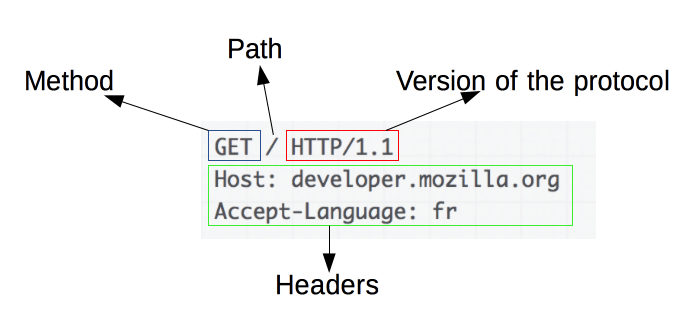
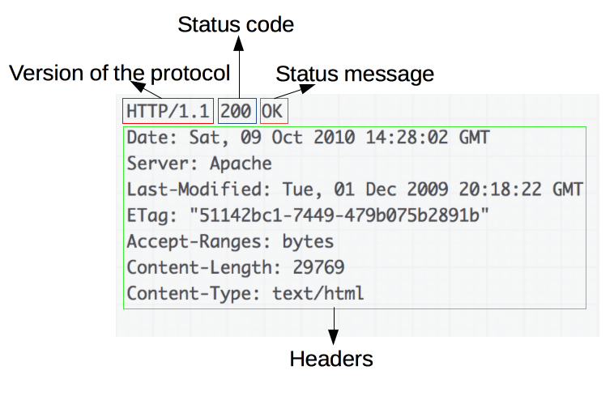

HTTP에 대해 설명하고, 알고있다면 HTTP 메세지 구조에 대해 더 자세히 설명해주세요

❤️‍🔥 TIL : Today I Learned

:::note

HTTP에 대해 설명하고, HTTP 메세지 구조에 대해 설명합니다.

:::

<!--truncate-->

## HTTP란?

- HTTP는 HyperText Transfer Protocol의 약자로 HTML 문서와 같은 리소스들을 가져올 수 있도록 해주는 프로토콜입니다.
- 브라우저인 클라이언트에 의해 전송되는 메시지를 요청(requests)이라고 부르며, 그에 대해 서버에서 응답으로 전송되는 메시지를 응답(responses)이라고 부릅니다.

특징: 비연결성, 무상태성

- 비연결성: 리소스 응답이 정상적으로 받아지면 연결을 끊음 → 리소스 요청 때마다 연결해야하는 오버헤드 비용 발생 ⇒ `Connection: keep-alive` 설정을 통해 유지 및 기존 연결의 재사용 가능
- 무상태성: 서버가 클라이언트의 요청 각각을 독립적으로 여겨 식별할 수 없음을 의미 → cookie, session 등을 이용해 클라이언트의 상태를 식별할 수 있도록 함

### HTTP 프로토콜의 가장 큰 특징은 뭔가요?

HTTP 프로토콜은 상태가 없는 (stateless) 프로토콜입니다.

여기서 상태가 없다는 말은 데이터를 주고 받기 위한 각각의 데이터 요청이 서로 독립적으로 관리가 된다는 말입니다. 이전에 보냈던 데이터 요청과 다음에 보낼 데이터 요청이 서로 관련이 없다는 의미입니다.

이러한 특징 덕분에 서버는 세션과 같은 별도의 추가 정보를 관리하지 않아도 되고, 다수의 요청 처리 및 서버의 부하를 줄일 수 있는 성능 상의 이점이 생깁니다.

HTTP 프로토콜은 일반적으로 TCP/IP 통신 위에서 동작하며 기본 포트는 80번입니다.

## HTTP 메세지 구조

기존에는 리퀘스트/리스폰스 메시지 포맷을 따로 지정했으나 다시 합쳐지게 되었습니다.

`start-line`에서 둘의 구분이 가능합니다.

### requests 요청 메시지

```http
request-line = method SP request-target SP HTTP-version CRLF

PATCH http://woowacourse.com/admin/setting HTTP/1.1
```

1. 메서드
2. 요청 대상
3. 프로토콜 버전

### response 응답 메시지

```http
status-line = HTTP-version SP status-code SP reason-phrase CRLF

HTTP/1.1 403 Forbidden
```

1. 프로토콜 버전
2. 세 자리 숫자 응답 코드
3. 응답 코드 부연 설명

### 헤더





위 설명한 **start-line과 메시지 본문을 제외**하면 모두 **헤더필드**에 속합니다.

참고:

[HTTP 개요 - HTTP | MDN](https://developer.mozilla.org/ko/docs/Web/HTTP/Overview)

[HTTP 영상 - YouTube](https://www.youtube.com/watch?v=IjxkKQvn8Bc)

:::tip 최종 정리

1. HTTP는 HyperText Transfer Protocol의 약자로 HTML 문서와 같은 리소스들을 가져올 수 있도록 해주는 프로토콜입니다.
2. 요청인 request와 응답인 response 둘로 구분이 되는데 둘은 start-line에서 다른 특성을 가지고 있습니다.
   - request는 메서드, 요청 대상, 프로토콜 버전
   - response는 프로토콜 버전, 3자리 응답 코드, 상태코드의 부연설명

:::

{/* 이 글은 Tistory(https://hyoloui.tistory.com/151)에서 옮겨 온 글입니다. 원문 작성일: 2023-03-30 */}
