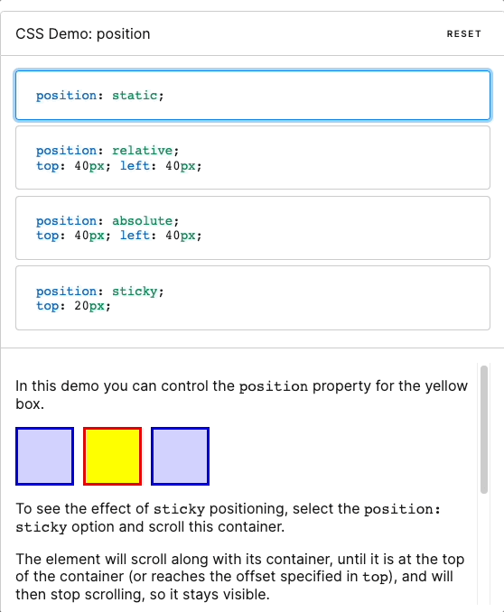

❤️‍🔥 TIL : Today I Learned

:::note 목적

CSS `position`에 대해 설명합니다.

:::

<!--truncate-->

## position ?

CSS `position` 속성은 문서 상에 요소를 배치하는 방법을 지정합니다. `top`, `right`, `bottom`, `left` 속성이 요소를 배치할 최종 위치를 결정합니다.

## 구문

- `static` : 기본값으로 요소들이 겹치지 않고 상 → 하로 배치 됩니다.
- `relative` : 원래 배치되어야 할 위치에서 지정한 값 만큼 떨어진 곳에 요소를 배치합니다.
- `absolute` : 가장 가까운 상위 요소의 위치를 기준으로 지정한 값 만큼 떨어진 곳에 요소를 배치합니다.
- `fixed` : 웹 브라우저 화면 전체를 기준으로 배치합니다. 스크롤을 하더라도 위치가 고정되는 특징이 있습니다.
- `sticky` : 스크롤 위치가 임계점에 이르면 `position: fixed`와 같이 화면에 고정할 수 있는 속성으로 스크롤 영역 기준으로 배치합니다.

## absolute 를 사용하는 방법

프로젝트를 진행 하면서 자식요소는 부모 요소를 기준으로 위치를 지정해야 할 일이 자주 발생합니다.

위 같은 상황에서 `position: absolute`를 사용하면 해결이 가능한데 상대 경로(기준)가 되는 상위 요소에서 `position: relative` 속성이 있어야 합니다. 없다면 초기 컨테이닝 블록(html 최상단)을 기준으로 삼습니다.

참조 : [position - CSS: Cascading Style Sheets | MDN](https://developer.mozilla.org/ko/docs/Web/CSS/position#%EA%B5%AC%EB%AC%B8)

:::tip 최종 정리

1. `position`은 문서상의 요소를 지정하는 방법을 정의 하고 `top`, `left`, `right`, `bottom` 등으로 위치를 결정합니다.
2. `absolute`로 부모요소를 상대로 위치를 지정하고자 할 때는 부모 요소에서 `position: relative` 속성이 있어야 합니다.

:::

{/* 이 글은 Tistory(https://hyoloui.tistory.com/152)에서 옮겨 온 글입니다. 원문 작성일: 2023-03-30 */}
