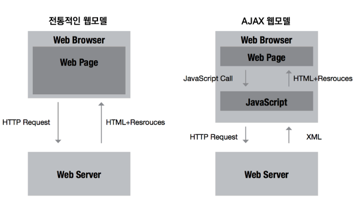
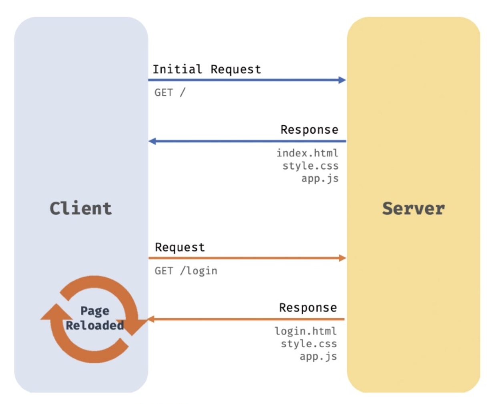
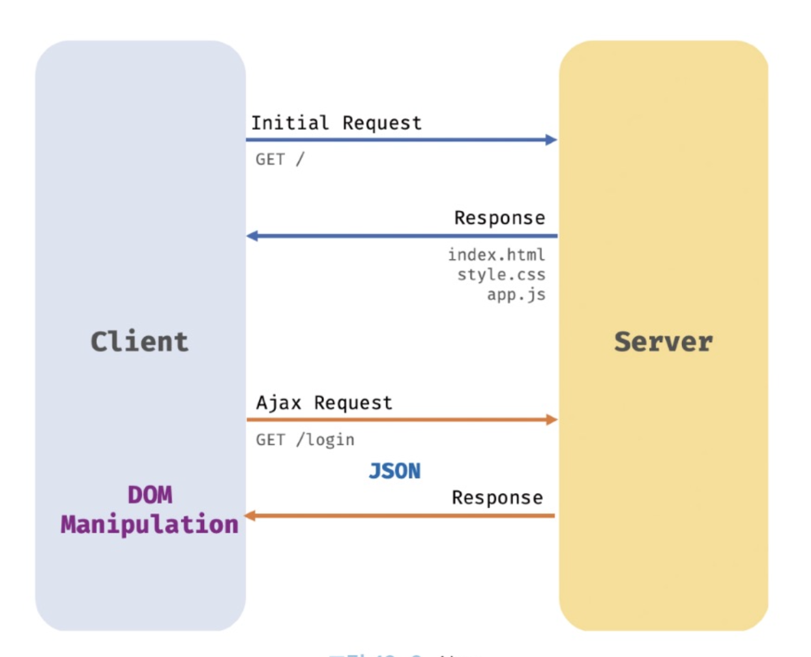

TIL : Today I Learned

:::note

- Ajax !== "아작스" / Ajax == "에이잭스"
- JSON !== "제이썬" / JSON == "제이슨"

:::

<!--truncate-->

## AJAX

### Ajax란?

자바스크립트를 사용하여 브라우저가 서버에게 **비동기 방식으로 데이터를 요청**하고, 서버가 응답한 데이터를 수신하여 **웹페이지를 동적으로 갱신**하는 프로그래밍 방식을 말한다. 특정 기술이 아니고, 새로운 접근법을 설명하는 용어이다.

브라우저에서 제공하는 Web API인 **`XMLHttpRequest` 객체**를 기반으로 동작한다.



이러한 비동기 방식으로 웹의 패러다임이 획기적으로 변했다고 할 수 있다.



기존 전통적인 방식은 html 태그로 시작하여 html 태그로 끝나는 완전한 html을 response 받아 처음부터 다시 렌더링하는 방식으로 동작했다. 따라서 **화면이 전환되면 서버로부터 새로운 html을 전송받고 다시 렌더링**을 진행했다.



서버로부터 웹페이지의 **변경에 필요한 데이터**만 비동기 방식으로 전송받아 웹페이지를 변경할 필요가 없는 부분은 다시 렌더링하지 않고, **필요한 부분만 한정적으로 렌더링**하는 방식이 가능해진 것이다.

:::tip

불필요한 데이터 **통신이 줄어들었고**, 순간적으로 **깜박이는 현상이 없으며** **블로킹 현상이 발생하지 않는다**.

코드 블로킹은 어떠한 코드가 실행됨에 따라 해당 코드의 실행 때문에 다른 코드를 실행할 수 없는 현상을 말한다.

:::

### JSON

클라이언트와 서버 간의 HTTP 통신을 위한 텍스트 데이터 포맷이다. 자바스크립트에 종속되지 않은 언어 독립형 데이터 포맷으로, 대부분의 프로그래밍 언어에서 사용할 수 있다.

**표기 방식**

키는 반드시 **큰따옴표**(작은따옴표 사용 불가)로 묶어야 한다. **값은 객체 리터럴과 같은 표기법**을 그대로 사용할 수 있다. 하지만 문자열은 반드시 큰따옴표로 묶어야 한다.

```json
{
  "name": "Lee",
  "age": 27,
  "alive": true,
  "hobby": ["traveling", "tennis"]
}
```

**`JSON.stringify`**

`JSON.stringify` 메서드는 객체를 JSON 포맷의 문자열로 반환한다. 클라이언트에서 서버로 객체를 전송하려면 객체를 문자열화해야 하는데 이를 **직렬화**라고 한다.

```js
const obj = {
  a: 1,
  b: {
    c: 2,
  },
};

const copiedObj = JSON.parse(JSON.stringify(obj));

obj.b === copiedObj.b; // false
```

**객체**와 **배열** 모두 JSON 포맷의 문자열로 변환한다.

**`JSON.parse`**

`JSON.parse` 메서드는 JSON 포맷의 문자열을 객체로 변환한다. 서버로부터 클라이언트에게 전송된 JSON 데이터는 문자열이다. 이 문자열을 객체로 사용하려면 다시 JSON 포맷의 문자열을 객체화해야 하는데 이를 **역직렬화**라고 한다.

```js
const json = JSON.stringify(obj);

const returnObj = JSON.parse(json);
console.log(typeof returnObj, returnObj);
// object { a: 1, b: { c: 2 } }
```

위를 통해 객체를 `JSON.stringify(Object)` 한 후 `JSON.parse(String)` 하면 깊은 복사를 가능하게 한다. 하지만 성능적으로 매우 떨어진다.

### XMLHttpRequest

브라우저는 주소창이나 HTML의 `form` 태그 또는 `a` 태그를 통해 HTTP 요청 전송 기능을 기본 제공한다. 자바스크립트를 사용하여 **HTTP 요청을 전송하려면 `XMLHttpRequest` 객체를 사용**한다. Web API인 `XMLHttpRequest` 객체는 HTTP 요청 전송과 HTTP 응답 수신을 위한 다양한 메서드와 프로퍼티를 제공한다.

**`XMLHttpRequest` 객체 생성**

`XMLHttpRequest` 생성자 함수를 호출하여 생성한다. Web API이므로 브라우저 환경에서만 정상적으로 실행된다.

```js
const xhr = new XMLHttpRequest();
```

**`XMLHttpRequest` 객체의 이벤트 핸들러 프로퍼티, 메서드**

대표적인 프로퍼티와 메서드는 다음과 같다.

| 프로퍼티 | 설명 |
| --- | --- |
| `readyState` (프로토타입 프로퍼티) | 요청 상태를 나타낸다. 해당 프로퍼티로 클라이언트와 서버 간 통신의 진행 상태를 알 수 있다. 0 = 초기화되지 않은 상태, 1 = 로드되지 않은 상태(즉 `send()`가 호출되지 않은 상태), 2 = 로드된 상태, 3 = 상호작용 상태(데이터 일부분만 받은 상태), 4 = 완료 상태 |
| `status` (프로토타입 프로퍼티) | HTTP 요청에 대한 응답 상태(HTTP 상태 코드)를 나타내는 정수. 예) 200 |
| `statusText` (프로토타입 프로퍼티) | HTTP 요청에 대한 응답 메시지를 나타내는 문자열. 예) `"OK"` |
| `responseText` (프로토타입 프로퍼티) | 서버가 전송한 HTTP 요청에 대한 응답 문자열 |
| `onreadystatechange` (이벤트 핸들러 프로퍼티) | `readyState` 프로퍼티 값이 변경된 경우 |
| `onerror` (이벤트 핸들러 프로퍼티) | HTTP 요청에 에러가 발생한 경우 |
| `open` (`XMLHttpRequest` 메서드) | HTTP 요청 초기화 |
| `DONE` (`XMLHttpRequest` 정적 프로퍼티) | 서버 응답 완료. 값: 4 |

**HTTP 요청 전송**

HTTP 요청을 전송하는 경우 다음 순서를 따른다.

1. `XMLHttpRequest.prototype.open` 메서드로 HTTP 요청을 초기화한다.
2. 필요에 따라 `XMLHttpRequest.prototype.setRequestHeader` 메서드로 특정 HTTP 요청의 헤더 값을 설정한다.
3. `XMLHttpRequest.prototype.send` 메서드로 HTTP 요청을 전송한다.

```js
// XMLHttpRequest 객체 생성
const xhr = new XMLHttpRequest();

// 1. HTTP 요청 초기화
xhr.open('GET', '/users');

// 2. HTTP 요청 헤더 설정 (여기서 데이터의 MIME 타입 지정: json)
xhr.setRequestHeader('content-type', 'application/json');

// 3. HTTP 요청 전송
xhr.send();
```

2번 항목에서 `Content-type`은 요청 몸체에 담아 전송할 데이터의 MIME 타입의 정보를 표현한다. 자주 사용되는 MIME 타입은 다음과 같다.

| MIME 타입 | 서브 타입 |
| --- | --- |
| text | `text/plain`, `text/html`, `text/css`, `text/javascript` |
| application | `application/json`, `application/x-www-form-urlencoded` |
| multipart | `multipart/form-data` |

**HTTP 응답 처리**

서버가 전송한 응답을 처리하려면 `XMLHttpRequest` 객체가 발생시키는 이벤트를 캐치해야 한다. 아래 예제 코드를 잘 살펴보길 바란다.

```js
const xhr = new XMLHttpRequest();

// 1.
xhr.open('GET', 'https://jsonplaceholder.typicode.com/todos/1');

// 2.
xhr.send();

// 응답 처리
xhr.onreadystatechange = () => {
  // 서버 응답이 아직 완료되지 않았다면 아무런 처리를 하지 않는다.
  if (xhr.readyState !== XMLHttpRequest.DONE) return;

  // status 값이 200 이라면 정상 응답, 아니라면 에러 발생 상태
  if (xhr.status === 200) {
    console.log(JSON.parse(xhr.response));
  } else {
    console.log('Error', xhr.status, xhr.statusText);
  }
};
```

여기서 사용한 `onreadystatechange` 대신 `onload` 이벤트를 사용해도 좋다. 왜냐하면 `load` 이벤트는 HTTP 요청이 성공적으로 완료된 경우 발생한다. 따라서 `load` 이벤트를 캐치하는 경우 `xhr.readyState`가 `XMLHttpRequest.DONE`인지 확인할 필요가 없다.

## XMLHttpRequest 객체

- Ajax의 가장 핵심적인 구성 요소는 바로 `XMLHttpRequest` 객체이다.
- Ajax에서 `XMLHttpRequest` 객체는 웹 브라우저가 서버와 데이터를 교환할 때 사용된다.
- 콜백 지옥이 생길 수도 있다.

## fetch API

- 내장 라이브러리이기 때문에 import 없이 사용 가능하다.
- `XMLHttpRequest`의 대체자로 나온 것이 fetch API이다. 비동기 HTTP 요청을 좀 더 쓰기 편하게 해준다.
- fetch API는 Promise 기반으로 동작한다. 콜백 지옥 탈출
- React Native 같은 잦은 업데이트에도 잘 적용이 된다.
- 기본 응답 결과는 `Response` 객체이다. json으로 바꾸거나 text로 바꾸는 처리 과정이 필요하다.
- 구형 브라우저에서는 지원을 안 한다.
- 네트워크 에러 발생 시 계속 기다려야 한다.
- API 요청을 취소할 수가 없다.

## Axios

- Axios는 브라우저, Node.js를 위한 Promise API를 활용하는 HTTP 비동기 통신 라이브러리이다.
- Axios도 Promise 기반이다.
- 크로스 브라우징 기반으로 브라우저 호환성이 뛰어나다.
- 자동으로 JSON 데이터 형식으로 변환된다.
- 요청 취소 및 타임아웃 설정이 가능하다.
- fetch에 존재하지 않는 기능이 좀 더 많다.
- React에서 주로 사용된다.
- XSRF 해킹 기법에 비교적 안전하다.
- 라이브러리 설치가 필요하다.

그래서 우리는 프로젝트 진행 간 개발 환경에서 상황에 맞게 서버 통신을 진행하고 비동기 통신을 진행할 도구를 잘 선택해야 한다.

하지만 `XMLHttpRequest`에서 일어나는 콜백 지옥 문제, 편의성을 위해 새로 나온 기술들이 많이 존재하므로 사용하지 않을 이유가 없다.

참조: [ghost4551 - [JavaScript] 비동기 HTTP 통신 종류 (ajax, fetch, axios)](https://ghost4551.tistory.com/139)

:::tip 최종 정리

1. Ajax는 자바스크립트로 브라우저가 서버에게 비동기 방식으로 데이터를 요청하고, 응답한 데이터를 수신하여 웹페이지를 동적으로 갱신하는 것을 말한다. (기술이 아닌 접근법을 말함)
2. `JSON.stringify` == 편지봉투에 담기 (직렬화)
3. `JSON.parse` == 편지봉투 열기 (역직렬화)
4. HTTP 요청을 전송하려면 Web API인 `XMLHttpRequest` 객체를 사용해야 한다.
5. HTTP 요청 전송은 1. 요청 초기화 2. 헤더 값 설정 3. 요청 전송 과정으로 이루어진다.
6. 서버가 전송한 응답을 처리하려면 `XMLHttpRequest` 객체가 발생시키는 이벤트를 캐치해야 한다.

:::

{/* 이 글은 Tistory(https://hyoloui.tistory.com/153)에서 옮겨 온 글입니다. 원문 작성일: 2023-03-30 */}
