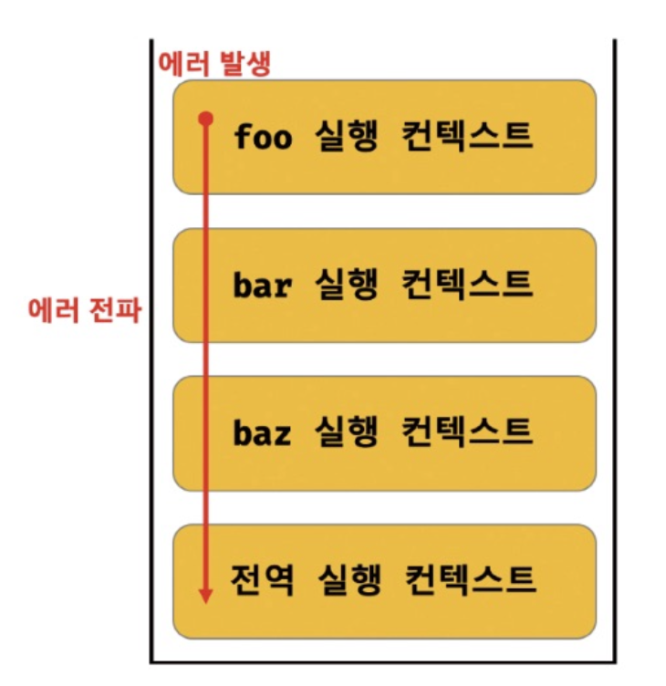

TIL : Today I Learned

:::note 에러 처리의 필요성

에러는 언제나 발생할 수 있다. 발생한 에러에 대해 대처하지 않고 방치하면 프로그램은 강제 종료된다.

:::

<!--truncate-->

## 에러 처리

### 에러 처리의 필요성

```js
console.log('[Start]');

foo(); // ReferenceError : foo is not defined
// 발생한 에러를 방치하면 프로그램은 강제 종료된다.

console.log('[End]');
```

위 예시 코드에서 `[End]`가 출력되지 않는다. 이러한 현상이 프로젝트에서 발생한다면... 끔찍하다.

**`try...catch`**

```js
console.log('[Start]');

try {
  foo();
} catch (error) {
  console.log('[에러 발생]', error);
  // [에러 발생] ReferenceError : foo is not defined
}

console.log('[End]');
```

**옵셔널 체이닝 (`?.`)**

```js
const $button = document.querySelector('button'); // null
$button.classList.add('disabled');
// TypeError: Cannot read property 'classList' of null.

$button?.classList.add('disabled');
```

이처럼 에러나 예외적인 상황에 대응하지 않으면 프로그램은 강제 종료된다.

### try...catch...finally 문

기본적으로 에러 처리 구현 방법은 크게 두 가지가 있다.

- `if` 문이나 단축 평가 또는 옵셔널 체이닝 연산자를 통한 방법
- 에러 처리 코드를 미리 등록해 **에러 발생 시 처리 코드로 점프**하도록 하는 방법

여기서 알아볼 `try...catch...finally` 문은 두 번째 방법이다. 일반적으로 이 방법을 에러 처리(error handling)라고 한다.

```js
console.log('[Start]');

try {
  // 에러가 발생할 가능성이 있는 코드
  foo();
} catch (err) {
  // try 코드 블록에서 발생한 Error 객체가 전달된다.
  console.error(err);
} finally {
  // 에러 발생과 상관없이 반드시 한 번 실행된다.
  console.log('finally');
}

console.log('[End]');
```

### Error 객체

- `Error` 생성자 함수는 에러 객체를 생성한다.
- 에러를 상세히 설명하는 에러 메시지를 인수로 전달할 수 있다.

에러 객체의 `message` 프로퍼티의 값은 `Error` 생성자 함수에 인수로 전달한 에러 메시지이고, `stack` 프로퍼티의 값은 에러를 발생시킨 콜 스택의 호출 정보를 나타내는 문자열이며 **디버깅 목적**으로 사용한다.

```js
1 @ 1; // SyntaxError: Invalid or unexpected token
foo(); // ReferenceError: foo is not defined
null.foo(); // TypeError: Cannot read property 'foo' of null
new Array(-1); // RangeError: Invalid array length
decodeURIComponent('%'); // URIError: URI malformed
```

### throw 문

`Error` 생성자 함수로 에러 객체를 생성한다고 에러가 발생하는 것은 아니다. 즉, 에러 객체 생성과 에러 발생은 의미가 다르다.

```js
const repeat = (n, f) => {
  // 매개변수 f에 전달된 인수가 함수가 아니면 TypeError를 발생시킨다.
  if (typeof f !== 'function') throw new TypeError('f must be a function');

  for (let i = 0; i < n; i++) {
    f(i);
  }
};

try {
  repeat(2, 1);
} catch (err) {
  console.error(err);
}
```

위 코드의 흐름은 다음과 같다.

`n`만큼 function을 반복하는 함수를 생성했다. `repeat` 함수는 에러를 발생시킬 가능성이 있으므로 `try` 코드 블록 내부에서 호출해야 한다. 또한 `repeat` 함수에서는 `if` 문으로 함수가 아닌 경우에 `throw` 하고 함수는 에러 객체를 생성한 후 종료된다. 객체는 `catch` 문의 인수로 전달되어 `console.error`에 도달한다.

이후 나머지 코드로 진행된다.

### 에러의 전파

```js
const foo = () => {
  throw Error('foo에서 발생한 에러'); // 4
  console.log('여기 실행 안됨');
};

const bar = () => {
  foo(); // 3
  console.log('여기 실행 안됨');
};

const baz = () => {
  bar(); // 2
  console.log('여기 실행 안됨');
};

try {
  baz(); // 1
  console.log('여기 실행 안됨');
} catch (err) {
  console.error(err);
}
```

<details>
<summary>실행 결과</summary>

```bash
Error: foo에서 발생한 에러
    at foo (<anonymous>:2:8)
    at bar (<anonymous>:6:2)
    at baz (<anonymous>:10:2)
    at <anonymous>:14:2
```

</details>

이렇게 `foo` 함수가 `throw` 한 에러는 다음과 같이 함수를 호출한 호출자에게 전파되어 전역에서 캐치된다.



:::warning

주의할 것은 비동기 함수에서는 호출자가 없다는 것이다. 비동기 함수는 태스크 큐나 마이크로태스크 큐에 일시 저장되었다가 콜 스택이 비면 이벤트 루프에 의해 콜 스택으로 푸시되어 실행된다. 이때 콜 스택에 푸시된 콜백 함수의 실행 컨텍스트는 콜 스택의 가장 하부에 존재하게 된다. 따라서 에러를 전파할 호출자가 존재하지 않는다.

:::

:::tip 최종 정리

1. 에러는 언제나 발생할 수 있다. 발생한 에러에 대해 대처하지 않고 방치하면 프로그램은 강제 종료되므로 에러 처리가 필요하다.
2. 에러 처리 방법에는 크게 두 가지가 있다.
   - `if` 문이나 단축 평가 또는 옵셔널 체이닝 연산자를 통한 방법
   - 에러 처리 코드를 미리 등록해 **에러 발생 시 처리 코드로 점프**하도록 하는 방법 (`try...catch`)
3. `Error` 생성자 함수는 에러 객체를 만드는 것이므로 `throw` 해서 error 객체를 `catch`의 인수로 전달해야 한다.
4. 에러는 호출자를 타고 전파된다. 하지만 비동기 함수는 호출자가 없기 때문에 주의해야 한다.

:::

{/* 이 글은 Tistory(https://hyoloui.tistory.com/156)에서 옮겨 온 글입니다. 원문 작성일: 2023-04-01 */}
