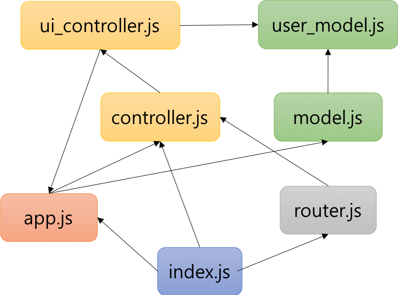

TIL : Today I Learned

> 모듈을 설명하고 추가 지식을 공유합니다.

<!--truncate-->

## 모듈

### 모듈의 일반적 의미

- 모듈이란 애플리케이션을 구성하는 개별적 요소로서 재사용 가능한 코드 조각을 말한다.
- 모듈이 성립하려면 자신만의 파일 스코프(모듈 스코프)를 가질 수 있어야 한다. 전역 X
- 기본적으로 비공개 상태이다. 파일 스코프를 갖는 모듈의 모든 자산은 캡슐화되어 다른 모듈에서 접근할 수 없다. 즉, 모듈은 개별적으로 존재하여 애플리케이션과 분리되어 존재한다.
- 하지만 개별적으로 존재하는 모듈은 재사용이 불가능하므로 존재 의미가 없다. 모듈은 재사용되어야 의미가 있다.

:::note

모듈은 공개가 필요한 자산에 한정하여 명시적으로 선택적 공개가 가능하다. 이를 **export**라 한다.

모듈 사용자는 모듈이 공개(export)한 자산 중 일부 또는 전체를 선택해 자신의 스코프 내부로 불러들여 재사용할 수 있다. 이를 **import**라 한다.

:::

### 자바스크립트와 모듈

- 자바스크립트 파일을 여러 개의 파일로 분리하여 `script` 태그로 로드해도 분리된 자바스크립트 파일은 결국 하나의 자바스크립트 파일 내에 있는 것처럼 동작한다. 즉, **모든 자바스크립트 파일은 하나의 전역을 공유한다.**
- 클라이언트 사이드, 즉 브라우저 환경에 국한하지 않고 범용적으로 사용하려는 움직임이 생기면서 모듈 시스템은 반드시 해결해야 하는 핵심 과제였다.
- 모듈 시스템은 크게 CommonJS와 AMD 진영으로 나뉘게 되었고, 자바스크립트 런타임 환경인 Node.js는 모듈 시스템의 사실상 표준인 **CommonJS**를 채택했다.
- Node.js는 ECMAScript 표준 사양은 아니지만 **모듈 시스템을 지원**한다. 따라서 Node.js 환경에서는 파일별로 독립적인 파일 스코프(모듈 스코프)를 갖는다.

### ES6 모듈 (ESM)

ES6에서는 클라이언트 사이드 자바스크립트에서도 동작하는 모듈 기능을 추가했다. 사용법은 간단하다.

```html
<script type="module" src="app.mjs"></script>
```

**모듈 스코프**

일반적인 자바스크립트 파일은 `script` 태그로 분리해서 로드해도 독자적인 모듈 스코프를 갖지 않는다.

```js title="foo.js"
var x = 'foo';
console.log(window.x); // foo
```

```js title="bar.js"
var x = 'bar';
console.log(window.x); // bar
```

`x` 변수는 중복 선언되며 의도치 않게 `x` 변수의 값이 덮어써진다.

```js title="foo.mjs"
var x = 'foo';
console.log(x); // foo
console.log(window.x); // undefined
```

```js title="bar.mjs"
var x = 'bar';
console.log(x); // bar
console.log(window.x); // undefined
```

모듈 내에서 선언한 식별자는 모듈 외부에서 참조할 수 없다.



**`export` 키워드**

- 모듈 내부에서 선언한 식별자를 외부에 공개하여 다른 모듈들이 재사용할 수 있게 하려면 `export` 키워드를 사용한다.
- **`export` 키워드는 선언문 앞에 사용**한다.

**`import` 키워드**

- `export` 한 식별자 이름으로 **`import`해야 하며 내부에 로드할 수 있다.**
- 모듈이 `export`한 식별자 이름을 일일이 지정하지 않고 하나의 이름으로 한 번에 `import`할 수도 있다. 이때 `import` 되는 식별자는 `as` 뒤에 지정한 이름의 객체에 프로퍼티로 할당된다.
- 모듈에서 **하나의 값만 `export` 한다면 `default`** 키워드를 사용할 수 있다.
- 단 **`default` 키워드를 사용하는 경우 `var`, `let`, `const`** 키워드는 사용할 수 없다.

:::tip 최종 정리

1. 모듈은 재사용 가능한 코드 조각이다.
2. 모든 자바스크립트 파일은 하나의 전역을 공유한다.
3. ES6부터 모듈 기능이 추가되어 `type`을 지정해 사용이 가능하다.
4. `export` 키워드로 모듈 내부의 식별자를 외부에 공개하고, `import` 키워드로 모듈 스코프 내부로 로드한다.

:::

{/* 이 글은 Tistory(https://hyoloui.tistory.com/157)에서 옮겨 온 글입니다. 원문 작성일: 2023-04-01 */}
