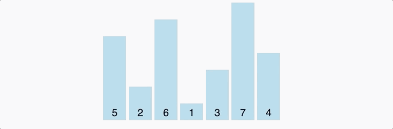
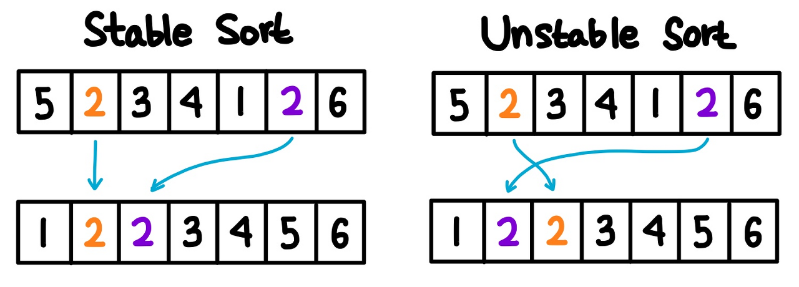
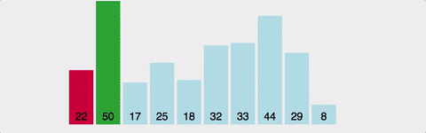
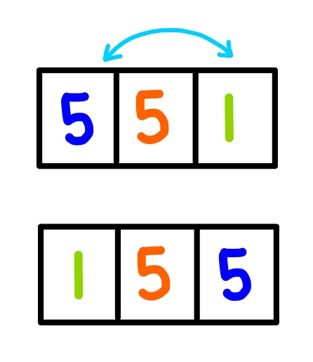

❤️‍🔥TIL : Today I Learned

## 버블 정렬, 선택 정렬

> 정렬 알고리즘 중에서도 버블 정렬과 선택 정렬의 이해와 방법을 설명합니다.

<!--truncate-->

## 정렬 이란?

무작위로 섞여있는 데이터를 어떤 기준에 맞춰 정렬하는 알고리즘은 여러 가지가 있고, 정렬 알고리즘은 다양한 경우에 매우 유용하게 사용된다.

1. 각종 **데이터 목록을 정리**하고 싶을 때
2. 분포도의 중위값을 알아내고 싶을 때
3. 데이터에서 중복값을 잡아내고 싶을 때
4. 이진 탐색을 하고 싶을 때

정렬의 종류와 비교 내용은 아래와 같다.

| 알고리즘 | 평균 수행시간 | 최악 수행시간 | 알고리즘 기법 | 비고 |
| --- | --- | --- | --- | --- |
| 버블 정렬 | O(n²) | O(n²) | 비교와 교환 | 코딩이 가장 손쉬움 |
| 카운팅 정렬 | O(n+k) | O(n+k) | 비교환 방식 | n이 비교적 작을 때만 가능 |
| 선택 정렬 | O(n²) | O(n²) | 비교와 교환 | 교환의 회수가 버블, 삽입정렬보다 작음 |
| 퀵 정렬 | O(n log n) | O(n²) | 분할 정복 | 최악의 경우 O(n²)이지만, 평균적으로는 가장 빠름 |
| 삽입 정렬 | O(n²) | O(n²) | 비교와 교환 | n의 개수가 작을 때 효과적 |
| 병합 정렬 | O(n log n) | O(n log n) | 분할 정복 | 연결 리스트의 경우 가장 효율적인 방식 |

+ 자 그런데 우리가 javascript 에서 자주 사용하는 `sort()` 메서드가 이미 존재하는데.. 정렬 알고리즘이 왜 필요할까요??

정렬 알고리즘을 배워야하는 이유는 시스템 정렬이 **항상 좋은 퍼포먼스를 보장하지는 않는다**. 또한 데이터베이스의 양이나 상황에 따라 어떤 정렬을 사용하는 것이 좋을지 달라지기 때문에 우리는 기본적으로 유명한 알고리즘을 알고 있어야 한다.

즉, 정렬의 방법을 우리가 알고있어야 상황에 맞게 **최대 효율이 나오는 알고리즘을 적용** 할 수 있는것 이다.

## 버블 정렬 (Bubble Sort)

- 버블 정렬은 우리가 알고있는 거품을 생각하는 것과 같은 이치로 동작한다고 이해하면 쉽다.
- 거품이 일어나듯이 **연쇄적으로 자기 자리를 찾아간다**고 해서 버블 정렬이다.

그림처럼 데이터를 두개씩 묶어서 비교한 후 작은 값을 앞으로 보내는 방식으로 정렬한다.



### Big O

- **Worst Case: O(n^2)**: 정렬이 하나도 안되어있는 경우
- **Best Case: O(n)**: 이미 정렬이 되어있는 경우

버블 정렬은 최악의 경우에 O(n^2)의 시간 복잡도를 가진다. 왜냐하면 각 자리를 찾기 위해서 n번의 순회를 해야하며 n번의 회전 동안에 요소의 개수만큼 또 순회를 해야하기 때문이다. 그러나 이미 정렬이 되어있는 경우에는 한 번의 순회로 정렬 여부를 알 수 있다.

구현은 매우 쉽지만 데이터의 개수가 많아질 수록 성능이 떨어지기 때문에, 이미 정렬된 데이터를 정렬이 되었는지 안되었는지 **테스트하는 용도로 사용될 수**도 있다.

### 장점

버블 정렬은 **in place** 알고리즘이기 때문에 **메모리가 절약된다**는 장점이 있다. 여기서 "in place"라는 것은 자료를 정렬할 때 추가적인 메모리 공간이 필요한 것이 아니고 데이터가 저장된 그 공간 내에서 정렬을 한다는 뜻이다.

또한 구현하기 매우 쉽다는 장점도 있다. 그 외에도 이미 정렬된 데이터를 순회하는 경우 O(n)번만 순회하면 되기 때문에 정렬이 되었는지 안되었는지 테스트하는 용도로 사용될 수도 있다.

### 단점

버블 정렬의 가장 큰 단점은 **자료의 개수가 많아질수록 성능이 매우 떨어진다**는 점이다. 왜냐면 최악의 경우 O(n^2)이 소요되기 때문이다. 만약 데이터가 위 이미지처럼 5개밖에 없다면 최대 25번 순회를 해야하지만 데이터가 1,000개라면 1,000,000번이나 순회를 해야한다.

### Stable

버블 정렬은 중복 데이터가 있을 경우 데이터의 위치를 교환하지 않고 지나가기 때문에 **stable한 정렬**이다. 여기서 stable이라는 뜻은 중복 데이터가 있는 경우에 기존 중복 데이터의 순서가 정렬이 다 끝난 이후에도 유지되는 정렬을 말한다.



### Code

```js
const bubbleSort = (arr) => {
  console.time("bubbleSort1");
  for (let i = 0; i < arr.length; i++) {
    for (let j = 0; j < arr.length - 1 - i; j++) {
      if (arr[j] > arr[j + 1]) {
        // swap
        let temp = arr[j + 1];
        arr[j + 1] = arr[j];
        arr[j] = temp;
      }
    }
  }
  console.timeEnd("bubbleSort1");
  return arr;
};

console.log(bubbleSort([5, 3, 8, 1, 2, 9, 4, 7, 6]));
```

1. `for`문으로 `i`가 0부터 `array.length`보다 작을 때까지 loop를 돌고,
2. 안에 `j`가 0부터 `array.length - 1 - i` 보다 작을 때까지 loop을 돈다.
3. `array.length - 1 - i` 인 이유는 우선 `array[j]`와 `array[j + 1]`을 비교할 예정이므로,
4. 배열의 마지막 데이터를 포함하지 않아도 검색 대상에 포함되니 1을 빼줘야 한다.
5. 두번째로 각 회전이 끝날 때마다 마지막 데이터의 정렬이 끝나기 때문에 `i`를 빼줘야 한다.
6. `array[j]`와 `array[j + 1]`을 비교하여 `array[j]`가 더 크면 자리를 교환한다.

## 선택 정렬 (Selection Sort)

- 버블 정렬과 유사한 정렬이다.
- 선택 정렬은 주어진 리스트 중 가장 작은 값을 찾아 맨 앞에 위치한 값과 교체한다.
- 교체 후 다음으로 넘어가 같은 작업을 반복하는데 가장 첫 원소는 제외한다.



버블 정렬이 각 회전이 끝날 때 마다 맨 마지막 데이터의 위치가 정해졌던 것과 반대로 선택 정렬은 n번째 회전이 끝날 때마다 **앞에서 n번째 데이터의 위치가 정해진다.**

### Big O

- **Worst Case: O(n^2)**: 정렬이 하나도 안되어있는 경우
- **Best Case: O(n^2)**: 이미 정렬이 되어있는 경우

선택 정렬은 위의 두 정렬과는 다르게 정렬이 이미 되어있는 경우에도 O(n^2)의 시간 복잡도를 가진다. 그 이유는 매번 정해진 자리에 올 수 있는 최소값을 찾아야하기 때문이다. 그렇기 때문에 성능이 매우 떨어진다.

### 장점

**in place** 알고리즘이기 때문에 **메모리가 절약되고,** 알고리즘이 직관적이므로 이해하기도 쉽고 구현하기도 쉽다.

### 단점

선택 정렬은 **최선의 경우에도, 최악의 경우에도 O(n^2)** 의 시간이 걸리는 만큼 **성능이 매우 떨어진다.**

### UnStable

선택 정렬은 데이터가 중복된 경우 위치가 바뀔 수 있기 때문에 **불안정한 정렬**이다.



위의 그림을 살펴보면 첫 번째 회전 시에 5가 있는 0번째 칸에 위 리스트의 최소값인 1이 들어가야하므로 1과 5를 교환해야하고 그러면 중복 데이터인 5의 순서가 변하는 것을 알 수 있다.

### Code

```js
const selectionSort = (arr) => {
  for (let i = 0; i < arr.length - 1; i++) {
    let minIndex = i;
    for (let j = i + 1; j < arr.length; j++) {
      if (arr[j] < arr[minIndex]) {
        minIndex = j;
      }
    }
    if (minIndex !== i) {
      [arr[i], arr[minIndex]] = [arr[minIndex], arr[i]];
    }
  }
  return arr;
};

console.log(selectionSort([5, 3, 8, 1, 2, 9, 4, 7, 6]));
```

1. 첫 번째 원소를 최솟값으로 저장한다.
2. 더 작은수를 찾을 때 까지 최솟값과 다른 원소들을 비교한다.
3. 만약 더 작은 숫자를 찾으면 그 수를 최솟값으로 갱신하고 진행한다.
4. 최솟값이 처음 시작한 값이 아니면 두 값을 바꾼다.
5. 배열이 정렬될 때 까지 반복한다.

**참조**

- [Bubble Sort 정리 - window6kim](https://window6kim.tistory.com/41)
- [정렬 알고리즘 - im-developer](https://im-developer.tistory.com/133)

:::tip 최종 정리

1. 버블 정렬은 **2개씩 비교하며 큰수를 뒤로 보내**는 것을 반복한다.
2. 선택 정렬은 **선택된 요소**와 요소의 뒷 요소를 전부 비교하여 **가장 작은 값을 찾아 앞으로 보내**는것을 반복한다.
3. 버블 정렬은 stable 한 정렬, 선택 정렬은 Unstable 한 정렬
4. 버블, 선택 정렬 둘의 최대 시간복잡도는 O(n^2)
5. 핵심! 버블은 두개중 큰 수를 뒤로, 선택은 나머지중 가장 최솟값을 앞으로

:::

{/* 이 글은 Tistory(https://hyoloui.tistory.com/158)에서 옮겨 온 글입니다. 원문 작성일: 2023-04-03 */}
