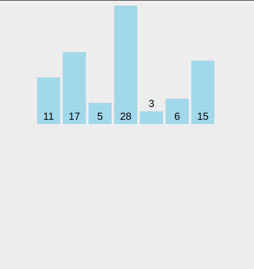
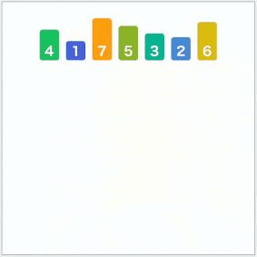

❤️‍🔥TIL : Today I Learned

## 삽입 정렬, 병합 정렬

> 정렬 알고리즘 중에서 삽입 정렬과 병합 정렬의 이해와 방법을 설명합니다.

<!--truncate-->

## 삽입 정렬(Insertion Sort)란?

- 배열의 모든 요소를 앞에서 차례로 비교합니다.(이미 정렬된 노란색 부분과)
- 자신의 위치를 찾아서 삽입하여 정렬 합니다.



### Big O : O(n^2)

### 삽입정렬의 장단점

- 장점 : Stable한 정렬, 대부분의 원소가 거의 정렬되어 있는 경우에 매우 빠르다
- 단점 : 원소 수가 많은 경우 적합하지 않고 비교적 많은 원소의 이동을 필요로 한다.

```js
const array = [5, 3, 8, 1, 2, 9, 4, 7, 6]; // 배열

const insertionSort = (arr) => {
  for (let i = 1; i < arr.length; i++) {
    let temp = arr[i]; // 두 번째 요소부터 시작
    let j; // 해당 요소의 바로 앞 요소
    // j가 0보다 크거나 같고, temp가 arr[j]보다 작을 때까지 반복
    for (j = i - 1; j >= 0 && temp < arr[j]; j--) {
      arr[j + 1] = arr[j]; // 다음 요소에 현재 요소를 대입
    }
    arr[j + 1] = temp; // for문이 끝나면 j+1에 temp를 대입
  }
  return arr;
};

console.log(insertionSort(array));
```

1. 시작점은 배열의 두번째 요소. (오름차순으로 가정)
2. 두 번째 요소를 이전 요소와 비교하고 이전 요소가 두 번째 요소보다 크다면 교체.
3. 다음 요소로 계속 진행하고 순서가 잘못된 요소를 찾으면 이미 정렬된 부분(그 요소의 왼쪽 부분)을 반복탐색해서 올바른 위치에 배치.
4. 배열이 정렬될 때 까지 반복.

## 병합 정렬 (Merge Sort)

- 데이터들을 **잘게 쪼갠 다음에 하나로 합치는 과정**에서 정렬하는 방법이다.
- 요즘은 데이터를 USB같은 장치로 저장하는 것이 일반적이었으나 아주 옛날에는 테이프를 이용해서 저장했다. 테이프 드라이브에 저장된 데이터를 정렬하는 일은 매우 어려운 일이었다. 왜냐면 테이프 드라이브는 항상 데이터를 처음부터 순차적으로 읽어야 한다는 특징이 있기 때문이다. 이러한 테이프 드라이브의 문제점 때문에 병합 정렬 알고리즘이 탄생하였다.



### Big O : O(nlog₂n)

### 병합 정렬 특징

- Devide and conquer 알고리즘이다. (분할 정복 알고리즘 - 최소 단위로 쪼갬)
- 다른 정렬 알고리즘과 달리 swap이 일어나지 않는다. (제자리 정렬이 아니다..)

### 장점

- Stable한 정렬이다.
- 시간복잡도가 O(nlogn)으로 동일해서 데이터의 분포에 영향을 덜 받는다.

\* Stable(안정) 정렬: 동일한 값을 가진 데이터의 순서가 유지되는 정렬 방법

### 단점

- 정렬하고자 하는 **데이터의 개수만큼 따로 저장**하고 있어야 하기 때문에 **O(n)의 공간복잡도**를 가진다. (메모리 공간을 많이 차지한다)
- 이동 횟수가 많다. ==> 배열 대신 연결리스트를 사용하면 극복 가능

```js
const array = [5, 3, 8, 1, 2, 9, 4, 7, 6]; // 9개의 숫자

// for문 병합 정렬
const mergeSort = (arr) => {
  if (arr.length < 2) return arr; // 배열의 길이가 2보다 작으면 배열을 반환
  const mid = Math.floor(arr.length / 2); // 배열의 중간값
  const left = arr.slice(0, mid); // 중간값을 기준으로 왼쪽 배열
  const right = arr.slice(mid); // 중간값을 기준으로 오른쪽 배열

  return merge(mergeSort(left), mergeSort(right)); // 재귀함수
};

const merge = (left, right) => {
  const result = []; // 결과값을 담을 배열
  const leftLength = left.length; // 왼쪽 배열의 길이
  const rightLength = right.length; // 오른쪽 배열의 길이
  let leftIndex = 0; // 왼쪽 배열의 인덱스
  let rightIndex = 0; // 오른쪽 배열의 인덱스

  while (leftIndex < leftLength && rightIndex < rightLength) {
    // 왼쪽 배열의 인덱스가 왼쪽 배열의 길이보다 작고, 오른쪽 배열의 인덱스가 오른쪽 배열의 길이보다 작을 때
    if (left[leftIndex] < right[rightIndex]) {
      // 왼쪽 배열의 인덱스의 값이 오른쪽 배열의 인덱스의 값보다 작을 때
      result.push(left[leftIndex]); // 왼쪽 배열의 인덱스의 값을 결과값에 넣는다.
      leftIndex++; // 왼쪽 배열의 인덱스를 1 증가시킨다.
    } else {
      // 왼쪽 배열의 인덱스의 값이 오른쪽 배열의 인덱스의 값보다 클 때
      result.push(right[rightIndex]); // 오른쪽 배열의 인덱스의 값을 결과값에 넣는다.
      rightIndex++; // 오른쪽 배열의 인덱스를 1 증가시킨다.
    }
  }

  return result.concat(left.slice(leftIndex)).concat(right.slice(rightIndex));
  // 결과값에 왼쪽 배열의 인덱스부터 끝까지를 붙이고, 오른쪽 배열의 인덱스부터 끝까지를 붙인다.
};
```

:::tip 최종 정리

1. 삽입 정렬은 배열의 **모든 요소를 앞에서 차례로 비교**하며, stable 한 정렬이다. 시간복잡도는 n^2
2. 병합 정렬은 stable 한 정렬이지만 Devide and conquer 알고리즘으로, 데이터들을 **잘게 쪼갠 다음에 하나로 합치는 과정**에서 정렬한다. 시간복잡도는 NlogN

:::

{/* 이 글은 Tistory(https://hyoloui.tistory.com/161)에서 옮겨 온 글입니다. 원문 작성일: 2023-04-03 */}
