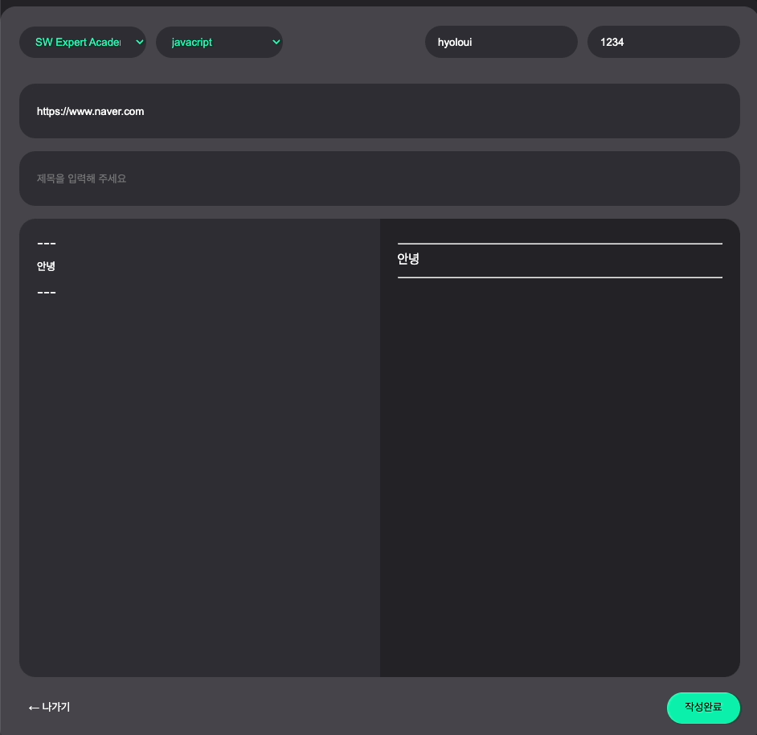

TIL : Today I Learned

<!--truncate-->

## useRef

> React에서 DOM 노드, react 엘리먼트에 접근하는 방법인 useRef를 설명합니다.

### useRef 란?

Ref는 render 메서드에서 생성된 DOM 노드나 React 엘리먼트에 접근하는 방법을 제공합니다.

useRef는 컴포넌트의 라이프사이클 동안 유지되는 가변 변수를 생성하는 React Hook입니다. 이는 일반적으로 DOM 요소나 컴포넌트 내부 또는 자식 요소에서 액세스 또는 업데이트해야 하는 값을 저장하는 데 사용됩니다. 이를 통해 다시 렌더링을 트리거하지 않고도 해당 값에 접근하거나 업데이트 할 수 있습니다.

Ref를 사용해야 할 때

1. 포커스, 텍스트 선택영역, 혹은 미디어의 재생을 관리할 때
2. 애니메이션을 직접적으로 실행시킬 때.
3. 서드파티 DOM 라이브러리를 React와 같이 사용할 때.

:::warning

선언적으로 해결될 수 있는 문제에서는 ref 사용을 지양해야 합니다.

예) Dialog 컴포넌트에서 `open()` 과 `close()` 메서드를 두는 대신, `isOpen`이라는 prop을 넘겨주세요.

:::

### useRef 의 적용

**1. 변수로 지정하여 사용이 가능합니다**

```jsx
import { useRef } from 'react';

export default function Counter() {
  let ref = useRef(0);

  function handleClick() {
    ref.current = ref.current + 1;
    alert('You clicked ' + ref.current + ' times!');
  }

  return (
    <button onClick={handleClick}>
      Click me!
    </button>
  );
}
```

**2. 클래스 혹은 아이디와 같이 jsx 엘리먼트 요소를 지정하여 접근에 사용합니다.**

```jsx
import { useRef } from 'react';

export default function Form() {
  const inputRef = useRef(null);

  function handleClick() {
    inputRef.current.focus();
  }

  return (
    <>
      <input ref={inputRef} />
      <button onClick={handleClick}>
        Focus the input
      </button>
    </>
  );
}
```

### useRef가 필요한 상황을 예시를 들어 설명

나는 프로젝트에서 useRef를 사용해 인풋박스에 focus를 사용한 경험이 있다.



React를 접한 지 얼마 되지 않아 className을 직접 지정하여 접근하려고 했다.

하지만, 내가 의도한 동작이 수행되지 않았고 결국 React에서의 직접적인 dom 요소를 조작하는 것은 예상치 못한 에러를 발생시키고, 에러를 찾아내기 쉽지 않다는 아티클을 보고 useRef의 필요성을 느껴 바로 적용하고 dom에 접근해 **비어있는 input 요소에 autoFocus 하는 기능 구현**에 이용했다.

### 레거시 API: 문자열 ref

React를 이전에 사용해 보셨다면 `ref` 어트리뷰트의 값이 `"textInput"` 처럼 문자열이고, DOM 노드를 `this.refs.textInput`와 같이 접근하는 구식 API를 아시고 계실지도 모릅니다. 문자열 ref는 [몇몇 문제](https://github.com/facebook/react/pull/8333#issuecomment-271648615)를 가지고 있고, 레거시로 여겨지며, **차후 배포에서 삭제될 것으로 예상**되기 때문에 권장되지 않습니다.

참조 : [Ref와 DOM – React](https://ko.reactjs.org/docs/refs-and-the-dom.html)

:::tip 최종 정리

1. Ref는 render 메서드에서 생성된 DOM 노드나 React 엘리먼트에 접근하는 방법을 제공합니다
2. 가변 변수를 생성하는 React Hook입니다. 변수로도 지정이 가능하지만, DOM에 접근할 때 주로 사용됩니다.

:::

{/* 이 글은 Tistory(https://hyoloui.tistory.com/162)에서 옮겨 온 글입니다. 원문 작성일: 2023-04-04 */}
