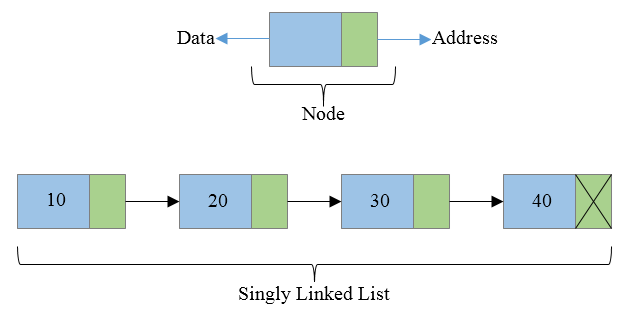
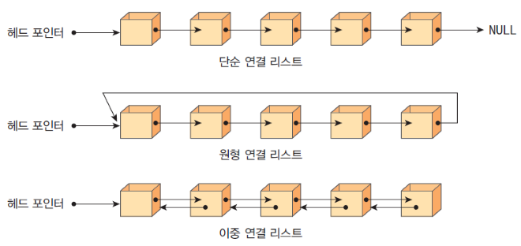
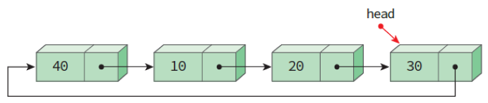
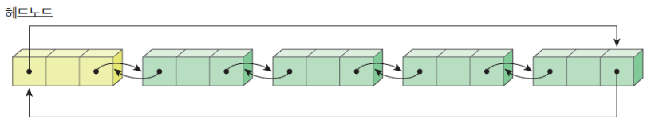

❤️‍🔥TIL : Today I Learned

## 연결 리스트

> 링크드 리스트라고 부르기도 하고, 연결 리스트라고 부르기도 합니다.

<!--truncate-->

## 연결 리스트란?

- 연결리스트(Linked List)는 리스트의 항목들을 노드(node)에 저장하는 **데이터 구조**이다.
- 각 노드는 **데이터 필드**와 다른 노드의 주소를 포함하는 **링크 필드**로 구성된다.
- 연결 리스트를 사용하는 이점에는 쉬운 삽입 및 삭제 처리 기능, 크기 제한 없음, 비연속 메모리 공간 사용 기능 등이 있다.
- 그러나 구현이 까다롭고 번거로우며 오류가 발생하기 쉽다.

데이터 필드 : 리스트의 원소, 즉 데이터 값을 저장하는 곳

링크 필드 : 다른 노드의 주소값을 저장하는 장소(포인터)



Linked List에서 가장 앞 쪽 시작부분을 Head, 가장 마지막 부분을 Tail이라고 부른다.

연결리스트의 종류에는 단순 연결리스트, 원형 연결리스트, 이중 연결리스트가 존재한다. 단순 연결리스트는 가장 끝의 노드(Tail)는 항상 NULL을 가리키게 되며 원형 연결리스트는 NULL이 위치한 곳이 없다. 이중 연결리스트는 양 끝 노드(Head, Tail)가 NULL을 가리키게 된다.



> 단순(단일) 연결리스트 : 단순 연결리스트는 하나의 링크 필드를 이용하여 연결하며 마지막 노드의 링크 값은 NULL을 가리켜야 한다.



> 원형 연결리스트 : 원형 연결리스트에서 head 포인터는 마지막 노드를 가리키게 된다. 이러한 방식의 원형 리스트의 head는 마지막 노드를, head의 link는 첫 노드를 가리키므로 리스트의 처음이나 마지막에 노드를 삽입하는 연산이 편리하다.



> 이중 연결리스트 : 각 노드가 선행 노드와 후속 노드에 대한 링크를 가지는 리스트다. 노드의 왼쪽 링크(left link)와 오른쪽 링크(right link)가 각각 다른 노드의 오른쪽 링크와 왼쪽 링크를 연결짓고 있으며 특별하게 **헤드도 노드로** 이루어져 있다.

## 단순(단일) 연결 리스트 CODE

### Node Class

```js
// 노드 객체
class Node {
  constructor(data) {
    this.data = data;
    this.next = null;
  }
}
```

### Linked List 클래스

```js
// 단일 연결 리스트 객체
class SinglyLinkedList {
  constructor() {
    this.head = null; // 초기값 head, tail = null, size = 0 초기화
    this.tail = null;
    this.size = 0;
  }
}
```

### append() : 리스트 맨 뒤에 노드 추가

```js
append(newValue) {
  const newNode = new Node(newValue);
  if (this.head === null) {
    this.head = this.tail = newNode;
  } else {
    this.tail.next = newNode;
    this.tail = newNode;
  }
  this.size += 1;
}
```

### insert() : 리스트 특정 위치에 노드 추가

```js
// 리스트 특정 위치에 노드 추가
insert(position, value) {
  // position이 0보다 작거나 리스트의 길이보다 크면 에러
  if (position < 0 || this.length < position) {
    throw new Error("Invalid position");
  }
  const node = new ListNode(value);
  // position이 0이면 head에 추가
  if (position === 0) {
    node.next = this.head;
    this.head = node;
  }
  // position이 리스트의 길이와 같으면 tail에 추가
  if (position === this.length) {
    this.tail.next = node;
    this.tail = node;
  }
  // position이 0보다 크고 리스트의 길이보다 작으면 중간에 추가
  if (0 < position && position < this.length) {
    let current = this.head;
    // position의 바로 앞 노드를 찾음
    for (let i = 0; i < position - 1; i++) {
      current = current.next;
    }
    // node의 next에 current의 next를 대입
    node.next = current.next;
    current.next = node;
  }
  this.length++;
}
```

### get() : 리스트 특정 위치의 노드 값 조회

```js
// 리스트 특정 위치의 노드 값 조회
get(position) {
  // position이 0보다 작거나 리스트의 길이보다 크면 에러
  if (position < 0 || this.length <= position) {
    throw new Error("Invalid position");
  }

  let current = this.head;
  // position의 노드를 찾음
  for (let i = 0; i < position; i++) {
    current = current.next;
  }
  return current.value;
}
```

### print() : 리스트 전체 출력

```js
// 리스트 전체 출력
print() {
  let current = this.head;
  while (current) {
    console.log(current.value);
    current = current.next;
  }
}
```

### append() : 연결 리스트 맨 뒤에 노드 추가

```js
// 리스트 맨 뒤에 노드 추가
append(value) {
  // 노드 생성
  const node = new ListNode(value);
  // 리스트가 비어있으면 head와 tail에 추가, 비어있지 않으면 tail의 next에 추가
  if (!this.head) {
    this.head = node;
    this.tail = node;
  } else {
    this.tail.next = node;
    this.tail = node;
  }
  this.length++;
}
```

### remove() : 요소 삭제 메서드

```js
// 리스트 특정 위치의 노드 삭제
remove(position) {
  // position이 0보다 작거나 리스트의 길이보다 크면 에러
  if (position < 0 || this.length <= position) {
    throw new Error("Invalid position");
  }

  let deletedNode;
  // position이 0이면 head를 삭제
  // 아니라면 position의 바로 앞 노드의 next에 position의 next를 대입
  if (position === 0) {
    deletedNode = this.head;
    this.head = this.head.next;
    // 리스트에 노드가 하나만 있으면 tail을 null로 변경
    if (!this.head) {
      this.tail = null;
    }
  } else {
    let current = this.head;
    for (let i = 0; i < position - 1; i++) {
      current = current.next;
    }
    deletedNode = current.next;
    current.next = deletedNode.next;
    if (position === this.length - 1) {
      this.tail = current;
    }
  }
  this.length--;
  return deletedNode.value;
}
```

**참조**

- [자바스크립트의 자료구조 - velog](https://velog.io/@blackb0x/%EC%9E%90%EB%B0%94%EC%8A%A4%ED%81%AC%EB%A6%BD%ED%8A%B8%EC%9D%98-%EC%9E%90%EB%A3%8C%EA%B5%AC%EC%A1%B0)
- [[자료구조] 리스트 구현 - 연결리스트(단순 연결리스트)](https://yjg-lab.tistory.com/118)

:::tip 최종 정리

1. 링크드 리스트, 연결 리스트는 항목들을 노드에 저장하는 데이터(자료) 구조 이다.
2. 노드는 값을 저장하는 데이터 필드와, 다른 노드의 주소를 저장하는 링크 필드로 구성된다.
3. 3 종류로 구분하며 단순, 원형, 이중 연결리스트가 있다.
4. 단순 연결리스트는 하나의 링크 필드를 이용하여 연결하며 마지막 노드의 링크 값은 NULL을 가리켜야 한다.
5. 원형 연결리스트는 head 포인터는 마지막 노드를 가리키게 된다. 즉, NULL이 없다.
6. 이중 연결리스트는 각 노드가 선행 노드와 후속 노드에 대한 링크를 가지는 리스트다.

:::

{/* 이 글은 Tistory(https://hyoloui.tistory.com/164)에서 옮겨 온 글입니다. 원문 작성일: 2023-04-05 */}
