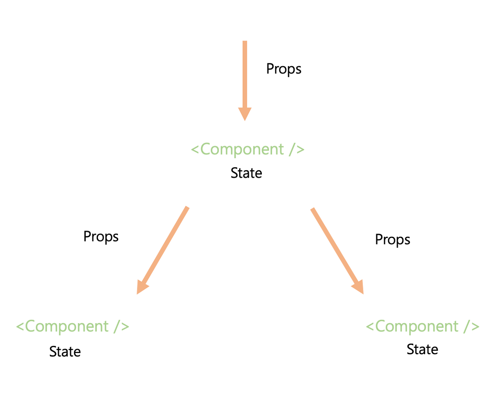

TIL : Today I Learned

<!--truncate-->

## props, state

> 리액트(React)에서 props와 state는 둘 다 컴포넌트(Component)에서 데이터를 다루는 데 사용되는 중요한 요소입니다. 그러나 이 둘은 약간의 차이점이 있습니다.

### Props 란?

props는 컴포넌트에서 데이터를 전달하는 데 사용됩니다. 부모 컴포넌트에서 자식 컴포넌트로 데이터를 전달할 때 사용됩니다. props는 읽기 전용(Read-only)이며, 부모 컴포넌트에서 전달한 데이터를 자식 컴포넌트에서 변경할 수 없습니다.

### State 란?

state는 컴포넌트 내부에서 관리되는 데이터입니다. 컴포넌트가 렌더링될 때 생성되며, 컴포넌트의 생명주기(Lifecycle) 동안 변경될 수 있습니다. state는 변경 가능하며, `setState` 메소드를 사용하여 업데이트할 수 있습니다. state가 변경되면, 리액트는 컴포넌트를 다시 렌더링하여 변경 사항을 반영합니다.

state 데이터의 변경이 필요할 때 setState를 사용해 함께 리렌더링하는 용도로 사용합니다.

### props와 state의 차이점은 무엇인가요?

[props](https://ko.reactjs.org/docs/components-and-props.html) ("properties"의 줄임말) 와 [state](https://ko.reactjs.org/docs/state-and-lifecycle.html) 는 일반 JavaScript 객체입니다. 두 객체 모두 렌더링 결과물에 영향을 주는 정보를 갖고 있는데, 한 가지 중요한 방식에서 차이가 있습니다. `props`는 (함수 매개변수처럼) 컴포넌트**에** 전달되는 반면 `state`는 (함수 내에 선언된 변수처럼) 컴포넌트 **안에서** 관리됩니다.

가장 큰 차이는 prop는 부모 component에서 전달되는 것이고, state는 해당 컴포넌트 안에서 관리됩니다.

참조 : [컴포넌트 State – React](https://ko.reactjs.org/docs/faq-state.html)

:::tip 최종 정리

1. prop는 부모 component에서 데이터를 전달(함수 매개변수 처럼)하는 데 사용
2. state는 컴포넌트 내부에서 관리되는 데이터이며, setState 메서드를 활용해 해당 데이터가 변동이 생기면 리렌더링 됩니다.

:::

{/* 이 글은 Tistory(https://hyoloui.tistory.com/166)에서 옮겨 온 글입니다. 원문 작성일: 2023-04-05 */}
