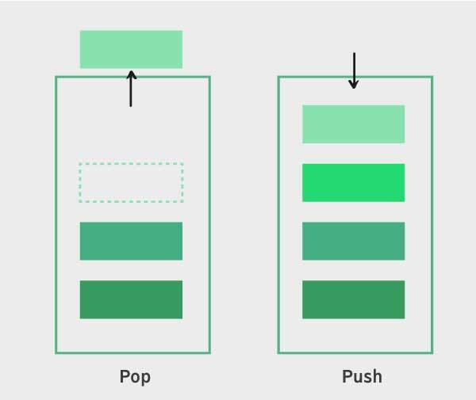
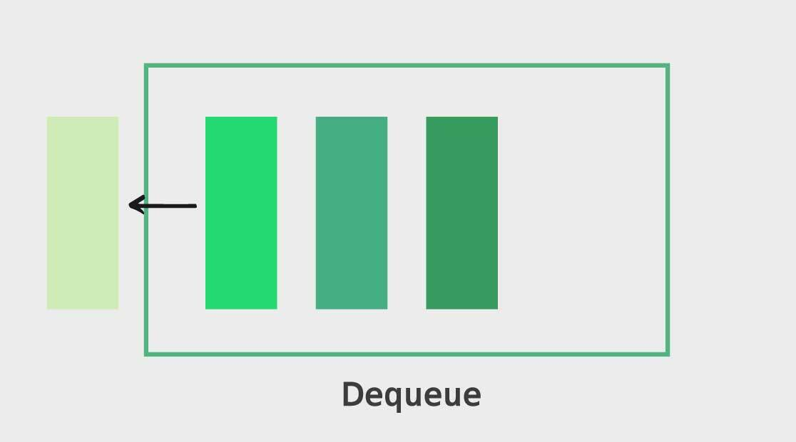
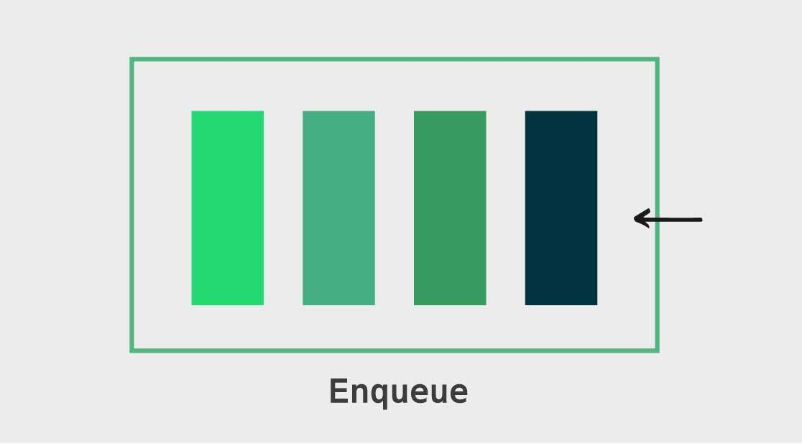

❤️‍🔥TIL : Today I Learned

## Stack, Queue

> 자료구조인 스택과 큐를 비교하여 설명합니다.

<!--truncate-->

## Stack



- 스택은 직역하면 더미, 퇴적, 쌓아 올림 이라는 뜻을 가지고 있다. 자료를 쌓았다고 하여 stack이다.
- 스택은 **후입선출(LIFO) 구조**를 갖는 자료구조 이다. 마지막으로 추가된 요소가 제일 먼저 제거된다.
- 자바스크립트에서는 배열을 이용하여 `push` 메서드를 사용하여 요소를 추가하고 `pop` 메서드를 사용하여 요소를 제거할 수 있습니다.
- Javascript 에서 함수 실행 콘텍스트들이 쌓이는 **Call stack** 또는 브라우저의 방문 기록이 쌓이는 **History stack** 이 대표적이다.

+ 스택은 서로 관계가 있는 여러 작업을 연달아 수행하면서 **이전의 작업 내용을 저장해 둘 필요가 있을 때** 널리 사용됩니다.

| Big-O (시간복잡도) | 삽입 | 삭제 | 접근 | n번째 접근 | 검색 |
| --- | --- | --- | --- | --- | --- |
| 스택 (Stack) | _O(1)_ | _O(1)_ | _O(1)_ | _O(n)_ | _O(n)_ |

### 기본 구조

- 기본 구조는 연결 리스트에서 했던 것 처럼 `Node` 클래스를 활용하며 `first`, `last`, `size` 프로퍼티를 둔다.
- 연결 리스트의 일종이라고 할 수 있다.

### Code - 노드로 구현

```js
class Node {
  constructor(value) {
    this.value = value;
    this.next = null;
  }
}

class Stack2 {
  constructor() {
    this.head = null;
    this.tail = null;
    this.size = 0;
  }

  push(value) {
    const node = new Node(value);
    if (!this.head) {
      this.head = node;
      this.tail = node;
    } else {
      const temp = this.head;
      this.head = node;
      this.head.next = temp;
    }
    this.size++;
  }

  pop() {
    if (!this.head) {
      return null;
    }

    const value = this.head.value;
    this.head = this.head.next;
    this.size--;
    return value;
  }
}
```

### Code - 배열로 구현

```js
class Stack {
  constructor() {
    this.items = [];
  }

  push(element) {
    this.items.push(element);
  }

  pop() {
    return this.items.pop();
  }

  peek() {
    return this.items[this.items.length - 1];
  }
}
```

## Queue





- 위에서 학습한 Stack과는 반대되는 특성을 가졌다.
- **선입선출(FIFO)** 원칙으로 만들어진 자료구조 먼저 들어온 데이터가 먼저 나간다.
- 자바스크립트에서 비동기를 처리해주는 대기열인 **Task Queue**가 대표적 예 이다.
- 데이터를 집어넣는 `enqueue`와 데이터를 추출하는 `dequeue` 등의 작업을 할 수 있다.
- 큐는 순서대로 처리해야 하는 작업을 임시로 저장해두는 버퍼(buffer)로 많이 사용된다.

+ Task Queue는 Call Stack이 전부 비워졌을 때 비동기함수를 하나씩 Call Stack 으로 보내준다.

| Big-O (시간복잡도) | 삽입 | 삭제 | 접근 | n번째 접근 | 검색 |
| --- | --- | --- | --- | --- | --- |
| 큐 (Queue) | _O(1)_ | _O(1)_ | _O(1)_ | _O(n)_ | _O(n)_ |

### 기본 구조

- 배열을 활용한다면, `unshift`와 `pop` 메서드나 `push`와 `shift` 메서드 조합을 사용하는 것이 큐의 작동방식과 같다. 하지만 `unshift` 메서드를 써서 데이터를 추가할 때마다 전체 배열에 인덱스를 다시 부여해야 하므로 성능이 좋지 않다.
- 그래서 성능을 신경써야 하는 경우라면, 직접 큐 클래스를 만드는 것이 낫다. 연결리스트를 활용하여 큐 클래스를 만들면 다음과 같다.

시간복잡도를 O(1)으로 하기 위해 연결리스트(Linked List)를 통해 큐(Queue)를 자바스크립트(JavaScript)로 구현해보겠다.

### Code - 노드로 구현

```js
class Node {
  constructor(value) {
    this.value = value;
    this.next = null;
  }
}

class Queue {
  constructor() {
    this.head = null;
    this.tail = null;
  }

  enqueue(value) {
    const node = new Node(value);
    if (!this.head) {
      this.head = node;
      this.tail = node;
    } else {
      this.tail.next = node;
      this.tail = node;
    }
  }

  dequeue() {
    if (!this.head) {
      return null;
    }
    const temp = this.head;
    this.head = this.head.next;
    return temp.value;
  }
}
```

### Code - 배열로 구현

```js
class Queue {
  constructor() {
    this.items = [];
  }

  enqueue(element) {
    this.items.push(element);
  }

  dequeue() {
    return this.items.shift();
  }
}
```

**참조**

- [[JS 자료구조] 스택(Stack)과 큐(Queue)](https://velog.io/@jangws/15.-%EC%8A%A4%ED%83%9Dstack-%EC%9E%90%EB%A3%8C%EA%B5%AC%EC%A1%B0-JS)
- [[알고리즘, 자료구조] 자바스크립트로 스택(Stack)구현하기 (+개념이해)](https://algoroot.tistory.com/54)
- [[알고리즘, 자료구조] 자바스크립트로 큐(Queue)구현하기 (+개념이해)](https://algoroot.tistory.com/55)
- [큐, 스택, 트리 | JavaScript로 만나는 세상](https://helloworldjavascript.net/pages/282-data-structures.html#%ED%81%90-queue)

:::tip 최종 정리

1. 스택은 LIFO(후입선출)의 특성을 갖는 자료구조다.
2. 함수 호출의 Call Stack이나 실행취소(Ctrl+Z)나 재귀의 작동방식 등이 스택이다.
3. 스택을 이용하여 탐색, 접근하는 것이 중요하다면 배열이나 다른 자료구조를 활용하는 것이 낫다. 다만, 아주 많은 데이터에 대하여 삽입과 제거를 위주로 작업한다면, 스택 자료구조가 적합할 수 있다.

<br />

1. 큐는 FIFO(선입선출)의 특성을 갖는 자료구조다.
2. 큐에서는 삽입과 제거가 중요하며, 이들은 O(1)으로서 빠르다. 탐색과 접근은 큐에서 실제로 잘 사용하지 않는 기능이다.

:::

{/* 이 글은 Tistory(https://hyoloui.tistory.com/167)에서 옮겨 온 글입니다. 원문 작성일: 2023-04-06 */}
